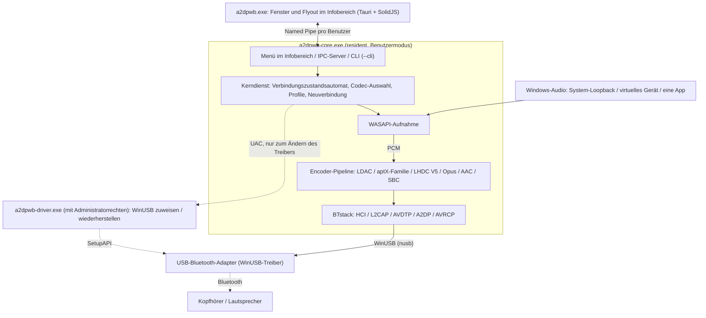
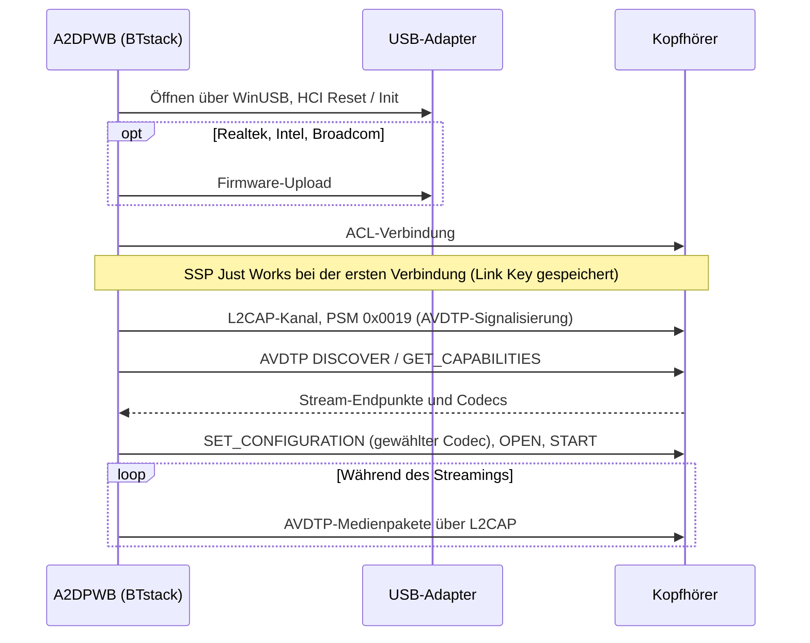
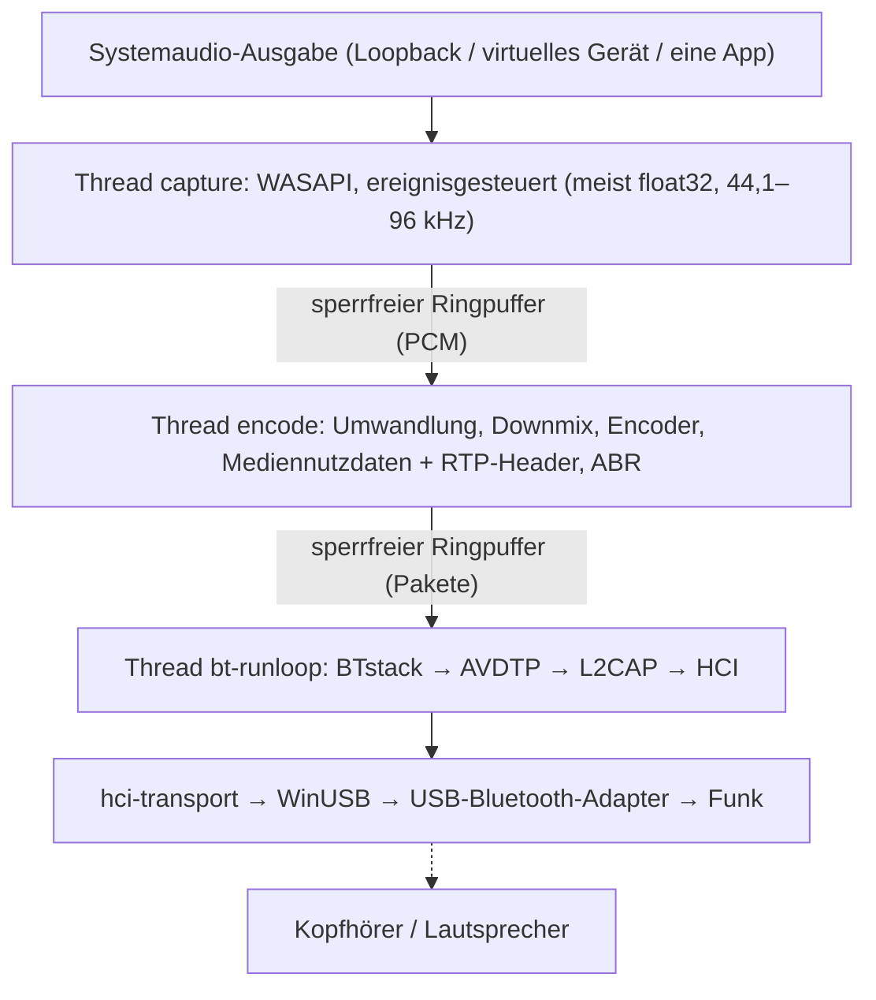
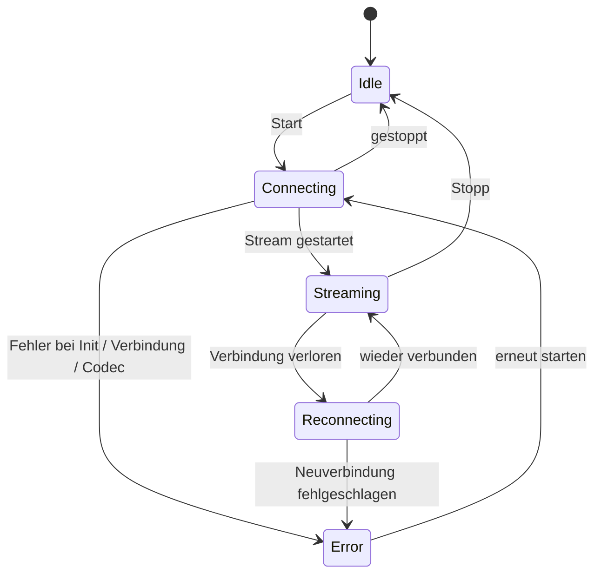

# Architektur
{: .no_toc }

## Inhalt
{: .no_toc .text-delta }

1. TOC
{:toc}

---

## Überblick

A2DP Windows Bridge (A2DPWB) ermöglicht Bluetooth-Audio mit LDAC, aptX HD, aptX Low Latency, aptX,
AAC und SBC unter Windows. Der eigene Bluetooth-Stack von Windows unterstützt für A2DP
nur SBC, klassisches aptX und (nur unter Windows 11) AAC — dieses Werkzeug ergänzt LDAC, aptX HD und aptX
Low Latency, ohne einen Kerneltreiber zu benötigen.

Verwendet **BTstack + WinUSB** — vollständig im Benutzermodus, keine Treibersignatur nötig.

A2DPWB 2.0 ist in Rust geschrieben. Die C-Bibliotheken, die sich nicht ersetzen lassen
(BTstack und die Codec-Encoder), werden aus dem Quellcode kompiliert und über
kleine FFI-Crates aufgerufen; alles andere, einschließlich des SBC-Encoders, ist Rust.

## Prozesse

A2DPWB läuft als bis zu drei Programme:

| Programm | Läuft | Aufgabe |
|:---------|:------|:--------|
| `a2dpwb-core.exe` | Solange A2DPWB läuft (gestartet vom Fenster, vom Startmenü oder über **Mit Windows starten**) | Bluetooth, Audioaufnahme und Kodierung, Profile und Einstellungen, das Symbol im Infobereich und sein Menü, der IPC-Server. `--cli` führt denselben Kern stattdessen in einer Konsole aus |
| `a2dpwb.exe` | Nur solange ein Fenster offen ist (beendet sich 3 Minuten, nachdem das letzte geschlossen wurde) | Das Hauptfenster und das Flyout im Infobereich (Tauri 2, SolidJS + TypeScript). Hält keinen eigenen Zustand |
| `a2dpwb-driver.exe` | Für eine einzelne Treiberänderung, mit Administratorrechten (UAC) | Weist einem Adapter WinUSB zu oder stellt seinen vorherigen Treiber wieder her und beendet sich dann |

- **Der Kern ist kein Windows-Dienst.** Er ist ein gewöhnlicher Prozess des
  angemeldeten Benutzers, weil der WASAPI-Loopback das Audio der Sitzung dieses Benutzers aufnimmt.
  Ein Mutex pro Sitzung beschränkt ihn auf eine Instanz; ein erneuter Start öffnet das
  Fenster.
- **Der Infobereich gehört zum Kern.** Sein Rechtsklickmenü (Öffnen, die ersten 10
  Profile, Trennen, Beenden) öffnet sich sofort, ohne das Fenster zu starten. Ein
  Linksklick startet das Flyout des Fensters.
- **Das Fenster zeigt nur an.** Es erhält eine Momentaufnahme des Kernzustands
  und danach die Änderungen; das Schließen oder ein Absturz des Fensters stoppt
  das Audio nicht. Das Schließen eines Fensters blendet es nur aus, daher öffnet es sich
  über den Infobereich sofort wieder.
- **Die Kommandozeile verwendet denselben Kern.** `a2dpwb-core.exe --cli` führt den
  Kerndienst ohne Infobereich und IPC aus; der Emulatortest läuft auf diese Weise.

## Transport: BTstack + WinUSB

Umgeht den Bluetooth-Stack von Windows vollständig, indem direkt über WinUSB (der von Microsoft
signierte generische USB-Treiber) mit einem USB-Bluetooth-Adapter kommuniziert wird. BTstack,
ein Bluetooth-Stack mit verfügbarem Quellcode (nicht kommerzielle Lizenz), implementiert HCI, L2CAP, AVDTP und A2DP im
Benutzermodus.

**Vorteile**:
- Keine Kosten für eine Treibersignatur
- Kein Testsignaturmodus erforderlich
- Secure Boot muss nicht deaktiviert werden
- Der gesamte Code läuft im Benutzermodus (einfacheres Debugging)

**Nachteile**:
- Erfordert einen eigenen USB-Bluetooth-Adapter (getrennt vom integrierten
  Bluetooth von Windows)
- Solange WinUSB den Adapter belegt, steht er für das normale Windows-Bluetooth
  nicht zur Verfügung
- Die Geräteadresse wird manuell eingegeben oder per Suche (GAP Inquiry) mit
  dem USB-Adapter gefunden

**Funktionsweise**:
1. Einem USB-Bluetooth-Adapter wird WinUSB zugewiesen, in der App (**Adapter >
   WinUSB zuweisen**, siehe [Treiberzuweisung](#driver-assignment)) oder mit Zadig
2. Das Crate `hci-transport` öffnet den Adapter über WinUSB mit `nusb`
   und verbindet ihn als HCI-Transport mit BTstack
3. BTstack sendet HCI-Befehle, um den Bluetooth-Controller zu initialisieren
4. (Realtek-, Intel- und Broadcom-Adapter) Bei Bedarf wird Firmware hochgeladen
5. BTstack baut eine ACL-Verbindung auf und öffnet L2CAP-Kanäle (PSM 0x0019)
6. Die AVDTP-Signalisierung ermittelt die SEPs der Gegenseite und handelt die Codecs aus
7. Das kodierte Audio wird als AVDTP-Medienpakete über L2CAP gesendet

Der USB-Transport behält die Wiederherstellungsschritte bei, die echte Adapter in
v1 benötigten: Die Event- und ACL-Pipes werden beim Öffnen des Adapters zurückgesetzt, ein fehlgeschlagener
Event-Lesevorgang wird wiederholt, HCI-Befehle haben eine Zeitüberschreitung, und beim Schließen des Adapters wird
HCI Reset gesendet, sodass die nächste Sitzung einen untätigen Controller vorfindet.

## Crate-Struktur

Ein Cargo-Workspace (`Cargo.toml` im Wurzelverzeichnis des Repositorys) in fünf Schichten;
jede Schicht hängt nur von den Schichten unter ihr ab. Die Bibliotheken liegen in
`app/src/crates/`, die Programme in `app/src/core`, `app/src/ui` und
`app/src/driver`. Nur die `*-sys`-Crates und `win-sys` dürfen `unsafe`-Code
enthalten; alle anderen Crates haben `#![forbid(unsafe_code)]`.

| Schicht | Crate | Aufgabe |
|:--------|:------|:--------|
| 1. FFI | `btstack-sys` | Baut BTstack mit `cc` (MSVC), handgeschriebene FFI-Deklarationen und sichere Wrapper, `btstack_config.h`. BTstack darf nur auf dem Thread seiner Run Loop aufgerufen werden: Das `!Send`-Token `Stack` erzwingt dies |
| 1. FFI | `ldac-sys`, `openaptx-sys`, `fdkaac-sys`, `lhdcv5-sys`, `opus-sys` | Bauen die C-Encoder und stellen sie bereit; ein Crate pro Bibliothek, damit jede Lizenz getrennt bleibt |
| 1. FFI | `win-sys` | Win32-APIs ohne Rust-Bibliothek: MMCSS, das Standard-Audiogerät (IPolicyConfig), die WLAN-API (AFH), Energiebenachrichtigungen, der Run-Schlüssel, Medientasten, die DACL der Pipe, Rechteerhöhung und die WinUSB-Treiberzuweisung (SetupAPI) |
| 2. Bausteine | `hci-transport` | HCI über USB („H2“) mit `nusb` und H4 über TCP zu einem virtuellen Controller (`tools/emu`) |
| 2. Bausteine | `codec` | Der Trait `Encoder`, der SBC-Encoder (Rust-Portierung des Encoders aus Bluedroid), sichere Wrapper der C-Encoder, Auswertung der Codec Information und die Codec-Wahl |
| 2. Bausteine | `audio-capture` | WASAPI-Aufnahme (Crate `wasapi`): System-Loopback, virtuelles Gerät, eine Anwendung (Prozess-Loopback); Geräte- und App-Listen, Testton |
| 3. Engine | `bt-host` | Führt BTstack auf einem eigenen Thread aus, gesteuert durch Befehle und typisierte Ereignisse: GAP, A2DP Source, AVRCP, SDP, Link Keys, AFH, Laden der Firmware, HCI-Aufzeichnung (`.pklg`) |
| 3. Engine | `pipeline` | PCM-Ringpuffer, Formatumwandlung, Downmix, Kodierung, Mediennutzdaten, Taktung, ABR |
| 4. Kern | `a2dpwb-core` (Verzeichnis `core`) | Der Zustandsautomat, Neuverbindungen, Energiesparmodus / Fortsetzen, Profile, Einstellungen und die Migration von v1, Lautstärke-Sync, Updateprüfung, der Client für den Empfängertest, Statistik |
| 4. Kern | `ipc` | Die Protokolltypen, die Kern und Fenster gemeinsam nutzen (serde; TypeScript-Typen mit `ts-rs` generiert), und die Rahmung auf der Pipe |
| 5. Programme | `a2dpwb-core-exe` (`app/src/core`) | `a2dpwb-core.exe`: Kern, Infobereich (`tray-icon` auf einer `tao`-Ereignisschleife), IPC-Server, `--cli` |
| 5. Programme | `a2dpwb-ui` (`app/src/ui`) | `a2dpwb.exe`: Tauri 2; die Rust-Seite ist ein IPC-Client, die Seite ist SolidJS + TypeScript + Vite |
| 5. Programme | `a2dpwb-driver` (`app/src/driver`) | `a2dpwb-driver.exe`: das Hilfsprogramm mit Administratorrechten |

## Audiopfad und Threads

| Thread | Priorität | Aufgabe |
|:-------|:----------|:--------|
| capture | MMCSS "Audio" | Liest WASAPI; füllt stille Abschnitte mit Stille auf |
| encode | MMCSS "Pro Audio" | Wandelt in das Format des Encoders um, kodiert ganze Encoder-Blöcke (der Rest wartet auf die nächste Runde), packt Frames in Mediennutzdaten, in Runden von etwa 10 ms, damit die Pakete gleichmäßig hinausgehen |
| bt-runloop | -- | Die Run Loop von BTstack; sendet ein wartendes Paket, sobald L2CAP senden kann |
| USB | -- | WinUSB-Übertragungen: drei laufende Lesevorgänge auf jeder IN-Pipe (Events, ACL-Daten), ein Schreiber für Befehle und ACL-Daten |
| core | Normal | Zustandsautomat, IPC (tokio), Einstellungen, Statistik (4 Hz), Updateprüfung |

Sobald ein Stream läuft, reserviert der Audiopfad keinen Speicher und nimmt keine Sperre.
Die Statistik besteht aus atomaren Zählern, die der Kern viermal pro Sekunde liest.
BTstack ist nicht threadsicher: Andere Threads schicken ihm Befehle, die auf
dem Thread bt-runloop ausgeführt werden.

## Kern und IPC

Das Fenster kommuniziert mit dem Kern über die Named Pipe des Benutzers
`\\.\pipe\a2dpwb-<user SID>`, deren DACL nur diesen Benutzer zulässt. Nachrichten sind
JSON-Frames mit vorangestellter Länge:

1. Das Fenster sendet `hello { protocol, client }`. Ein Kern mit einer anderen
   Protokollversion lehnt es ab, und das Fenster meldet, dass die beiden Programme
   aus verschiedenen Versionen stammen.
2. Der Kern antwortet mit einem `snapshot`: seinem gesamten Zustand (Adapter, Geräte,
   Stream, Profile, Einstellungen, Update) und einer Revisionsnummer.
3. Danach sendet der Kern `event`s mit den Änderungen. Fehlt eine Revision,
   holt das Fenster eine neue Momentaufnahme.
4. Aktionen sind `request { id, method, params }` mit einer `response { id,
   result | error }`. Die Methodengruppen sind `stream.*`, `device.*`,
   `profile.*`, `settings.*`, `adapter.*`, `audio.*`, `diag.*` und `app.*`.

Fehler sind Codes mit Parametern (zum Beispiel `adapter.driver_missing`), keine
Texte; das Fenster übersetzt sie und bietet die Behebung neben der Meldung an.
Daten mit hoher Rate (Verbindungsqualität, das Protokoll) werden nur gesendet, solange eine Seite
sie abonniert.

Der Zustandsautomat der Verbindung:

Eine fehlgeschlagene Verbindung wird bis zu 3-mal versucht, eine verlorene bis zu
10-mal wiederhergestellt. Wechselt der PC in den Energiesparmodus, stoppt der Kern BTstack, ohne
die verlorene Verbindung als Fehler zu zählen, und verbindet nach dem Aufwachen erneut.

## Treiberzuweisung {#driver-assignment}

Windows 8 und neuer enthalten den von Microsoft signierten WinUSB-Treiber
(`winusb.inf`). `a2dpwb-driver.exe` tut über SetupAPI dasselbe wie im Geräte-Manager
„Treiber aktualisieren > Aus einer Liste auswählen > WinUsb Device“:

1. Den Adapter über seine Geräteinstanz-ID öffnen.
2. Einen Wert `DeviceInterfaceGUIDs` in seine `Device Parameters` schreiben, damit
   WinUSB eine Geräteschnittstelle für ihn registriert.
3. Das Modell „WinUsb Device“ aus `%SystemRoot%\INF\winusb.inf` auswählen und
   mit `DiInstallDevice` installieren. Der mitgelieferte Treiber ist signiert, daher wird kein
   Zertifikat installiert (anders als bei Zadig / libwdi, die eine generierte
   INF mit einem selbst erstellten Zertifikat signieren).
4. **Wiederherstellen**: das Gerät entfernen (`DiUninstallDevice`) und neu auflisten lassen;
   Windows wählt dann wieder seinen am besten bewerteten Treiber (normalerweise `BthUSB` oder den
   Treiber des Herstellers). Der Treiber, den der Adapter vorher hatte, wird im
   Einstellungsordner (`driver\`) festgehalten und nach der Wiederherstellung verglichen.

Der Kern läuft nie als Administrator: Für eine Zuweisung oder Wiederherstellung startet er
das Hilfsprogramm mit einer UAC-Abfrage (`ShellExecuteEx` "runas") und liest dessen
JSON-Ergebnis. Das Auflisten der Adapter und ihrer Treiber benötigt keine Administratorrechte.

## Wichtige Module

### Codec-Wahl (`codec::caps`)

- Wertet die Fähigkeiten der Gegenseite aus: die standardisierten Elemente für SBC und AAC sowie die
  Hersteller-Codecs, einschließlich aptX LL unter beiden Vendor IDs und aptX Adaptive
  (nur erkannt und protokolliert)
- Wählt den Codec: Automatisch nimmt den besten Codec, den die Gegenseite anbietet; ein angeforderter
  Codec, den die Gegenseite nicht anbietet, wird durch die Wahl von Automatisch ersetzt, wenn das
  Profil es erlaubt (**Anderen Codec verwenden, falls dieser nicht verfügbar ist**), und
  ist andernfalls ein Fehler
- Wählt die Abtastrate für die aptX-Familie (44,1 / 48 kHz aus den Raten, die die Gegenseite
  meldet; WASAPI rechnet die Aufnahme um)

### Bluetooth-Host (`bt-host`)

**Aufgaben**:
- BTstack mit dem USB- (oder TCP-)HCI-Transport auf einem eigenen Thread ausführen
- Stream-Endpunkte registrieren: Hersteller-Codecs (LDAC, aptX HD, aptX, aptX LL,
  LHDC V5, FastStream, Opus) sowie SBC (auch von SBC XQ verwendet) und AAC
- SDP-Einträge registrieren (A2DP Source, AVRCP Controller, AVRCP Target)
- SSP-Kopplung verwalten (Just Works, General Bonding; Link Keys werden gespeichert)
- Eine halboffene Verbindung nach einer Zeitüberschreitung beim Verbinden abbauen, damit erneute Versuche funktionieren
- Eine fehlgeschlagene Verbindung erneut versuchen (bis zu 3 Versuche) und die Ursachen unterscheiden (keine
  Antwort, stumme Verbindung, Gegenseite hat die Verbindung beendet, Authentifizierung); einen Link Key
  verwerfen, den das Gerät nicht mehr kennt, und erneut koppeln
- GAP Inquiry für die Gerätesuche
- AVRCP Absolute Volume und die Tasten der Kopfhörer
- AFH-Host-Kanalklassifizierung sowie RSSI- / AFH-Werte für die Anzeige der
  Verbindungsqualität
- Laden der Firmware für Realtek-, Intel- und Broadcom-Chipsätze
- HCI-Aufzeichnung (`.pklg`), einschließlich des Verbindungsaufbaus, wenn sie während einer Verbindung beginnt

**Wichtige verwendete BTstack-APIs**:
- `a2dp_source_create_stream_endpoint()` — Codec-Endpunkte registrieren
- `a2dp_source_establish_stream()` — Mit der A2DP-Senke verbinden
- `a2dp_source_set_config_other()` — Herstellerspezifischen Codec konfigurieren
- `a2dp_source_stream_send_media_payload_rtp()` — Kodiertes Audio mit einem
  RTP-Header senden (LDAC, aptX HD, AAC, SBC, SBC XQ, LHDC V5, Opus)
- `a2dp_source_stream_send_media_packet()` — Rohe Medienpakete ohne
  RTP-Header senden (aptX, aptX LL, FastStream)

### Audioaufnahme (`audio-capture`)

Nimmt Audio in Echtzeit über die Windows Audio Session API auf.
- System-Loopback des Standardausgabegeräts, Loopback eines gewählten
  (virtuellen) Geräts oder Prozess-Loopback einer Anwendung und ihrer untergeordneten
  Prozesse (Windows 10 Build 19041 oder neuer)
- Liefert das Mixformat des Geräts im gemeinsamen Modus (meist float32; die
  Pipeline wandelt es für den Encoder um)
- Wartet im Modus Anwendung auf die Anwendung und übernimmt sie wieder, wenn
  sie neu gestartet wird

### Audio-Encoder

| Encoder | Bibliothek | Bitrate | Merkmale |
|---------|------------|---------|----------|
| LDAC | libldac (AOSP) | 330/660/990 kbps | Modi HQ/SQ/MQ, ABR |
| aptX HD | libopenaptx | 576 kbps | 24-Bit-Eingang, feste Rate, RTP-Header |
| aptX LL | libopenaptx | 352 kbps | ca. 32 ms Latenz, kein RTP-Header, Pakete ≤ ca. 7,5 ms |
| aptX | libopenaptx | 352/384 kbps (44,1/48 kHz) | 16 Bit Stereo, kein RTP-Header |
| AAC | fdk-aac | bis 256 kbps | AAC-LC, LATM-Transport |
| SBC | Rust-Portierung des Bluedroid-Encoders | bis ca. 345 kbps | Verpflichtende A2DP-Grundlage; bitgenau zum C-Encoder (über alle Konfigurationen getestet) |
| SBC XQ | derselbe SBC-Encoder | ca. 385/505/552 kbps | Dual Channel, Bitpool 47 / 43 bei 44,1 / 48 kHz (Hoch); nur wenn das SBC der Senke Dual Channel und einen Bitpool von mindestens 43 erlaubt; teilt sich mit SBC den Stream-Endpunkt, den Header der Mediennutzdaten und den RTP-Header |
| FastStream | derselbe SBC-Encoder | 198/216 kbps (44,1/48 kHz) | CSR-Hersteller-Codec, nur Musikrichtung (kein Sprachrückkanal): SBC Joint Stereo Bitpool 29, Frames auf 72 Byte aufgefüllt, 3 pro Paket, kein Header der Mediennutzdaten und kein RTP-Header (wie bei PipeWire); wird von Automatisch nie gewählt |
| LHDC V5 | lhdcv5-enc (C-Portierung des AOSP-Encoders) | 400/500/900/1000 kbps, ABR 160–400 kbps | 16/24 Bit, 5-ms-Frames, 2 Byte Header der Mediennutzdaten, RTP-Header |
| Opus | libopus 1.5.2 | 128/192/256 kbps (Stereo; Mono die Hälfte) | Experimentell; A2DP Opus von Android: 48 kHz, 20-ms-Frames (10 ms, falls die Senke nur diese hat), Constrained VBR, begrenzt auf die Mediennutzdaten, ein Frame pro Paket, 1 Byte Header der Mediennutzdaten, RTP-Header |

Alle Encoder implementieren den Trait `codec::Encoder`: Sie geben das PCM-Format
und die Anzahl der Frames an, die ein Aufruf verbraucht, und liefern Codec-Frames zurück.

libopenaptx erwartet Gruppen von 4 Stereo-Samples als gepacktes 24-Bit-Little-Endian-PCM;
die aptX-Wrapper wandeln die 16-Bit- oder 32-Bit-Samples in dieses Format um,
und ein Mono-Eingang wird auf beide Kanäle dupliziert.

## Codec Information Elements der Hersteller-Codecs

Nicht standardisierte Codecs werden in AVDTP als Vendor Specific registriert:

| Codec | Vendor ID | Codec ID |
|-------|-----------|----------|
| LDAC | Sony (0x0000012D) | 0x00AA |
| aptX | APT (0x0000004F) | 0x0001 |
| aptX HD | Qualcomm (0x000000D7) | 0x0024 |
| aptX Low Latency | CSR (0x0000000A) oder Qualcomm (0x000000D7) | 0x0002 |
| aptX Adaptive | Qualcomm (0x000000D7) | 0x00AD (nur erkannt, nie ausgewählt) |
| LHDC V5 | Savitech (0x0000053A) | 0x4C35 |
| FastStream | CSR (0x0000000A) | 0x0001 |
| Opus | Google (0x000000E0) | 0x0001 |

AAC und SBC verwenden die in der A2DP-Spezifikation definierten Standard-Codec-IDs.

Größen der Codec Information Elements (einschließlich der 6 Byte für Vendor ID / Codec ID):

- **aptX**: 7 Byte (Byte 6 = Abtastrate / Kanalmodus)
- **aptX HD**: 11 Byte (Byte 6 wie bei aptX, dazu 4 reservierte Byte); Stereo ist
  erforderlich
- **aptX LL**: 8 Byte, oder 17 Byte, wenn die Senke das erweiterte Flag
  („new caps“) setzt. A2DPWB registriert einen aptX-LL-Endpunkt und konfiguriert den
  Stream mit der Vendor ID, die die Senke verwendet hat
- **LHDC V5**: 11 Byte (Android `a2dp_vendor_lhdcv5_constants.h`): Byte 6
  Abtastraten (0x20 44,1k, 0x10 48k, 0x04 96k, 0x01 192k), Byte 7 Bittiefe
  (0x04 16 Bit, 0x02 24 Bit) und die minimale/maximale Bitrate der Senke, Byte 8
  Codec-Unterversion (0x01 = V5 ver.1) und 0x10 = 5-ms-Frames, Byte 9-10
  optionale Funktionen (Low Latency, Lossless, JAS, AR, META), von denen
  A2DPWB keine anbietet. Nur Stereo. Die Bitratengrenzen der Senke werden in der
  Konfiguration zurückgegeben und auf den Encoder angewendet, wie bei Android. Medienpakete
  tragen einen 2 Byte langen Nutzdaten-Header: Frame-Anzahl << 2 (Latenz-Bits 0) und eine
  Sequenznummer
- **FastStream**: 8 Byte (PipeWire `a2dp_faststream_t`): Byte 6 Richtung
  (0x01 Sink = Musik, 0x02 Source = Sprache), Byte 7 im unteren Nibble die Raten der Senke
  (0x2 44,1k, 0x1 48k), im oberen Nibble die Rate der Quelle (0x2 16k). A2DPWB bietet
  und konfiguriert nur die Musikrichtung
- **Opus**: 7 Byte (Android `a2dp_vendor_opus_constants.h`): Byte 6 Bits
  2..0 Kanalmodus (0x01 Mono, 0x02 Stereo, 0x04 Dual Mono), Bits 4..3
  Frame-Dauer (0x08 10 ms, 0x10 20 ms), Bit 7 48 kHz. A2DPWB bietet Mono
  und Stereo, 10 und 20 ms an und konfiguriert 20 ms Stereo (Mono nur bei einem
  Mono-Eingang an eine Senke, die Mono unterstützt). Medienpakete tragen ein Opus-Paket hinter
  einem 1 Byte langen Nutzdaten-Header (Frame-Anzahl 1 in den unteren 4 Bits)

**RTP oder kein RTP**: Die Medienpakete von LDAC, aptX HD, AAC, SBC, SBC XQ, LHDC V5 und Opus tragen den
12 Byte langen RTP-Header. aptX, aptX LL und FastStream werden **ohne** RTP-Header gesendet (wie bei Android und
PipeWire), sodass die gesamte L2CAP-MTU für aptX-Frames zur Verfügung steht.

**aptX Adaptive** hat keinen Open-Source-Encoder (libopenaptx implementiert es
nicht), daher registriert oder wählt A2DPWB es nie. Führt eine Senke es auf, protokolliert A2DPWB
es nur; klassisches aptX wird verwendet, wenn die Senke dieses separat aufführt.

## Einstellungen und Dateien

Alles wird im Einstellungsordner `%APPDATA%\A2DPWB` gespeichert (oder in dem
Ordner, den die Umgebungsvariable `A2DPWB_CONFIG_DIR` angibt), in denselben
Formaten wie bei v1:

| Datei | Inhalt |
|:------|:-------|
| `settings.json` | App-Einstellungen, mit einer `schema_version`; unbekannte Schlüssel bleiben erhalten |
| `profiles.json` | Profile |
| `devices.txt`, `link_keys.txt` | Bekannte Geräte und ihre Link Keys: Mit v1 gekoppelte Kopfhörer verbinden sich ohne erneutes Koppeln |
| `le_audio_devices.txt`, `le_audio_bonds.tlv`, `le_audio_csip.txt` | LE Audio (experimentell): die LE-Audio-Einträge der Geräteliste, LE-Bonds (mit den dauerhaften CCC-Werten des GATT-Servers) und koordinierte Sets |
| `*.bin`, `*.hcd`, `ibt-*` | Firmwaredateien |
| `hci_<date>_<time>.pklg` | HCI-Aufzeichnungen |
| `logs\a2dpwb-core.<date>.log` | Das Protokoll des Kerns, eine Datei pro Tag (UTC), die letzten 7 werden aufbewahrt |
| `driver\` | Der vorherige Treiber jedes Adapters, dem WinUSB zugewiesen wurde |
| `backup-v1\` | Eine Kopie der Einstellungen von v1, einmalig beim ersten Start von v2 angelegt |

## Build-System

- **Cargo** baut alles; es gibt kein CMake. Jedes `-sys`-Crate kompiliert
  seine C-Bibliothek aus dem git submodule in `extern/` mit MSVC in `build.rs`
- Die Seite des Fensters wird mit **Vite** gebaut (`pnpm build` in `app/src/ui`) und
  von Tauri in `a2dpwb.exe` eingebettet
- Die TypeScript-Typen des IPC-Protokolls werden aus den Rust-Typen generiert
  (`cargo test -p ipc export_bindings`)
- Die Sprachdateien (`app/lang/*.json`) werden vom Fenster und vom Menü des Kerns im
  Infobereich verwendet
- `installer/build-release.ps1` erstellt das NSIS-Installationsprogramm (Bundler von Tauri),
  das portable ZIP und das Updater-Manifest. Siehe [Bauen](building)

## Wichtige Hinweise

- **Adapterkompatibilität**: Realtek- (am besten getestet) und CSR-USB-Adapter; Intel und
  Broadcom sind experimentell. Realtek-Adapter benötigen beim Start einen Firmware-Upload,
  Intel-Adapter im Bootloader-Modus ebenfalls
- **Kopplung**: Verwendet SSP Just Works mit General Bonding. Link Keys werden
  in einer lokalen Datei gespeichert
- **Zweiter Adapter empfohlen**: Das integrierte Bluetooth für Windows behalten und
  einen eigenen USB-Adapter für A2DPWB verwenden
- Die Firmware mancher Bluetooth-Adapter begrenzt die erreichbare Bitrate
- USB-Bluetooth-Adapter ab Version 5.0 eignen sich im Allgemeinen gut für LDAC
- Priorität der automatischen Codec-Auswahl: LDAC > aptX HD > aptX LL > aptX > LHDC V5 > Opus (experimentell) > AAC > SBC XQ > SBC (FastStream nur, wenn ausdrücklich gewählt)
