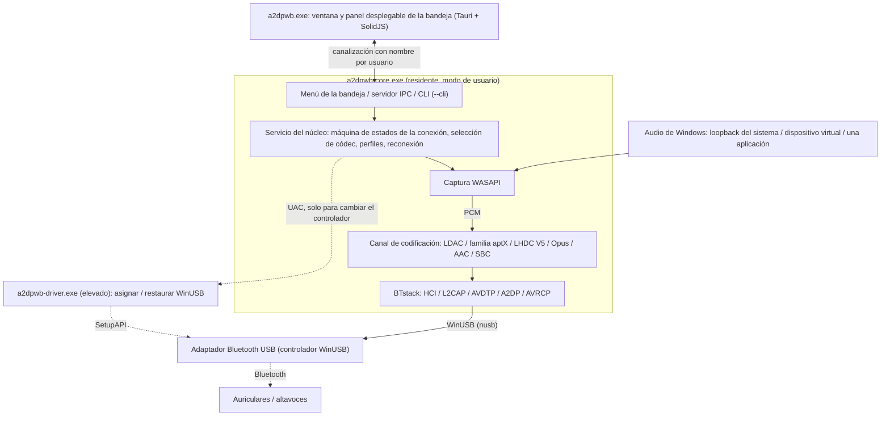
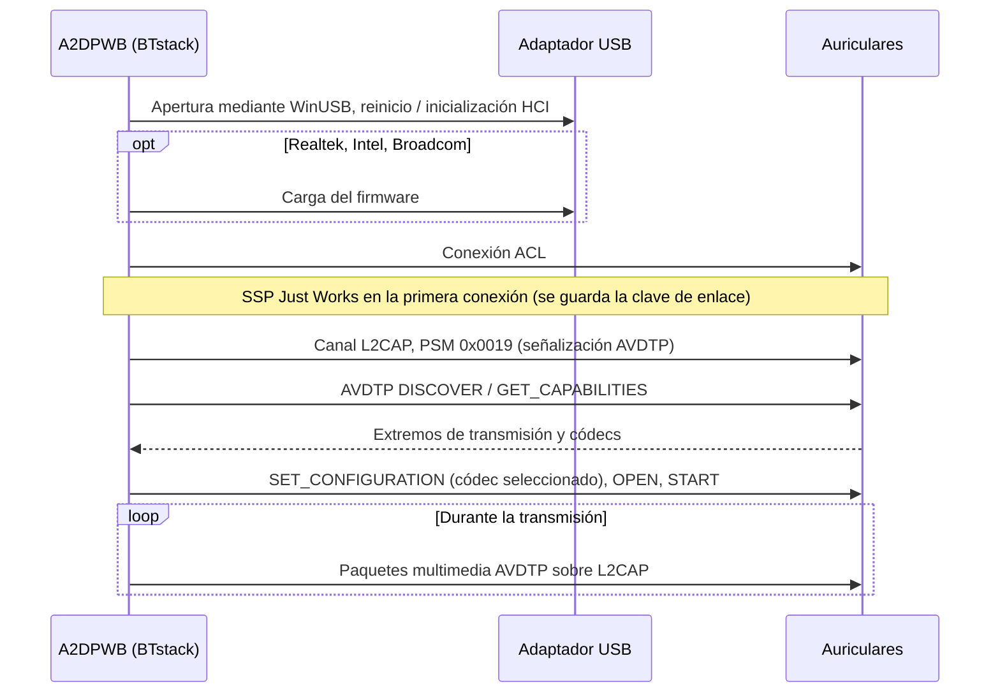
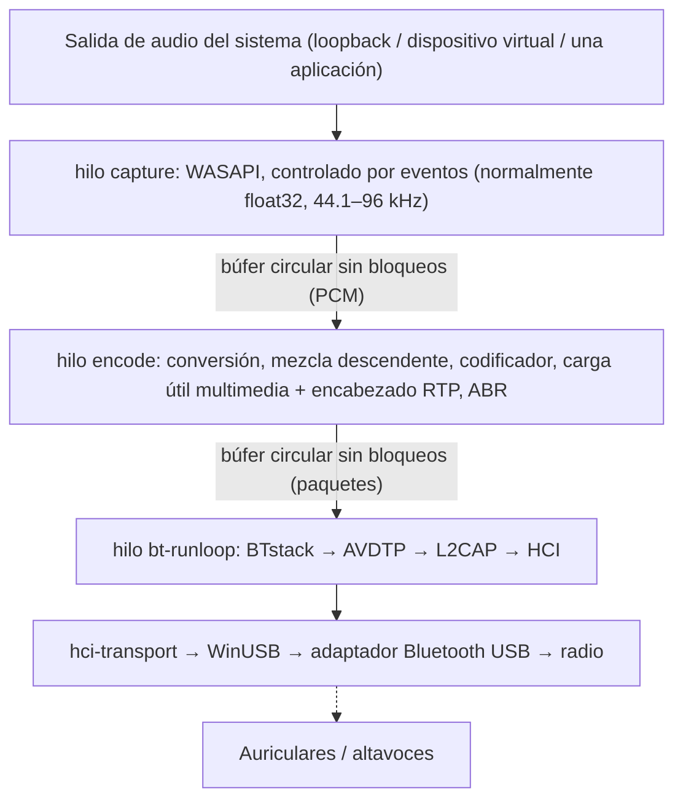
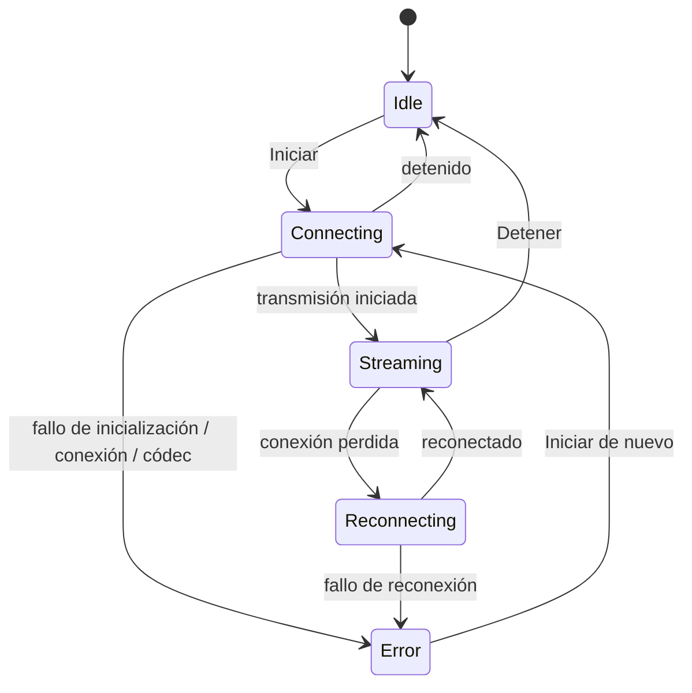

# Arquitectura
{: .no_toc }

## Contenido
{: .no_toc .text-delta }

1. TOC
{:toc}

---

## Descripción general

A2DP Windows Bridge (A2DPWB) habilita el audio Bluetooth LDAC, aptX HD, aptX Low Latency, aptX,
AAC y SBC en Windows. La pila Bluetooth propia de Windows solo admite
SBC, aptX clásico y (solo en Windows 11) AAC para A2DP; esta herramienta añade LDAC, aptX HD y aptX
Low Latency sin necesidad de un controlador de kernel.

Usa **BTstack + WinUSB**: todo en modo de usuario, sin necesidad de firmar controladores.

A2DPWB 2.0 está escrito en Rust. Las bibliotecas en C que no se pueden sustituir
(BTstack y los codificadores de los códecs) se compilan desde el código fuente y se llaman a través
de pequeños crates FFI; todo lo demás, incluido el codificador SBC, es Rust.

## Procesos

A2DPWB se ejecuta como hasta tres programas:

| Programa | Se ejecuta | Función |
|:--------|:-----|:-----|
| `a2dpwb-core.exe` | Mientras A2DPWB está en ejecución (lo inician la ventana, el menú Inicio o **Iniciar con Windows**) | Bluetooth, captura y codificación del audio, perfiles y configuración, el icono de la bandeja y su menú, el servidor IPC. `--cli` ejecuta el mismo núcleo desde una consola |
| `a2dpwb.exe` | Solo mientras hay una ventana abierta (se cierra 3 minutos después de cerrar la última) | La ventana principal y el panel desplegable de la bandeja (Tauri 2, SolidJS + TypeScript). No guarda ningún estado propio |
| `a2dpwb-driver.exe` | Para un único cambio de controlador, con derechos de administrador (UAC) | Asigna WinUSB a un adaptador o restaura su controlador anterior y se cierra |

- **El núcleo no es un servicio de Windows.** Es un proceso normal del
  usuario que ha iniciado sesión, porque el loopback de WASAPI captura el audio de la sesión de ese usuario.
  Un mutex por sesión lo limita a una sola instancia; iniciarlo de nuevo abre la
  ventana.
- **La bandeja pertenece al núcleo.** Su menú de clic derecho (abrir, los 10 primeros
  perfiles, desconectar, salir) se abre al instante, sin iniciar la ventana. Un
  clic izquierdo inicia el panel desplegable de la ventana.
- **La ventana solo muestra.** Recibe una instantánea del estado del núcleo
  y después los cambios; cerrarla, o que la ventana se bloquee, no detiene
  el audio. Cerrar una ventana solo la oculta, así que volver a abrirla desde la bandeja
  es instantáneo.
- **La línea de comandos usa el mismo núcleo.** `a2dpwb-core.exe --cli` ejecuta el
  servicio del núcleo sin bandeja ni IPC; la prueba con el emulador se ejecuta así.

## Transporte: BTstack + WinUSB

Omite por completo la pila Bluetooth de Windows comunicándose directamente con un
adaptador Bluetooth USB mediante WinUSB (controlador USB genérico firmado por Microsoft). BTstack,
una pila Bluetooth de código disponible (licencia no comercial), implementa HCI, L2CAP, AVDTP y A2DP en
modo de usuario.

**Ventajas**:
- Sin coste de firma de controladores
- No requiere el modo de firma de prueba
- No hay que desactivar el Arranque seguro
- Todo el código se ejecuta en modo de usuario (depuración más sencilla)

**Inconvenientes**:
- Requiere un adaptador Bluetooth USB dedicado (aparte del Bluetooth integrado
  de Windows)
- Mientras WinUSB lo controla, el adaptador no está disponible para el Bluetooth
  normal de Windows
- La dirección del dispositivo se escribe a mano o se encuentra con una búsqueda (GAP inquiry) con
  el adaptador USB

**Cómo funciona**:
1. Se asigna WinUSB a un adaptador Bluetooth USB, desde la aplicación (**Adaptador >
   Asignar WinUSB**, consulte [Asignación del controlador](#driver-assignment)) o con Zadig
2. El crate `hci-transport` abre el adaptador a través de WinUSB con `nusb`
   y lo conecta a BTstack como su transporte HCI
3. BTstack envía comandos HCI para inicializar el controlador Bluetooth
4. (Adaptadores Realtek, Intel y Broadcom) Se carga el firmware si es necesario
5. BTstack establece una conexión ACL y abre canales L2CAP (PSM 0x0019)
6. La señalización AVDTP descubre los SEP remotos y negocia los códecs
7. El audio codificado se envía como paquetes multimedia AVDTP sobre L2CAP

El transporte USB conserva los pasos de recuperación que necesitaron los adaptadores reales en
la v1: las canalizaciones de eventos y ACL se restablecen al abrir el adaptador, una lectura
de eventos fallida se reintenta, los comandos HCI tienen tiempo de espera y al cerrar el adaptador se envía
HCI Reset, de modo que la siguiente sesión encuentra un controlador inactivo.

## Estructura de crates

Un único workspace de Cargo (`Cargo.toml` en la raíz del repositorio) en cinco capas;
cada capa depende solo de las capas inferiores. Las bibliotecas están en
`app/src/crates/`, los programas en `app/src/core`, `app/src/ui` y
`app/src/driver`. Solo los crates `*-sys` y `win-sys` pueden contener código `unsafe`;
todos los demás crates tienen `#![forbid(unsafe_code)]`.

| Capa | Crate | Función |
|:------|:------|:-----|
| 1. FFI | `btstack-sys` | Compila BTstack con `cc` (MSVC), declaraciones FFI escritas a mano y envoltorios seguros, `btstack_config.h`. BTstack solo puede llamarse en el hilo de su bucle de ejecución: el token `!Send` `Stack` lo garantiza |
| 1. FFI | `ldac-sys`, `openaptx-sys`, `fdkaac-sys`, `lhdcv5-sys`, `opus-sys` | Compilan los codificadores en C y los exponen; un crate por biblioteca, para que cada licencia quede separada |
| 1. FFI | `win-sys` | API de Win32 sin biblioteca de Rust: MMCSS, el dispositivo de audio predeterminado (IPolicyConfig), la API WLAN (AFH), las notificaciones de energía, la clave Run, las teclas multimedia, la DACL de la canalización, la elevación y la asignación del controlador WinUSB (SetupAPI) |
| 2. Componentes | `hci-transport` | HCI sobre USB («H2») con `nusb`, y H4 sobre TCP hacia un controlador virtual (`tools/emu`) |
| 2. Componentes | `codec` | El trait `Encoder`, el codificador SBC (port en Rust del de Bluedroid), envoltorios seguros de los codificadores en C, el análisis de Codec Information y la elección del códec |
| 2. Componentes | `audio-capture` | Captura WASAPI (crate `wasapi`): loopback del sistema, dispositivo virtual, una aplicación (loopback de proceso); listas de dispositivos y aplicaciones, tono de prueba |
| 3. Motor | `bt-host` | Ejecuta BTstack en su propio hilo, controlado mediante comandos y eventos tipados: GAP, A2DP Source, AVRCP, SDP, claves de enlace, AFH, carga de firmware, captura HCI (`.pklg`) |
| 3. Motor | `pipeline` | Búferes circulares de PCM, conversión de formato, mezcla descendente, codificación, cargas útiles multimedia, ritmo de envío, ABR |
| 4. Núcleo | `a2dpwb-core` (directorio `core`) | La máquina de estados, las reconexiones, suspensión / reanudación, los perfiles, la configuración y la migración desde la v1, la sincronización de volumen, la búsqueda de actualizaciones, el cliente de la prueba con receptor, las estadísticas |
| 4. Núcleo | `ipc` | Los tipos del protocolo compartidos por el núcleo y la ventana (serde; tipos de TypeScript generados con `ts-rs`) y el entramado de la canalización |
| 5. Programas | `a2dpwb-core-exe` (`app/src/core`) | `a2dpwb-core.exe`: núcleo, bandeja (`tray-icon` sobre un bucle de eventos `tao`), servidor IPC, `--cli` |
| 5. Programas | `a2dpwb-ui` (`app/src/ui`) | `a2dpwb.exe`: Tauri 2; la parte de Rust es un cliente IPC, la página es SolidJS + TypeScript + Vite |
| 5. Programas | `a2dpwb-driver` (`app/src/driver`) | `a2dpwb-driver.exe`: el auxiliar elevado |

## Ruta del audio e hilos

| Hilo | Prioridad | Trabajo |
|:-------|:---------|:-----|
| capture | MMCSS "Audio" | Lee WASAPI; rellena con silencio los tramos sin sonido |
| encode | MMCSS "Pro Audio" | Convierte al formato que admite el codificador, codifica bloques completos del codificador (el resto espera a la siguiente ronda) y empaqueta las tramas en cargas útiles multimedia, en rondas de unos 10 ms para que los paquetes salgan de forma regular |
| bt-runloop | -- | El bucle de ejecución de BTstack; envía un paquete en cola cada vez que L2CAP puede enviar |
| USB | -- | Transferencias WinUSB: tres lecturas en curso en cada canalización IN (eventos, datos ACL), un escritor para comandos y datos ACL |
| core | Normal | Máquina de estados, IPC (tokio), configuración, estadísticas (4 Hz), búsqueda de actualizaciones |

Una vez que la transmisión está en marcha, la ruta del audio no asigna memoria ni toma ningún bloqueo.
Las estadísticas son contadores atómicos que el núcleo lee cuatro veces por segundo.
BTstack no es seguro entre hilos: los demás hilos le envían comandos, que se ejecutan en
el hilo bt-runloop.

## Núcleo e IPC

La ventana se comunica con el núcleo a través de la canalización con nombre del usuario
`\\.\pipe\a2dpwb-<user SID>`, cuya DACL solo admite a ese usuario. Los mensajes son
tramas JSON precedidas de su longitud:

1. La ventana envía `hello { protocol, client }`. Un núcleo con otra
   versión de protocolo lo rechaza, y la ventana indica que los dos programas
   son de versiones distintas.
2. El núcleo responde con un `snapshot`: todo su estado (adaptador, dispositivos,
   transmisión, perfiles, configuración, actualización) y un número de revisión.
3. A partir de ahí, el núcleo envía `event`s con los cambios. Si falta una revisión,
   la ventana obtiene una instantánea nueva.
4. Las acciones son `request { id, method, params }` con una `response { id,
   result | error }`. Los grupos de métodos son `stream.*`, `device.*`,
   `profile.*`, `settings.*`, `adapter.*`, `audio.*`, `diag.*` y `app.*`.

Los errores son códigos con parámetros (por ejemplo `adapter.driver_missing`), no
textos; la ventana los traduce y ofrece la solución junto al mensaje.
Los datos de alta frecuencia (calidad del enlace, el registro) solo se envían mientras una pantalla
está suscrita a ellos.

La máquina de estados de la conexión:

Una conexión fallida se intenta hasta 3 veces, y una perdida se reconecta hasta
10 veces. Cuando el PC entra en suspensión, el núcleo detiene BTstack sin contar
el enlace perdido como un fallo y vuelve a conectar cuando el PC se reanuda.

## Asignación del controlador {#driver-assignment}

Windows 8 y posteriores incluyen el controlador WinUSB firmado por Microsoft
(`winusb.inf`). `a2dpwb-driver.exe` hace lo mismo que «Actualizar
controlador > Elegir en una lista > WinUsb Device» del Administrador de dispositivos, mediante SetupAPI:

1. Abre el adaptador por su ID de instancia de dispositivo.
2. Escribe un valor `DeviceInterfaceGUIDs` en sus `Device Parameters`, para que
   WinUSB registre una interfaz de dispositivo para él.
3. Selecciona el modelo «WinUsb Device» de `%SystemRoot%\INF\winusb.inf` y lo
   instala con `DiInstallDevice`. El controlador incluido en Windows está firmado, así que no se
   instala ningún certificado (a diferencia de Zadig / libwdi, que firman un INF generado
   con un certificado propio).
4. **Restaurar**: quita el dispositivo (`DiUninstallDevice`) y lo vuelve a enumerar;
   Windows elige entonces de nuevo su controlador mejor clasificado (normalmente `BthUSB` o el
   del fabricante). El controlador que tenía antes el adaptador se registra en la
   carpeta de configuración (`driver\`) y se compara tras la restauración.

El núcleo nunca se ejecuta como administrador: para una asignación o una restauración inicia
el auxiliar con una solicitud de UAC (`ShellExecuteEx` "runas") y lee su resultado
JSON. Enumerar los adaptadores y su controlador no requiere elevación.

## Módulos clave

### Elección del códec (`codec::caps`)

- Analiza las capacidades del dispositivo remoto: los elementos estándar de SBC y AAC y los
  códecs de fabricante, incluido aptX LL con ambos Vendor ID y aptX Adaptive
  (solo se detecta y se registra)
- Elige el códec: Automático toma el mejor códec que ofrece el dispositivo remoto; un códec
  solicitado que el remoto no ofrece se sustituye por la elección de Automático cuando el
  perfil lo permite (**Usar otro códec si este no está disponible**), y
  en caso contrario es un error
- Elige la frecuencia de muestreo de la familia aptX (44.1 / 48 kHz entre las que
  anuncia el remoto; WASAPI remuestrea la captura)

### Host Bluetooth (`bt-host`)

**Responsabilidades**:
- Ejecutar BTstack con el transporte HCI USB (o TCP) en su propio hilo
- Registrar los extremos de transmisión: códecs de fabricante (LDAC, aptX HD, aptX, aptX LL,
  LHDC V5, FastStream, Opus) además de SBC (que también usa SBC XQ) y AAC
- Registrar los registros SDP (A2DP Source, AVRCP Controller, AVRCP Target)
- Gestionar el emparejamiento SSP (Just Works, General Bonding; claves de enlace persistentes)
- Cerrar una conexión semiabierta tras un tiempo de espera de conexión, para que los reintentos funcionen
- Reintentar una conexión fallida (hasta 3 intentos) y distinguir las causas (sin
  respuesta, enlace sin datos, el remoto cerró el enlace, autenticación); descartar una clave de enlace
  que el dispositivo ya no reconoce y volver a emparejar
- GAP inquiry para la búsqueda de dispositivos
- Volumen absoluto AVRCP y los botones de los auriculares
- Clasificación de canales AFH del host y lecturas de RSSI / AFH para la vista
  de calidad del enlace
- Carga de firmware para chipsets Realtek, Intel y Broadcom
- Captura HCI (`.pklg`), incluido el establecimiento de la conexión si empieza con la conexión ya activa

**API clave de BTstack utilizadas**:
- `a2dp_source_create_stream_endpoint()` — Registrar los extremos de códec
- `a2dp_source_establish_stream()` — Conectar con el receptor A2DP
- `a2dp_source_set_config_other()` — Configurar un códec específico del fabricante
- `a2dp_source_stream_send_media_payload_rtp()` — Enviar audio codificado con
  encabezado RTP (LDAC, aptX HD, AAC, SBC, SBC XQ, LHDC V5, Opus)
- `a2dp_source_stream_send_media_packet()` — Enviar paquetes multimedia sin procesar, sin
  encabezado RTP (aptX, aptX LL, FastStream)

### Captura de audio (`audio-capture`)

Captura el audio en tiempo real mediante Windows Audio Session API.
- Loopback del sistema del dispositivo de salida predeterminado, loopback de un dispositivo
  (virtual) elegido, o loopback de proceso de una aplicación y sus procesos
  secundarios (Windows 10 compilación 19041 o posterior)
- Entrega el formato de mezcla del modo compartido del dispositivo (normalmente float32; el
  pipeline lo convierte para el codificador)
- En el modo Aplicación, espera a la aplicación y la vuelve a captar cuando
  se reinicia

### Codificadores de audio

| Codificador | Biblioteca | Tasa de bits | Características |
|---------|---------|---------|----------|
| LDAC | libldac (AOSP) | 330/660/990 kbps | Modos HQ/SQ/MQ, ABR |
| aptX HD | libopenaptx | 576 kbps | Entrada de 24 bits, tasa fija, encabezado RTP |
| aptX LL | libopenaptx | 352 kbps | Latencia de ~32 ms, sin encabezado RTP, paquetes ≤ ~7.5 ms |
| aptX | libopenaptx | 352/384 kbps (44.1/48 kHz) | Estéreo de 16 bits, sin encabezado RTP |
| AAC | fdk-aac | hasta 256 kbps | AAC-LC, transporte LATM |
| SBC | Port en Rust del codificador de Bluedroid | hasta ~345 kbps | Base obligatoria de A2DP; idéntico bit a bit al codificador en C (probado en todas las configuraciones) |
| SBC XQ | el mismo codificador SBC | ~385/505/552 kbps | Canal dual, bitpool 47 / 43 a 44.1 / 48 kHz (Alta); solo cuando el SBC del receptor admite canal dual y un bitpool de al menos 43; comparte con SBC el extremo de transmisión, el encabezado de carga útil multimedia y el encabezado RTP |
| FastStream | el mismo codificador SBC | 198/216 kbps (44.1/48 kHz) | Códec de fabricante de CSR, solo en la dirección de música (sin canal de retorno de voz): SBC joint stereo con bitpool 29, tramas rellenadas hasta 72 bytes, 3 por paquete, sin encabezado de carga útil multimedia ni encabezado RTP (como PipeWire); Automático nunca lo elige |
| LHDC V5 | lhdcv5-enc (port en C del codificador de AOSP) | 400/500/900/1000 kbps, ABR 160–400 kbps | 16/24 bits, tramas de 5 ms, encabezado de carga útil multimedia de 2 bytes, encabezado RTP |
| Opus | libopus 1.5.2 | 128/192/256 kbps (estéreo; mono la mitad) | Experimental; Opus A2DP de Android: 48 kHz, tramas de 20 ms (10 ms si el receptor solo admite eso), VBR restringida limitada a la carga útil multimedia, una trama por paquete, encabezado de carga útil multimedia de 1 byte, encabezado RTP |

Todos los codificadores implementan el trait `codec::Encoder`: indican el formato PCM
y el número de tramas que consume una llamada, y devuelven tramas del códec.

libopenaptx espera grupos de 4 muestras estéreo como PCM de 24 bits empaquetado
little-endian; los envoltorios de aptX convierten las muestras de 16 o 32 bits a ese formato,
y la entrada mono se duplica en ambos canales.

## Elementos de información de códecs de fabricante

Los códecs no estándar se registran como Vendor Specific en AVDTP:

| Códec | Vendor ID | Codec ID |
|-------|-----------|----------|
| LDAC | Sony (0x0000012D) | 0x00AA |
| aptX | APT (0x0000004F) | 0x0001 |
| aptX HD | Qualcomm (0x000000D7) | 0x0024 |
| aptX Low Latency | CSR (0x0000000A) o Qualcomm (0x000000D7) | 0x0002 |
| aptX Adaptive | Qualcomm (0x000000D7) | 0x00AD (solo se detecta, nunca se selecciona) |
| LHDC V5 | Savitech (0x0000053A) | 0x4C35 |
| FastStream | CSR (0x0000000A) | 0x0001 |
| Opus | Google (0x000000E0) | 0x0001 |

AAC y SBC usan los Codec ID estándar de A2DP definidos en la especificación de A2DP.

Tamaños de los elementos de información de códec (incluidos los 6 bytes de Vendor ID/Codec ID):

- **aptX**: 7 bytes (byte 6 = frecuencia de muestreo / modo de canal)
- **aptX HD**: 11 bytes (byte 6 como en aptX, más 4 bytes reservados); se requiere
  estéreo
- **aptX LL**: 8 bytes, o 17 bytes cuando el receptor activa el indicador extendido
  («new caps»). A2DPWB registra un único extremo aptX LL y configura el
  flujo con el Vendor ID que usó el receptor
- **LHDC V5**: 11 bytes (`a2dp_vendor_lhdcv5_constants.h` de Android): byte 6
  frecuencias de muestreo (0x20 44.1k, 0x10 48k, 0x04 96k, 0x01 192k), byte 7 profundidad de bits
  (0x04 16 bits, 0x02 24 bits) y los límites mínimo/máximo de tasa de bits del receptor, byte 8
  subversión del códec (0x01 = V5 ver.1) y 0x10 = tramas de 5 ms, bytes 9-10
  funciones opcionales (baja latencia, sin pérdida, JAS, AR, META), ninguna de las cuales
  ofrece A2DPWB. Solo estéreo. Los límites de tasa de bits del receptor se devuelven en la
  configuración y se aplican al codificador, como hace Android. Los paquetes multimedia
  llevan un encabezado de carga útil de 2 bytes: número de tramas << 2 (bits de latencia 0) y un
  número de secuencia
- **FastStream**: 8 bytes (`a2dp_faststream_t` de PipeWire): byte 6 dirección
  (0x01 sink = música, 0x02 source = voz), byte 7 en el nibble bajo las frecuencias del receptor
  (0x2 44.1k, 0x1 48k), en el nibble alto la frecuencia de la fuente (0x2 16k). A2DPWB ofrece
  y configura solo la dirección de música
- **Opus**: 7 bytes (`a2dp_vendor_opus_constants.h` de Android): byte 6 bits
  2..0 modo de canal (0x01 mono, 0x02 estéreo, 0x04 mono dual), bits 4..3
  duración de trama (0x08 10 ms, 0x10 20 ms), bit 7 48 kHz. A2DPWB ofrece mono
  y estéreo, 10 y 20 ms, y configura estéreo a 20 ms (mono solo para una entrada
  mono hacia un receptor que lo admita). Los paquetes multimedia llevan un paquete Opus tras
  un encabezado de carga útil de 1 byte (número de tramas 1 en los 4 bits bajos)

**Con o sin RTP**: los paquetes multimedia de LDAC, aptX HD, AAC, SBC, SBC XQ, LHDC V5 y Opus llevan el
encabezado RTP de 12 bytes. aptX, aptX LL y FastStream se envían **sin** encabezado RTP (como hacen Android y
PipeWire), de modo que toda la MTU de L2CAP queda disponible para las tramas aptX.

**aptX Adaptive** no tiene codificador de código abierto (libopenaptx no lo
implementa), así que A2DPWB nunca lo registra ni lo selecciona. Cuando un receptor lo ofrece, A2DPWB
solo lo registra en el log; se usa aptX clásico si el receptor lo ofrece por separado.

## Configuración y archivos

Todo se guarda en la carpeta de configuración, `%APPDATA%\A2DPWB` (o la
carpeta indicada por la variable de entorno `A2DPWB_CONFIG_DIR`), en los mismos
formatos que la v1:

| Archivo | Contenido |
|:-----|:---------|
| `settings.json` | Configuración de la aplicación, con un `schema_version`; las claves desconocidas se conservan |
| `profiles.json` | Perfiles |
| `devices.txt`, `link_keys.txt` | Dispositivos conocidos y sus claves de enlace: los auriculares emparejados con la v1 se reconectan sin volver a emparejar |
| `le_audio_devices.txt`, `le_audio_bonds.tlv`, `le_audio_csip.txt` | LE Audio (experimental): las entradas LE Audio de la lista de dispositivos, los vínculos LE (con los valores CCC persistentes del servidor GATT) y los conjuntos coordinados |
| `*.bin`, `*.hcd`, `ibt-*` | Archivos de firmware |
| `hci_<date>_<time>.pklg` | Capturas HCI |
| `logs\a2dpwb-core.<date>.log` | El registro del núcleo, un archivo por día (UTC); se conservan los 7 últimos |
| `driver\` | El controlador anterior de cada adaptador al que se asignó WinUSB |
| `backup-v1\` | Una copia de la configuración de la v1, creada una sola vez en el primer inicio de la v2 |

## Sistema de compilación

- **Cargo** lo compila todo; no hay CMake. Cada crate `-sys` compila
  su biblioteca en C desde el submódulo git de `extern/` con MSVC en `build.rs`
- La página de la ventana se compila con **Vite** (`pnpm build` en `app/src/ui`) y
  Tauri la incrusta en `a2dpwb.exe`
- Los tipos de TypeScript del protocolo IPC se generan a partir de los tipos de Rust
  (`cargo test -p ipc export_bindings`)
- Los archivos de idioma (`app/lang/*.json`) los usan la ventana y el menú de la bandeja
  del núcleo
- `installer/build-release.ps1` genera el instalador NSIS (el empaquetador de Tauri),
  el zip portable y el manifiesto del actualizador. Consulte [Compilación](building)

## Consideraciones importantes

- **Compatibilidad de adaptadores**: adaptadores USB Realtek (los más probados) y CSR; Intel y
  Broadcom son experimentales. Los adaptadores Realtek necesitan cargar el firmware al iniciar,
  y también los Intel en modo bootloader
- **Emparejamiento**: usa SSP Just Works con General Bonding. Las claves de enlace se guardan
  en un archivo local
- **Se recomienda un segundo adaptador**: mantenga el Bluetooth integrado para Windows y use
  un adaptador USB dedicado para A2DPWB
- El firmware de algunos adaptadores Bluetooth limita la tasa de bits alcanzable
- Por lo general, los adaptadores USB Bluetooth 5.0+ funcionan bien con LDAC
- Prioridad de la selección automática de códec: LDAC > aptX HD > aptX LL > aptX > LHDC V5 > Opus (experimental) > AAC > SBC XQ > SBC (FastStream solo si se elige)
