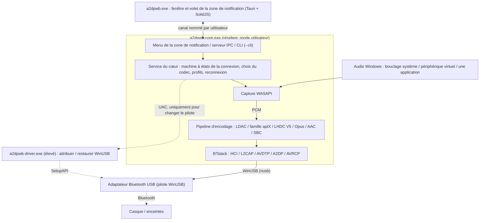
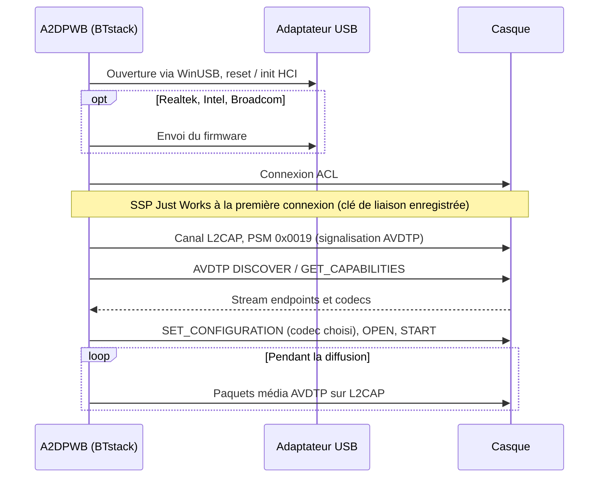
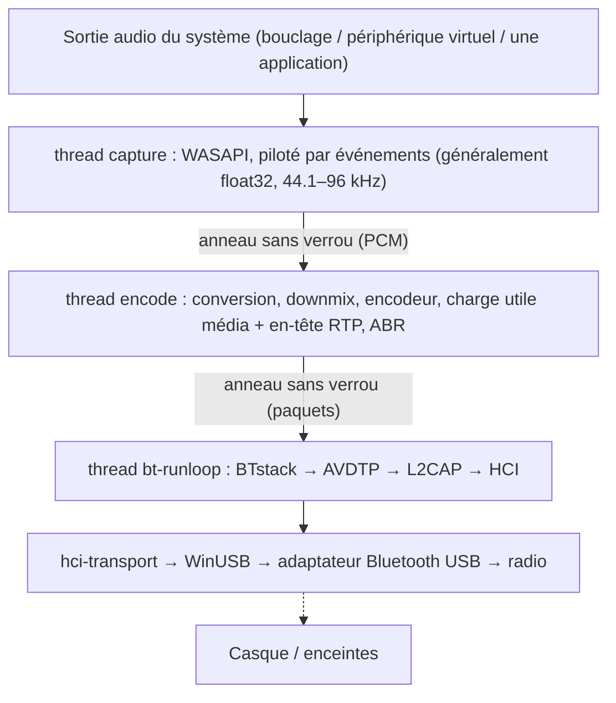
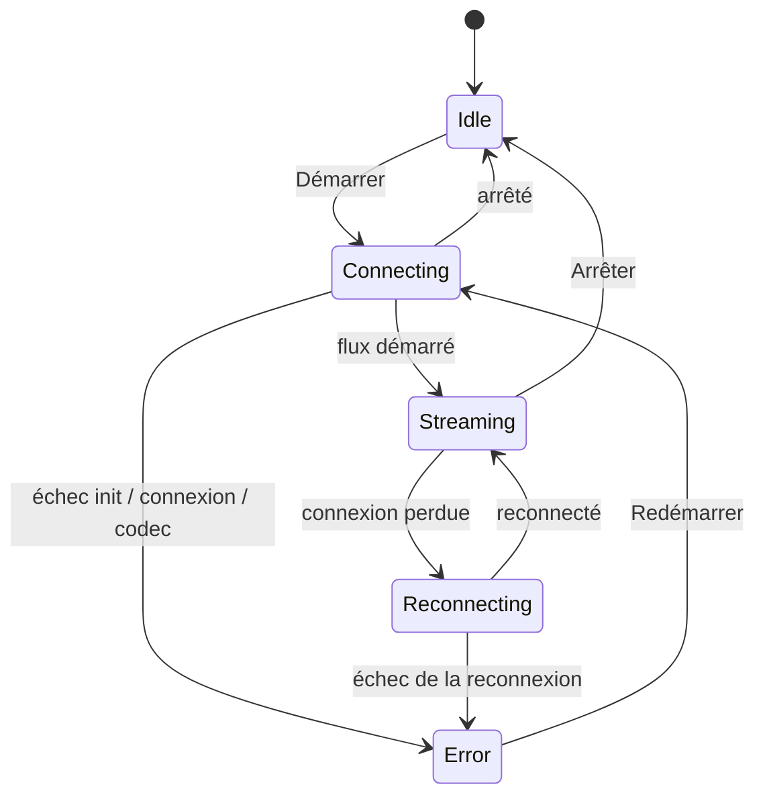

# Architecture
{: .no_toc }

## Table des matières
{: .no_toc .text-delta }

1. TOC
{:toc}

---

## Vue d'ensemble

A2DP Windows Bridge (A2DPWB) permet l'audio Bluetooth LDAC, aptX HD, aptX Low Latency, aptX,
AAC et SBC sous Windows. La pile Bluetooth propre à Windows ne prend en charge
que SBC, l'aptX classique et (Windows 11 uniquement) AAC pour A2DP — cet outil ajoute LDAC, aptX HD et aptX
Low Latency sans nécessiter de pilote noyau.

Utilise **BTstack + WinUSB** — entièrement en mode utilisateur, aucune signature de pilote nécessaire.

A2DPWB 2.0 est écrit en Rust. Les bibliothèques C qui ne peuvent pas être remplacées
(BTstack et les encodeurs des codecs) sont compilées depuis les sources et appelées via
de petites crates FFI ; tout le reste, y compris l'encodeur SBC, est en Rust.

## Processus

A2DPWB s'exécute sous la forme de trois programmes au plus :

| Programme | S'exécute | Rôle |
|:--------|:-----|:-----|
| `a2dpwb-core.exe` | Tant qu'A2DPWB fonctionne (démarré par la fenêtre, le menu Démarrer ou **Démarrer avec Windows**) | Bluetooth, capture et encodage audio, profils et paramètres, icône de la zone de notification et son menu, serveur IPC. `--cli` exécute ce même cœur depuis une console |
| `a2dpwb.exe` | Uniquement tant qu'une fenêtre est ouverte (se termine 3 minutes après la fermeture de la dernière) | La fenêtre principale et le volet de la zone de notification (Tauri 2, SolidJS + TypeScript). Ne conserve aucun état propre |
| `a2dpwb-driver.exe` | Le temps d'un changement de pilote, avec les droits administrateur (UAC) | Attribue WinUSB à un adaptateur ou restaure son pilote précédent, puis se termine |

- **Le cœur n'est pas un service Windows.** C'est un processus ordinaire de
  l'utilisateur connecté, car le bouclage WASAPI capture l'audio de la session de
  cet utilisateur. Un mutex par session limite le cœur à une seule instance ; le
  relancer ouvre la fenêtre.
- **La zone de notification appartient au cœur.** Son menu contextuel (ouvrir, les 10
  premiers profils, déconnecter, quitter) s'ouvre immédiatement, sans démarrer la fenêtre. Un
  clic gauche démarre le volet de la fenêtre.
- **La fenêtre ne fait qu'afficher.** Elle reçoit un instantané de l'état du cœur
  puis ses modifications ; la fermer, ou un plantage de la fenêtre, n'arrête pas
  l'audio. Fermer une fenêtre ne fait que la masquer : la rouvrir depuis la zone de
  notification est donc instantané.
- **La ligne de commande utilise le même cœur.** `a2dpwb-core.exe --cli` exécute le
  service du cœur sans zone de notification ni IPC ; le test avec l'émulateur fonctionne ainsi.

## Transport : BTstack + WinUSB

Contourne entièrement la pile Bluetooth de Windows en communiquant directement avec un
adaptateur Bluetooth USB via WinUSB (pilote USB générique signé par Microsoft). BTstack,
une pile Bluetooth à code source disponible (licence non commerciale), implémente HCI, L2CAP, AVDTP et A2DP en
mode utilisateur.

**Avantages** :
- Aucun coût de signature de pilote
- Pas besoin du mode de signature de test
- Pas besoin de désactiver le Secure Boot
- Tout le code s'exécute en mode utilisateur (débogage plus facile)

**Contreparties** :
- Nécessite un adaptateur Bluetooth USB dédié (distinct du Bluetooth intégré
  de Windows)
- Tant qu'il est pris par WinUSB, l'adaptateur n'est pas disponible pour le
  Bluetooth habituel de Windows
- L'adresse de l'appareil est saisie à la main ou trouvée par une recherche
  (GAP inquiry) avec l'adaptateur USB

**Fonctionnement** :
1. WinUSB est attribué à un adaptateur Bluetooth USB, dans l'application (**Adaptateur >
   Attribuer WinUSB**, voir [Attribution du pilote](#driver-assignment)) ou avec Zadig
2. La crate `hci-transport` ouvre l'adaptateur via WinUSB avec `nusb`
   et le connecte à BTstack comme transport HCI
3. BTstack envoie des commandes HCI pour initialiser le contrôleur Bluetooth
4. (Adaptateurs Realtek, Intel et Broadcom) Le firmware est envoyé si nécessaire
5. BTstack établit une connexion ACL et ouvre des canaux L2CAP (PSM 0x0019)
6. La signalisation AVDTP découvre les SEP distants et négocie les codecs
7. L'audio encodé est envoyé sous forme de paquets média AVDTP sur L2CAP

Le transport USB conserve les étapes de récupération dont les vrais adaptateurs avaient
besoin en v1 : les pipes d'événements et ACL sont réinitialisés à l'ouverture de l'adaptateur,
une lecture d'événement échouée est retentée, les commandes HCI ont un délai d'expiration, et
la fermeture de l'adaptateur envoie HCI Reset, si bien que la session suivante trouve un
contrôleur au repos.

## Structure des crates

Un seul workspace Cargo (`Cargo.toml` à la racine du dépôt) en cinq couches ;
chaque couche ne dépend que des couches inférieures. Les bibliothèques se trouvent dans
`app/src/crates/`, les programmes dans `app/src/core`, `app/src/ui` et
`app/src/driver`. Seules les crates `*-sys` et `win-sys` peuvent contenir du code
`unsafe` ; toutes les autres crates ont `#![forbid(unsafe_code)]`.

| Couche | Crate | Rôle |
|:------|:------|:-----|
| 1. FFI | `btstack-sys` | Compile BTstack avec `cc` (MSVC), déclarations FFI écrites à la main et enveloppes sûres, `btstack_config.h`. BTstack ne peut être appelé que sur le thread de sa boucle d'exécution : le jeton `Stack`, `!Send`, l'impose |
| 1. FFI | `ldac-sys`, `openaptx-sys`, `fdkaac-sys`, `lhdcv5-sys`, `opus-sys` | Compilent les encodeurs C et les exposent ; une crate par bibliothèque, pour que chaque licence reste séparée |
| 1. FFI | `win-sys` | API Win32 sans bibliothèque Rust : MMCSS, le périphérique audio par défaut (IPolicyConfig), l'API WLAN (AFH), les notifications d'alimentation, la clé Run, les touches multimédias, la DACL du canal nommé, l'élévation et l'attribution du pilote WinUSB (SetupAPI) |
| 2. Composants | `hci-transport` | HCI sur USB (« H2 ») avec `nusb`, et H4 sur TCP vers un contrôleur virtuel (`tools/emu`) |
| 2. Composants | `codec` | Le trait `Encoder`, l'encodeur SBC (portage en Rust de celui de Bluedroid), les enveloppes sûres des encodeurs C, l'analyse des Codec Information et le choix du codec |
| 2. Composants | `audio-capture` | Capture WASAPI (crate `wasapi`) : bouclage système, périphérique virtuel, une application (bouclage de processus) ; listes des périphériques et des applications, signal de test |
| 3. Moteur | `bt-host` | Exécute BTstack sur son propre thread, piloté par des commandes et des événements typés : GAP, A2DP Source, AVRCP, SDP, clés de liaison, AFH, chargement du firmware, capture HCI (`.pklg`) |
| 3. Moteur | `pipeline` | Anneaux PCM, conversion de format, downmix, encodage, charges utiles média, cadencement, ABR |
| 4. Cœur | `a2dpwb-core` (répertoire `core`) | La machine à états, les reconnexions, la veille / reprise, les profils, les paramètres et la migration depuis la v1, la synchro du volume, la recherche de mises à jour, le client du test avec récepteur, les statistiques |
| 4. Cœur | `ipc` | Les types du protocole partagés par le cœur et la fenêtre (serde ; types TypeScript générés avec `ts-rs`) et le découpage en trames sur le canal nommé |
| 5. Programmes | `a2dpwb-core-exe` (`app/src/core`) | `a2dpwb-core.exe` : cœur, zone de notification (`tray-icon` sur une boucle d'événements `tao`), serveur IPC, `--cli` |
| 5. Programmes | `a2dpwb-ui` (`app/src/ui`) | `a2dpwb.exe` : Tauri 2 ; le côté Rust est un client IPC, la page est en SolidJS + TypeScript + Vite |
| 5. Programmes | `a2dpwb-driver` (`app/src/driver`) | `a2dpwb-driver.exe` : l'assistant élevé |

## Trajet audio et threads

| Thread | Priorité | Travail |
|:-------|:---------|:-----|
| capture | MMCSS « Audio » | Lit WASAPI ; comble les passages silencieux par du silence |
| encode | MMCSS « Pro Audio » | Convertit dans le format attendu par l'encodeur, encode des blocs d'encodeur complets (le reste attend le tour suivant), regroupe les trames en charges utiles média, par tours d'environ 10 ms pour que les paquets partent régulièrement |
| bt-runloop | -- | La boucle d'exécution de BTstack ; envoie un paquet en file d'attente dès que L2CAP peut envoyer |
| USB | -- | Transferts WinUSB : trois lectures en cours sur chaque pipe IN (événements, données ACL), un écrivain pour les commandes et les données ACL |
| core | Normale | Machine à états, IPC (tokio), paramètres, statistiques (4 Hz), recherche de mises à jour |

Une fois un flux lancé, le trajet audio n'alloue aucune mémoire et ne prend aucun verrou.
Les statistiques sont des compteurs atomiques que le cœur lit quatre fois par seconde.
BTstack n'est pas thread-safe : les autres threads lui envoient des commandes, qui s'exécutent
sur le thread bt-runloop.

## Cœur et IPC

La fenêtre communique avec le cœur via le canal nommé de l'utilisateur
`\\.\pipe\a2dpwb-<user SID>`, dont la DACL n'admet que cet utilisateur. Les messages sont
des trames JSON préfixées par leur longueur :

1. La fenêtre envoie `hello { protocol, client }`. Un cœur avec une autre
   version de protocole le refuse, et la fenêtre indique que les deux programmes
   proviennent de versions différentes.
2. Le cœur répond par un `snapshot` : son état complet (adaptateur, appareils,
   flux, profils, paramètres, mise à jour) et un numéro de révision.
3. Le cœur envoie ensuite des `event` avec les modifications. Une révision manquée
   fait récupérer un nouvel instantané à la fenêtre.
4. Les actions sont des `request { id, method, params }` avec une `response { id,
   result | error }`. Les groupes de méthodes sont `stream.*`, `device.*`,
   `profile.*`, `settings.*`, `adapter.*`, `audio.*`, `diag.*` et `app.*`.

Les erreurs sont des codes avec paramètres (par exemple `adapter.driver_missing`), et non
des textes ; la fenêtre les traduit et propose la correction à côté du message.
Les données à haut débit (qualité de liaison, journal) ne sont envoyées que tant qu'un écran
y est abonné.

La machine à états de la connexion :

Une connexion échouée est retentée jusqu'à 3 fois, une connexion perdue est rétablie jusqu'à
10 fois. Lorsque le PC se met en veille, le cœur arrête BTstack sans compter la liaison
perdue comme un échec et se reconnecte à la sortie de veille.

## Attribution du pilote {#driver-assignment}

Windows 8 et ultérieur incluent le pilote WinUSB signé par Microsoft
(`winusb.inf`). `a2dpwb-driver.exe` fait, via SetupAPI, ce que fait « Mettre à jour
le pilote > Choisir parmi une liste > WinUsb Device » dans le Gestionnaire de périphériques :

1. Ouvrir l'adaptateur par son identifiant d'instance de périphérique.
2. Écrire une valeur `DeviceInterfaceGUIDs` dans ses `Device Parameters`, afin que
   WinUSB enregistre une interface de périphérique pour lui.
3. Sélectionner le modèle « WinUsb Device » de `%SystemRoot%\INF\winusb.inf` et
   l'installer avec `DiInstallDevice`. Le pilote intégré à Windows est signé : aucun
   certificat n'est donc installé (contrairement à Zadig / libwdi, qui signent un INF
   généré avec un certificat fait maison).
4. **Restauration** : supprimer le périphérique (`DiUninstallDevice`) et le réénumérer ;
   Windows choisit alors de nouveau son pilote le mieux classé (normalement `BthUSB` ou le
   pilote du fabricant). Le pilote que l'adaptateur avait auparavant est consigné dans le
   dossier des paramètres (`driver\`) et comparé après la restauration.

Le cœur ne s'exécute jamais en administrateur : pour une attribution ou une restauration, il
démarre l'assistant avec une invite UAC (`ShellExecuteEx` "runas") et lit son résultat JSON.
Lister les adaptateurs et leur pilote ne nécessite aucune élévation.

## Modules principaux

### Choix du codec (`codec::caps`)

- Analyse les capacités de l'appareil distant : les éléments standard SBC et AAC et les
  codecs constructeur, y compris l'aptX LL sous ses deux Vendor IDs et l'aptX Adaptive
  (seulement détecté et journalisé)
- Choisit le codec : Auto prend le meilleur codec proposé par l'appareil distant ; un codec
  demandé que l'appareil distant ne propose pas est remplacé par le choix d'Auto si le
  profil le permet (**Utiliser un autre codec si celui-ci est indisponible**), et
  provoque une erreur sinon
- Choisit la fréquence d'échantillonnage de la famille aptX (44,1 / 48 kHz parmi les
  fréquences annoncées par l'appareil distant ; WASAPI rééchantillonne la capture)

### Hôte Bluetooth (`bt-host`)

**Responsabilités** :
- Exécuter BTstack avec le transport HCI USB (ou TCP) sur son propre thread
- Enregistrer les stream endpoints : codecs constructeur (LDAC, aptX HD, aptX, aptX LL,
  LHDC V5, FastStream, Opus) plus SBC (également utilisé par SBC XQ) et AAC
- Enregistrer les enregistrements SDP (A2DP Source, AVRCP Controller, AVRCP Target)
- Gérer l'association SSP (Just Works, General Bonding ; clés de liaison conservées)
- Fermer une connexion à moitié ouverte après un délai de connexion dépassé, pour que les nouvelles tentatives fonctionnent
- Retenter une connexion échouée (jusqu'à 3 tentatives) et distinguer les causes (pas de
  réponse, liaison muette, liaison fermée par l'appareil distant, authentification) ; supprimer une clé de liaison
  que l'appareil ne connaît plus et refaire l'association
- GAP inquiry pour la recherche d'appareils
- Volume absolu AVRCP et boutons du casque
- Classification des canaux AFH par l'hôte et lectures RSSI / AFH pour la vue
  Qualité de liaison
- Chargement du firmware pour les puces Realtek, Intel et Broadcom
- Capture HCI (`.pklg`), y compris l'établissement de la connexion lorsqu'elle démarre en cours de connexion

**Principales API BTstack utilisées** :
- `a2dp_source_create_stream_endpoint()` — Enregistrer les endpoints des codecs
- `a2dp_source_establish_stream()` — Se connecter au récepteur A2DP
- `a2dp_source_set_config_other()` — Configurer un codec propre à un constructeur
- `a2dp_source_stream_send_media_payload_rtp()` — Envoyer l'audio encodé avec un
  en-tête RTP (LDAC, aptX HD, AAC, SBC, SBC XQ, LHDC V5, Opus)
- `a2dp_source_stream_send_media_packet()` — Envoyer des paquets média bruts sans
  en-tête RTP (aptX, aptX LL, FastStream)

### Capture audio (`audio-capture`)

Capture l'audio en temps réel via Windows Audio Session API.
- Bouclage système du périphérique de sortie par défaut, bouclage d'un périphérique
  (virtuel) choisi, ou bouclage de processus d'une application et de ses processus
  enfants (Windows 10 build 19041 ou ultérieur)
- Fournit le format de mixage du mode partagé du périphérique (généralement float32 ; le
  pipeline le convertit pour l'encodeur)
- En mode Application, attend l'application et la reprend lorsqu'elle est
  relancée

### Encodeurs audio

| Encodeur | Bibliothèque | Débit | Caractéristiques |
|---------|---------|---------|----------|
| LDAC | libldac (AOSP) | 330/660/990 kbps | Modes HQ/SQ/MQ, ABR |
| aptX HD | libopenaptx | 576 kbps | Entrée 24 bits, débit fixe, en-tête RTP |
| aptX LL | libopenaptx | 352 kbps | Latence ~32 ms, sans en-tête RTP, paquets ≤ ~7,5 ms |
| aptX | libopenaptx | 352/384 kbps (44.1/48 kHz) | Stéréo 16 bits, sans en-tête RTP |
| AAC | fdk-aac | jusqu'à 256 kbps | AAC-LC, transport LATM |
| SBC | Portage en Rust de l'encodeur Bluedroid | jusqu'à ~345 kbps | Base A2DP obligatoire ; identique bit à bit à l'encodeur C (testé sur toutes les configurations) |
| SBC XQ | le même encodeur SBC | ~385/505/552 kbps | Dual channel, bitpool 47 / 43 à 44,1 / 48 kHz (Haute) ; uniquement si le SBC du récepteur autorise le dual channel et un bitpool d'au moins 43 ; partage le stream endpoint, l'en-tête de charge utile média et l'en-tête RTP de SBC |
| FastStream | le même encodeur SBC | 198/216 kbps (44.1/48 kHz) | Codec constructeur CSR, sens musique uniquement (pas de voie retour vocale) : SBC joint stereo bitpool 29, trames complétées à 72 octets, 3 par paquet, sans en-tête de charge utile média ni en-tête RTP (comme PipeWire) ; jamais choisi par Auto |
| LHDC V5 | lhdcv5-enc (portage en C de l'encodeur AOSP) | 400/500/900/1000 kbps, ABR 160–400 kbps | 16/24 bits, trames de 5 ms, en-tête de charge utile média de 2 octets, en-tête RTP |
| Opus | libopus 1.5.2 | 128/192/256 kbps (stéréo ; mono : moitié) | Expérimental ; Opus A2DP d'Android : 48 kHz, trames de 20 ms (10 ms si le récepteur ne propose que cela), VBR contraint plafonné à la charge utile média, une trame par paquet, en-tête de charge utile média de 1 octet, en-tête RTP |

Tous les encodeurs implémentent le trait `codec::Encoder` : ils indiquent le format PCM
et le nombre de trames consommées par appel, et renvoient des trames codec.

libopenaptx attend des groupes de 4 échantillons stéréo en PCM 24 bits little-endian
compacté ; les enveloppes aptX convertissent les échantillons 16 bits ou 32 bits dans ce format,
et une entrée mono est dupliquée sur les deux canaux.

## Information Elements des codecs constructeur

Les codecs non standard sont enregistrés comme Vendor Specific dans AVDTP :

| Codec | Vendor ID | Codec ID |
|-------|-----------|----------|
| LDAC | Sony (0x0000012D) | 0x00AA |
| aptX | APT (0x0000004F) | 0x0001 |
| aptX HD | Qualcomm (0x000000D7) | 0x0024 |
| aptX Low Latency | CSR (0x0000000A) ou Qualcomm (0x000000D7) | 0x0002 |
| aptX Adaptive | Qualcomm (0x000000D7) | 0x00AD (seulement détecté, jamais choisi) |
| LHDC V5 | Savitech (0x0000053A) | 0x4C35 |
| FastStream | CSR (0x0000000A) | 0x0001 |
| Opus | Google (0x000000E0) | 0x0001 |

AAC et SBC utilisent les Codec IDs A2DP standard définis dans la spécification A2DP.

Tailles des Information Elements des codecs (y compris les 6 octets de Vendor ID/Codec ID) :

- **aptX** : 7 octets (octet 6 = fréquence d'échantillonnage / mode de canal)
- **aptX HD** : 11 octets (octet 6 comme pour l'aptX, plus 4 octets réservés) ; la stéréo est
  obligatoire
- **aptX LL** : 8 octets, ou 17 octets lorsque le récepteur active l'indicateur étendu
  (« new caps »). A2DPWB enregistre un seul endpoint aptX LL et configure le
  flux avec le Vendor ID utilisé par le récepteur
- **LHDC V5** : 11 octets (Android `a2dp_vendor_lhdcv5_constants.h`) : octet 6
  fréquences d'échantillonnage (0x20 44.1k, 0x10 48k, 0x04 96k, 0x01 192k), octet 7 profondeur de bits
  (0x04 16 bits, 0x02 24 bits) et limites de débit min/max du récepteur, octet 8
  sous-version du codec (0x01 = V5 ver.1) et 0x10 = trames de 5 ms, octets 9-10
  fonctions optionnelles (low latency, lossless, JAS, AR, META), dont aucune
  n'est proposée par A2DPWB. Stéréo uniquement. Les limites de débit du récepteur sont renvoyées dans la
  configuration et appliquées à l'encodeur, comme le fait Android. Les paquets média
  portent un en-tête de charge utile de 2 octets : nombre de trames << 2 (bits de latence à 0) et un
  numéro de séquence
- **FastStream** : 8 octets (PipeWire `a2dp_faststream_t`) : octet 6 sens
  (0x01 sink = musique, 0x02 source = voix), octet 7 quartet bas les fréquences du récepteur
  (0x2 44.1k, 0x1 48k), quartet haut la fréquence de la source (0x2 16k). A2DPWB ne propose
  et ne configure que le sens musique
- **Opus** : 7 octets (Android `a2dp_vendor_opus_constants.h`) : octet 6 bits
  2..0 mode de canal (0x01 mono, 0x02 stéréo, 0x04 dual mono), bits 4..3
  durée de trame (0x08 10 ms, 0x10 20 ms), bit 7 48 kHz. A2DPWB propose mono
  et stéréo, 10 et 20 ms, et configure 20 ms en stéréo (mono uniquement pour une entrée
  mono vers un récepteur qui le propose). Les paquets média portent un paquet Opus derrière
  un en-tête de charge utile de 1 octet (nombre de trames 1 dans les 4 bits de poids faible)

**RTP ou non** : les paquets média LDAC, aptX HD, AAC, SBC, SBC XQ, LHDC V5 et Opus portent
l'en-tête RTP de 12 octets. aptX, aptX LL et FastStream sont envoyés **sans** en-tête RTP (comme le font Android et
PipeWire), si bien que toute la MTU L2CAP est disponible pour les trames aptX.

**aptX Adaptive** n'a pas d'encodeur open source (libopenaptx ne l'implémente
pas) : A2DPWB ne l'enregistre et ne le choisit donc jamais. Lorsqu'un récepteur le propose, A2DPWB
se contente de le journaliser ; l'aptX classique est utilisé si le récepteur le propose séparément.

## Paramètres et fichiers

Tout est conservé dans le dossier des paramètres, `%APPDATA%\A2DPWB` (ou le
dossier indiqué par la variable d'environnement `A2DPWB_CONFIG_DIR`), dans les mêmes
formats qu'en v1 :

| Fichier | Contenu |
|:-----|:---------|
| `settings.json` | Paramètres de l'application, avec un `schema_version` ; les clés inconnues sont conservées |
| `profiles.json` | Profils |
| `devices.txt`, `link_keys.txt` | Appareils connus et leurs clés de liaison : les casques associés avec la v1 se reconnectent sans nouvelle association |
| `le_audio_devices.txt`, `le_audio_bonds.tlv`, `le_audio_csip.txt` | LE Audio (expérimental) : les entrées LE Audio de la liste des appareils, les liaisons LE (avec les valeurs CCC persistantes du serveur GATT) et les ensembles coordonnés |
| `*.bin`, `*.hcd`, `ibt-*` | Fichiers de firmware |
| `hci_<date>_<time>.pklg` | Captures HCI |
| `logs\a2dpwb-core.<date>.log` | Le journal du cœur, un fichier par jour (UTC), les 7 derniers sont conservés |
| `driver\` | Le pilote précédent de chaque adaptateur auquel WinUSB a été attribué |
| `backup-v1\` | Une copie des paramètres de la v1, faite une seule fois au premier démarrage de la v2 |

## Système de compilation

- **Cargo** compile tout ; il n'y a pas de CMake. Chaque crate `-sys` compile
  sa bibliothèque C depuis le sous-module git dans `extern/` avec MSVC dans `build.rs`
- La page de la fenêtre est construite avec **Vite** (`pnpm build` dans `app/src/ui`) et
  intégrée à `a2dpwb.exe` par Tauri
- Les types TypeScript du protocole IPC sont générés à partir des types Rust
  (`cargo test -p ipc export_bindings`)
- Les fichiers de langue (`app/lang/*.json`) sont utilisés par la fenêtre et par le menu
  de la zone de notification du cœur
- `installer/build-release.ps1` produit le programme d'installation NSIS (le bundler de Tauri),
  le zip portable et le manifeste de mise à jour. Voir [Compilation](building)

## Points importants

- **Compatibilité des adaptateurs** : adaptateurs USB Realtek (les mieux testés) et CSR ; Intel et
  Broadcom sont expérimentaux. Les adaptateurs Realtek nécessitent l'envoi du firmware au démarrage,
  les adaptateurs Intel en mode bootloader aussi
- **Association** : utilise SSP Just Works avec General Bonding. Les clés de liaison sont conservées
  dans un fichier local
- **Second adaptateur recommandé** : gardez le Bluetooth intégré pour Windows, utilisez
  un adaptateur USB dédié pour A2DPWB
- Le firmware de certains adaptateurs Bluetooth limite le débit atteignable
- Les adaptateurs Bluetooth USB 5.0+ fonctionnent généralement bien pour LDAC
- Priorité du choix automatique du codec : LDAC > aptX HD > aptX LL > aptX > LHDC V5 > Opus (expérimental) > AAC > SBC XQ > SBC (FastStream uniquement s'il est choisi)
