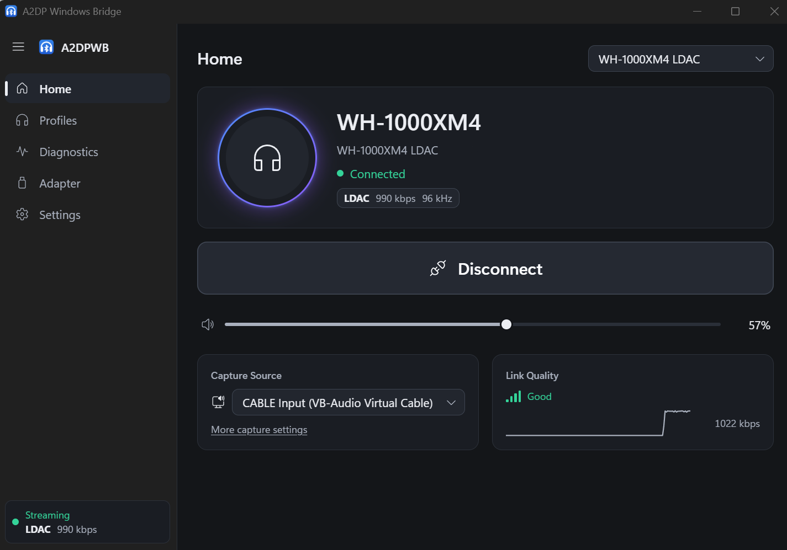
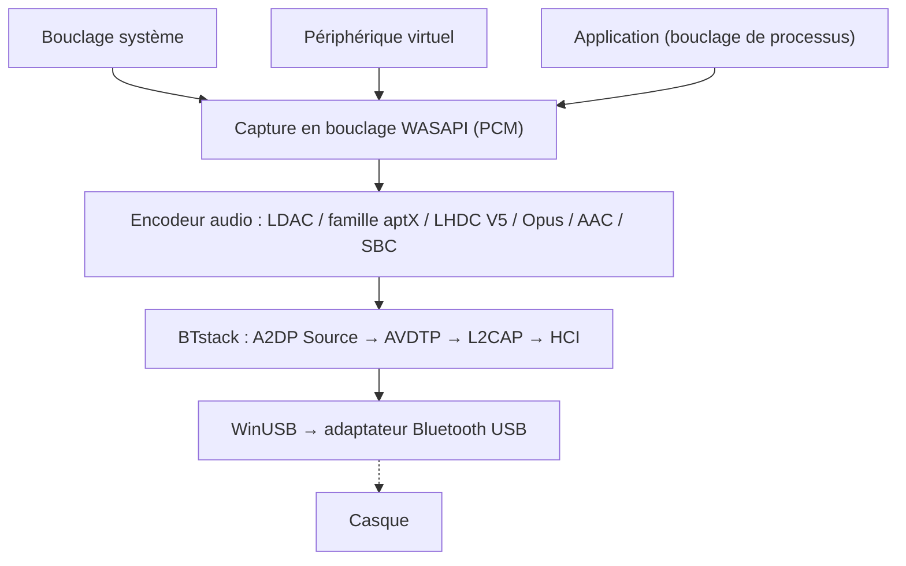

# A2DP Windows Bridge (A2DPWB)

Diffusion audio Bluetooth A2DP pour Windows, avec tous les codecs.
{: .fs-6 .fw-300 }

Diffuse l'audio du système en **LDAC, aptX HD, aptX Low Latency, aptX, AAC, SBC, LHDC V5** et (à titre expérimental) **Opus** ainsi que l'**Opus 05** de PipeWire grâce à un adaptateur Bluetooth USB en mode WinUSB -- sans pilote noyau ni signature de test.

[Commencer](setup){: .btn .btn-primary .fs-5 .mb-4 .mb-md-0 .mr-2 }
[GitHub](https://github.com/SeiyaFunaokaJP/A2DP-Windows-Bridge){: .btn .fs-5 .mb-4 .mb-md-0 }

---

## Codecs pris en charge

| Codec | Débit | Fréquence d'échantillonnage | Profondeur de bits | Latence |
|:------|:--------|:------------|:----------|:--------|
| LDAC | 330/660/990 kbps | 44.1--96 kHz | 16/24/32 bit | ~200 ms |
| aptX HD 🧪 | 576 kbps | 44.1/48 kHz | 24 bit | ~150 ms |
| aptX Low Latency 🧪 | 352 kbps | 44.1/48 kHz | 16 bit | ~32 ms |
| aptX | 352/384 kbps | 44.1/48 kHz | 16 bit | -- |
| AAC | 128/192/256 kbps | 44.1/48 kHz | 16 bit | ~150 ms |
| SBC XQ 🧪 | ~385/505/552 kbps | 44.1/48 kHz | 16 bit | ~150 ms |
| SBC | jusqu'à ~345 kbps | 44.1/48 kHz | 16 bit | ~150 ms |
| FastStream 🧪 | 198/216 kbps | 44.1/48 kHz | 16 bit | -- |
| LHDC V5 | 400/500/900/1000 kbps, ABR 160--400 kbps | 44.1/48/96/192 kHz | 16/24 bit | -- |
| Opus 🧪 | 128/192/256 kbps | 48 kHz | 16 bit | -- |
| Opus 05 🧪 | 128/192/256 kbps | 48 kHz | 16 bit | -- |

### Codecs pris en charge selon la plateforme (envoi vers le casque)

| Codec | Windows 10 natif | Windows 11 natif | Ubuntu natif (PipeWire) | **A2DPWB** (Windows 10 / 11) |
|:------|:-------------------:|:-------------------:|:--------------------------:|:----------------------------:|
| LDAC | ❌ | ❌ | ✅ | ✅ |
| aptX HD | ❌ | ❌ | ✅ | 🧪 expérimental |
| aptX Low Latency | ❌ | ❌ | ✅ | 🧪 expérimental |
| aptX | ✅ | ✅ | ✅ | ✅ |
| AAC | ❌ | ✅ | ❌ absent des paquets Ubuntu | ✅ |
| SBC XQ | ❌ | ❌ | ✅ | 🧪 expérimental (récepteurs dont le SBC autorise le double canal et un bitpool ≥ 43) |
| SBC | ✅ | ✅ | ✅ | ✅ |
| FastStream | ❌ | ❌ | ✅ | 🧪 expérimental (musique uniquement, choisi explicitement) |
| LHDC V5 | ❌ | ❌ | ❌ | ✅ |
| Opus (Opus A2DP d'Android) | ❌ | ❌ | ✅ PipeWire 1.2+ (`opus_g`) ; absent d'Ubuntu 24.04 (PipeWire 1.0.5) | 🧪 expérimental |
| Opus 05 (Opus propre à PipeWire) | ❌ | ❌ | ✅ PipeWire 0.3.57+ (`opus_05`, uniquement vers des appareils PipeWire) | 🧪 expérimental (choisi explicitement) |
| aptX Adaptive | ❌ | ❌ | ❌ | ❌ |

✅ pris en charge · 🧪 expérimental · ❌ non pris en charge. Toutes les colonnes concernent le côté émetteur (PC → casque). « Natif » désigne l'audio Bluetooth propre au système, sans A2DPWB ; la colonne Ubuntu correspond aux codecs PipeWire d'Ubuntu 26.04 (`libspa-0.2-bluetooth`).

{: .warning }
**aptX HD et aptX Low Latency sont expérimentaux.** Ils suivent les implémentations d'Android / PipeWire et réussissent les tests d'aller-retour encodage/décodage, mais n'ont pas encore été vérifiés avec un vrai casque. Les latences de ce tableau sont des valeurs typiques, non mesurées avec A2DPWB.

{: .warning }
**À propos de LHDC V5.** Il utilise un portage en C de l'encodeur LHDC V5 que Google a ajouté à Android 17 (AOSP, Apache-2.0) ; ce portage a été vérifié bit à bit par rapport à l'encodeur Rust d'AOSP, et la signalisation A2DP suit `a2dp_vendor_lhdcv5` d'Android. Un utilisateur l'a vérifié avec un vrai casque LHDC V5 à 1000 kbps / 192 kHz sur la v1.1.1-beta.1 ([#50](https://github.com/SeiyaFunaokaJP/A2DP-Windows-Bridge/issues/50)) ; la v2 utilise le même encodeur. Seul le LHDC V5 avec perte est pris en charge : LHDC V2/V3 (casques plus anciens) et le mode sans perte « LHDC-RAW » n'ont pas d'encodeur open source. En mode Auto, LHDC V5 passe après LDAC et la famille aptX, et avant AAC / SBC.

{: .warning }
**Opus est expérimental.** Il s'agit du codec propriétaire Opus A2DP d'Android (Android 13+, identifiant fabricant 0x000000E0 Google) : 48 kHz, trames de 20 ms, 256 kbps en stéréo comme le demande Android (Standard 192, Mobile 128 kbps), encodé avec libopus 1.5.2. Il réussit le test de bout en bout face à un récepteur virtuel, mais n'a pas encore été vérifié avec un vrai casque Opus. En mode Auto, il passe après LHDC V5 et avant AAC / SBC.

{: .warning }
**Opus 05 est expérimental et non vérifié sur du matériel réel.** C'est le codec propriétaire Opus A2DP propre à PipeWire (identifiant fabricant 0x000005F1, codec 0x1005 ; `opus_05` de PipeWire), que seul PipeWire implémente : le récepteur doit donc être un PC où PipeWire fait office de récepteur A2DP. A2DPWB n'envoie que le sens musique en stéréo (pas de 5.1 / 7.1, pas de voie de retour) : 48 kHz, trames de 10 ms (20 ms si le récepteur ne gère que celles-ci), le même encodeur libopus et les mêmes débits qu'Opus, plafonnés à la limite du récepteur. Auto ne le choisit jamais ; choisissez-le dans le profil ou avec `-c opus05`. Il réussit le test de bout en bout face à un récepteur virtuel qui offre les capacités de PipeWire, mais n'a pas été essayé avec un vrai récepteur PipeWire. PipeWire en récepteur A2DP décode Opus 05 depuis la 0.3.57 et l'Opus d'Android (`opus_g`) depuis la 1.2.0 : Ubuntu 24.04 LTS fournit PipeWire 1.0.5 (Opus 05 seulement), Ubuntu 25.10 (1.4.7) et 26.04 LTS (1.6.2) fournissent les deux ; ni l'un ni l'autre n'est encore vérifié avec A2DPWB.

{: .warning }
**SBC XQ est expérimental.** Le 18/10/2026, un Sony WH-1000XM4 l'a accepté (double canal, bitpool 43 à 48 kHz, 552 kbps) et A2DPWB a diffusé vers lui sans paquet perdu, mais le son n'a pas été jugé à l'oreille et aucun autre casque n'a été essayé. Les récepteurs qui refusent la configuration sont reconnectés en SBC ordinaire. **FastStream est expérimental :** il réussit le test de bout en bout face à un récepteur virtuel, mais n'a pas été essayé avec de vrais casques FastStream. Sens musique uniquement ; Auto ne le choisit jamais.

{: .note }
**Seul l'aptX classique vous intéresse ?** Windows 10 prend déjà en charge l'aptX classique dans sa pile Bluetooth intégrée (pas aptX HD, aptX LL ni aptX Adaptive) : A2DPWB n'est donc pas nécessaire pour cela. A2DPWB sert surtout pour LDAC, aptX HD et aptX Low Latency.

{: .note }
**aptX Adaptive n'est pas pris en charge** (il n'existe pas d'encodeur open source). Si votre casque propose aussi l'aptX classique, A2DPWB utilise directement l'aptX ; sinon, Auto choisit AAC ou SBC. Voir [Famille aptX et compatibilité aptX Adaptive](usage#aptx-compatibility).

## Plateformes prises en charge {#platform-support}

| Composant | Windows 10 (x64 / ARM64) | Windows 11 (x64 / ARM64) | Linux (Ubuntu) |
|:----------|:----------------:|:----------------:|:--------------:|
| **A2DPWB** (fenêtre, zone de notification, CLI) | ✅ (pas encore essayé sur du vrai matériel) | ✅ | ❌ |
| [Compilation depuis les sources](building) (Rust, Visual Studio 2022+, Node.js) | ✅ | ✅ | ❌ |
| `a2dpwb_decode` (vérificateur de flux) | ✅ | ✅ | ❌ |
| Test de bout en bout `tools/emu/run_test.py` | ✅ | ✅ | ❌ |
| Adaptateur virtuel `tools/emu/emu_vhci.py` | ❌ | ❌ | ✅ |
| [Récepteur de mesure](usage#receiver) `tools/linux_sink` | ❌ | ❌ | ✅ |

A2DPWB lui-même ne fonctionne que sous Windows (Windows 10 22H2 ou Windows 11), en versions x64 et ARM64. Les outils Linux nécessitent Python 3.11 ou ultérieur (vérifié sur Ubuntu 26.04) ; `setup.sh` cible Ubuntu / Debian, les autres distributions nécessitent d'installer les paquets à la main.

## Matériel vérifié {#verified-hardware}

| Quoi | Configuration | Codecs | Résultat |
|:-----|:------|:-------|:-------|
| Sony WH-1000XM4 (casque) | Windows 11 + TP-Link UB500 | LDAC, AAC, SBC ; SBC XQ diffuse (non jugé à l'oreille) | ✅ Lecture OK (le XM4 n'a pas d'aptX) |
| TP-Link UB500 (Realtek RTL8761BU, adaptateur) | Windows 11, WinUSB, linux-firmware `rtl8761bu` | – | ✅ |
| Récepteur de mesure `tools/linux_sink` | Windows 11 + UB500 → Ubuntu 26.04 par radio | SBC, AAC, aptX, aptX HD, aptX LL, LDAC | ✅ Reçu et mesuré |
| Liaison virtuelle `tools/emu` (Bumble) | Windows 11, sans radio | SBC, SBC XQ, AAC, aptX, aptX HD, aptX LL, LDAC, LHDC V5, FastStream, Opus, Opus 05 | ✅ Le test de bout en bout réussit |

Windows 10 n'a pas encore été essayé sur du vrai matériel. Autres adaptateurs : voir [Adaptateurs recommandés](setup#adapters).

## Modes de capture audio

A2DPWB capture l'audio via WASAPI et propose trois modes :

| Mode | Description | Utilisation |
|:-----|:------------|:---------|
| **Bouclage système** | Capture toute la sortie audio du système depuis le périphérique de lecture par défaut, via le bouclage WASAPI | Configuration simple -- tous les sons sont diffusés |
| **Périphérique virtuel** | Capture depuis un périphérique audio virtuel choisi (p. ex. VB-CABLE, VoiceMeeter) | Envoyer certaines applications vers le Bluetooth en gardant le reste de l'audio sur les haut-parleurs |
| **Application** | Capture uniquement ce que lit une application, après son propre traitement (Windows 11 / Windows 10 2004+) | Envoyer une seule application, ou la sortie d'une application d'effets à l'échelle du système (égaliseur, amélioration du son) |

En mode **Périphérique virtuel**, A2DPWB peut faire du périphérique virtuel choisi le périphérique de lecture par défaut de Windows (**Changer auto. le périphérique par défaut**), puis capture sa sortie en bouclage. Les applications qui envoient leur son vers ce périphérique virtuel sont diffusées en Bluetooth. À l'arrêt de la diffusion, le périphérique par défaut précédent est rétabli.

Le bouclage système ne retire pas l'audio du périphérique de lecture par défaut : le son y est joué en plus d'être envoyé en Bluetooth. Voir [Modes de capture](usage#capture-modes).

## Fonctionnement

A2DPWB contourne entièrement la pile Bluetooth de Windows. Il communique directement avec un adaptateur Bluetooth USB via WinUSB et utilise [BTstack](https://github.com/bluekitchen/btstack) pour implémenter toute la pile de protocoles Bluetooth en mode utilisateur. Un petit programme résident (`a2dpwb-core.exe`, avec l'icône de la zone de notification) diffuse l'audio ; la fenêtre ne fait qu'afficher son état, si bien que la fermer n'interrompt pas l'audio (voir [Architecture](architecture)).

## Fonctionnalités

- **Multi-codec** : LDAC, aptX HD, aptX Low Latency, aptX, AAC, SBC, LHDC V5 et (à titre expérimental) Opus / Opus 05, avec négociation automatique
- **LE Audio (expérimental)** : LC3 vers des casques et écouteurs LE Audio (BAP unicast, les deux écouteurs d'une paire, volume du casque, boutons multimédia, faible latence GMAP). Nécessite un adaptateur avec canaux isochrones Bluetooth 5.2 ; testé uniquement avec l'émulateur Bluetooth, pas encore avec de vrais casques LE Audio ([Utilisation](usage#le-audio))
- **Trois modes de capture** : bouclage système, routage via un périphérique audio virtuel, ou sortie d'une seule application
- **Fenêtre, zone de notification et CLI** : une fenêtre pour la configuration et le diagnostic, un volet et un menu dans la zone de notification pour se connecter au quotidien, et une ligne de commande (voir [Utilisation](usage))
- **WinUSB depuis l'application** : attribue le pilote WinUSB à l'adaptateur et restaure le pilote d'origine, sans Zadig (voir [Installation](setup#winusb))
- **Configuration au premier lancement** : adaptateur, pilote et firmware, casque, une première connexion
- **ABR** : débit adaptatif pour les connexions instables (LDAC et LHDC V5)
- **Reconnexion automatique** : se reconnecte en cas de déconnexion (jusqu'à 10 tentatives), ainsi qu'à la sortie de veille du PC
- **Qualité de liaison et AFH** : affiche ce qui est envoyé, le RSSI et les canaux utilisés ; indique à l'adaptateur les canaux Wi-Fi à éviter (voir [Utilisation](usage#link-quality))
- **Commandes du casque (AVRCP)** : curseur de volume synchronisé avec le casque et le volume de Windows ; les boutons lecture/pause, suivant et précédent du casque contrôlent la lecture sur le PC (voir [Utilisation](usage#headphone-buttons))
- **Gestion des profils** : configurations appareil + codec + capture, connectables depuis la zone de notification
- **Mises à jour** : la version installée se met à jour toute seule une fois la diffusion arrêtée (voir [Utilisation](usage#updates))
- **Localisation** : anglais, japonais, chinois simplifié / traditionnel, coréen, allemand, français et espagnol
- **Firmware Realtek** : téléchargement guidé du firmware pour les adaptateurs Realtek
- **Diagnostic** : déroulement de la connexion, journal, capture HCI, informations de diagnostic pour les rapports de bug, test avec récepteur pair sur un PC Linux (voir [Utilisation](usage#receiver))
