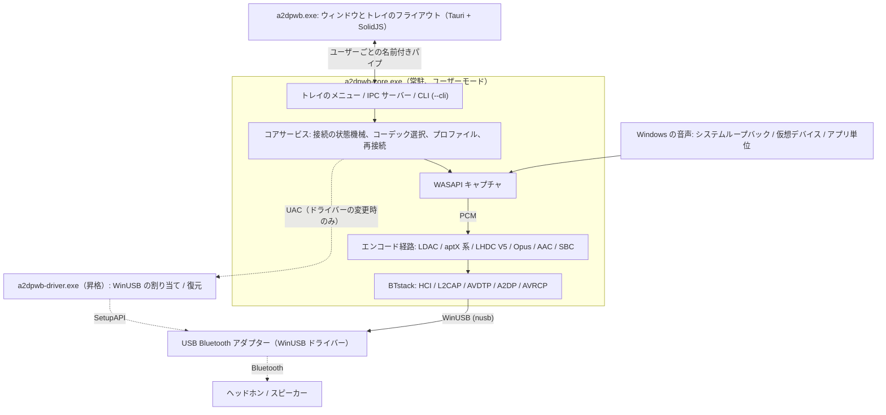
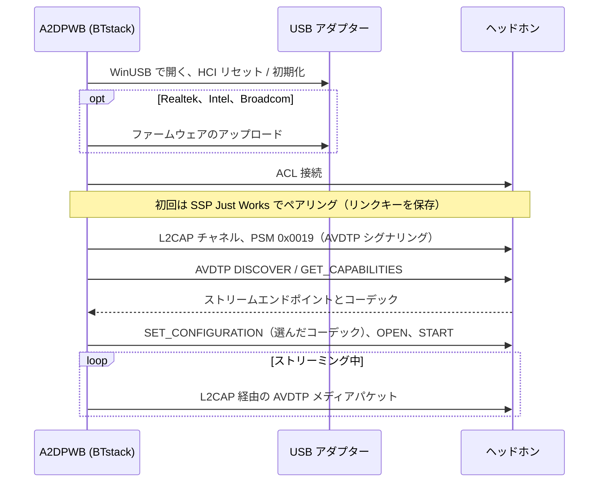
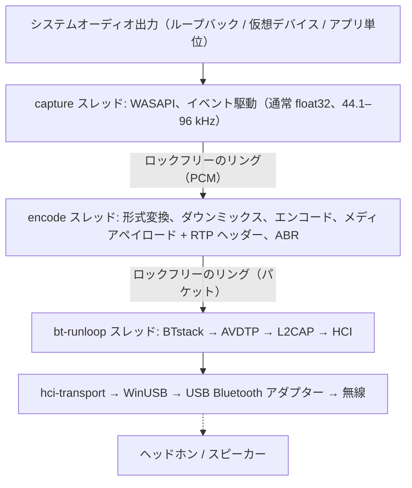
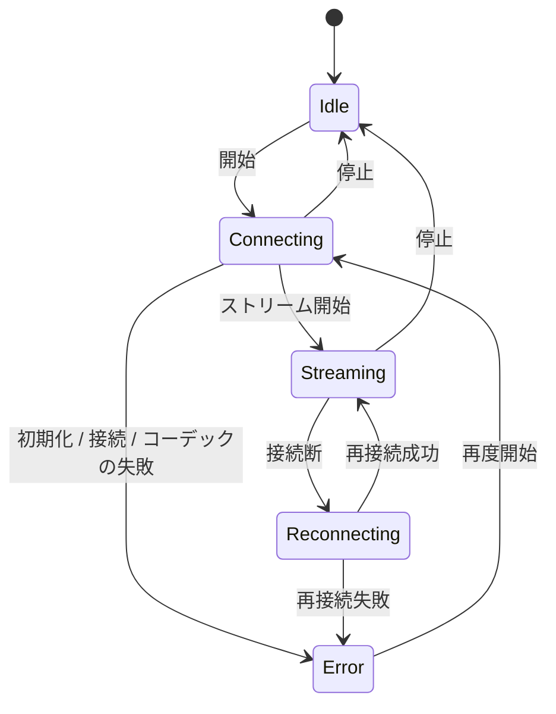

# アーキテクチャ
{: .no_toc }

## 目次
{: .no_toc .text-delta }

1. TOC
{:toc}

---

## 概要

A2DP Windows Bridge (A2DPWB) は Windows で LDAC、aptX HD、aptX Low Latency、aptX、AAC、SBC の Bluetooth オーディオを実現します。Windows 標準の Bluetooth スタックが A2DP で対応するのは SBC、クラシック aptX、AAC（Windows 11 のみ）だけですが、このツールはカーネルドライバーなしで LDAC、aptX HD、aptX Low Latency を追加します。

**BTstack + WinUSB** を使用 -- 完全にユーザーモードで動作し、ドライバー署名は不要です。

A2DPWB 2.0 は Rust で書かれています。置き換えの効かない C ライブラリ（BTstack と各コーデックのエンコーダー）はソースからビルドし、小さな FFI クレートを通して呼びます。それ以外は SBC エンコーダーも含めてすべて Rust です。

## プロセス

A2DPWB は最大 3 つのプログラムで動きます。

| プログラム | 動いている間 | 役割 |
|:-----------|:-------------|:-----|
| `a2dpwb-core.exe` | A2DPWB の実行中（ウィンドウ、スタートメニュー、**Windows 起動時に開始** から起動） | Bluetooth、音声の取り込みとエンコード、プロファイルと設定、トレイのアイコンとメニュー、IPC サーバー。`--cli` を付けると同じコアをコンソールで動かします |
| `a2dpwb.exe` | ウィンドウを開いている間だけ（最後のウィンドウを閉じてから 3 分で終了） | メインウィンドウとトレイのフライアウト（Tauri 2、SolidJS + TypeScript）。自分では状態を持ちません |
| `a2dpwb-driver.exe` | ドライバーを 1 回変更する間だけ、管理者権限（UAC）で | アダプターへの WinUSB の割り当て、または元のドライバーへの復元をして終了します |

- **コアは Windows サービスではありません。** サインインしたユーザーの普通のプロセスとして動きます。WASAPI ループバックで取り込むのは、そのユーザーのセッションの音だからです。セッションごとの mutex で 1 つだけに保ち、もう一度起動するとウィンドウが開きます。
- **トレイはコア側にあります。** 右クリックのメニュー（開く、最初の 10 件のプロファイル、切断、終了）は、ウィンドウを起動せずにすぐ開きます。左クリックでウィンドウのフライアウトを起動します。
- **ウィンドウは表示だけを担当します。** コアの状態のスナップショットを受け取り、その後は変化だけを受け取ります。ウィンドウを閉じても、ウィンドウが落ちても音は止まりません。ウィンドウを閉じると隠れるだけなので、トレイからすぐに開き直せます。
- **コマンドラインも同じコアを使います。** `a2dpwb-core.exe --cli` はトレイと IPC なしでコアサービスを動かします。エミュレータテストもこの経路です。

## トランスポート: BTstack + WinUSB

Windows の Bluetooth スタックを完全にバイパスし、WinUSB（Microsoft 署名済み汎用 USB ドライバー）経由で USB Bluetooth アダプターと直接通信します。ソース公開の Bluetooth スタック（非商用ライセンス）である BTstack が HCI、L2CAP、AVDTP、A2DP をユーザーモードで実装します。

**利点**:
- ドライバー署名コスト不要
- テスト署名モード不要
- Secure Boot の無効化不要
- すべてのコードがユーザーモードで動作（デバッグが容易）

**トレードオフ**:
- 専用の USB Bluetooth アダプターが必要（Windows 内蔵 Bluetooth とは別）
- WinUSB モードのアダプターは Windows の通常の Bluetooth として使用不可
- デバイスアドレスは手動入力、または USB アダプターでの検索（GAP inquiry）で指定

**動作の流れ**:
1. USB Bluetooth アダプターに WinUSB を割り当てる（アプリの **アダプタ > WinUSB を割り当てる**、[ドライバーの割り当て](#driver-assignment)を参照。Zadig でも可）
2. `hci-transport` クレートが `nusb` で WinUSB 経由でアダプターを開き、BTstack の HCI トランスポートとしてつなぐ
3. BTstack が HCI コマンドで Bluetooth コントローラーを初期化
4. (Realtek、Intel、Broadcom アダプター) 必要に応じてファームウェアをアップロード
5. BTstack が ACL 接続を確立し、L2CAP チャネル (PSM 0x0019) を開く
6. AVDTP シグナリングでリモート SEP を検出し、コーデックをネゴシエーション
7. エンコード済み音声が L2CAP 経由の AVDTP メディアパケットとして送信

USB トランスポートには、v1 で実機のアダプターのために入れた復旧処理がそのまま入っています。アダプターを開くときにイベントと ACL のパイプをリセットし、失敗したイベントの読み取りはやり直し、HCI コマンドにはタイムアウトを設け、閉じるときは HCI Reset を送って、次のセッションがアイドル状態のコントローラーから始められるようにします。

## クレート構成

ひとつの Cargo workspace（リポジトリ直下の `Cargo.toml`）を 5 つの層に分けています。各層は下の層にだけ依存します。ライブラリは `app/src/crates/`、プログラムは `app/src/core`、`app/src/ui`、`app/src/driver` にあります。`unsafe` を書けるのは `*-sys` クレートと `win-sys` だけで、それ以外のクレートには `#![forbid(unsafe_code)]` が付いています。

| 層 | クレート | 役割 |
|:---|:---------|:-----|
| 1. FFI | `btstack-sys` | BTstack を `cc`（MSVC）でビルドし、手書きの FFI 宣言と安全なラッパー、`btstack_config.h` を持つ。BTstack を呼べるのはランループのスレッドだけで、`!Send` の `Stack` トークンでこれを強制する |
| 1. FFI | `ldac-sys`、`openaptx-sys`、`fdkaac-sys`、`lhdcv5-sys`、`opus-sys` | C のエンコーダーをビルドして提供する。ライブラリごとに 1 クレートにして、ライセンスを分けて管理する |
| 1. FFI | `win-sys` | Rust のライブラリがない Win32 API: MMCSS、既定のオーディオデバイス（IPolicyConfig）、WLAN API（AFH）、電源通知、Run キー、メディアキー、パイプの DACL、昇格、WinUSB ドライバーの割り当て（SetupAPI） |
| 2. 部品 | `hci-transport` | `nusb` による HCI over USB（"H2"）と、仮想コントローラー（`tools/emu`）への H4 over TCP |
| 2. 部品 | `codec` | `Encoder` トレイト、SBC エンコーダー（Bluedroid 版の Rust 移植）、C エンコーダーの安全なラッパー、Codec Information の解析とコーデックの選択 |
| 2. 部品 | `audio-capture` | `wasapi` クレートによる WASAPI キャプチャ: システムループバック、仮想デバイス、アプリ単位（プロセスループバック）。デバイスとアプリの一覧、テストトーン |
| 3. エンジン | `bt-host` | BTstack を専用スレッドで動かし、コマンドと型付きイベントで操作する: GAP、A2DP Source、AVRCP、SDP、リンクキー、AFH、ファームウェアの読み込み、HCI キャプチャ（`.pklg`） |
| 3. エンジン | `pipeline` | PCM のリング、形式変換、ダウンミックス、エンコード、メディアペイロード、送信ペース、ABR |
| 4. コア | `a2dpwb-core`（ディレクトリ `core`） | 状態機械、再接続、スリープと復帰、プロファイル、設定と v1 からの移行、音量の連動、更新チェック、受信機テストのクライアント、統計 |
| 4. コア | `ipc` | コアとウィンドウで共有するプロトコルの型（serde。TypeScript の型は `ts-rs` で生成）とパイプのフレーム |
| 5. プログラム | `a2dpwb-core-exe`（`app/src/core`） | `a2dpwb-core.exe`: コア、トレイ（`tao` のイベントループ上の `tray-icon`）、IPC サーバー、`--cli` |
| 5. プログラム | `a2dpwb-ui`（`app/src/ui`） | `a2dpwb.exe`: Tauri 2。Rust 側は IPC クライアントだけで、画面は SolidJS + TypeScript + Vite |
| 5. プログラム | `a2dpwb-driver`（`app/src/driver`） | `a2dpwb-driver.exe`: 昇格ヘルパー |

## 音声の経路とスレッド

| スレッド | 優先度 | 仕事 |
|:---------|:-------|:-----|
| capture | MMCSS "Audio" | WASAPI を読む。無音の区間は無音で埋める |
| encode | MMCSS "Pro Audio" | エンコーダーの入力形式に変換し、エンコーダーのブロック単位でエンコードし（残りは次の回へ）、フレームをメディアペイロードに詰める。約 10 ms ずつ処理して、パケットを均等に送り出す |
| bt-runloop | -- | BTstack のランループ。L2CAP が送れる状態になるたびに、キューのパケットを送る |
| USB | -- | WinUSB の転送: 各 IN パイプ（イベント、ACL データ）で 3 本の読み取りを並行して待ち、コマンドと ACL データは書き込み側が送る |
| core | 通常 | 状態機械、IPC（tokio）、設定、統計（4 Hz）、更新チェック |

配信が始まった後の音声の経路では、メモリの確保もロックもしません。統計はアトミックなカウンターで、コアが 1 秒に 4 回読みます。BTstack はスレッド安全ではないので、ほかのスレッドはコマンドを送り、それを bt-runloop スレッドが実行します。

## コアと IPC

ウィンドウとコアは、ユーザーごとの名前付きパイプ `\\.\pipe\a2dpwb-<ユーザー SID>` で通信します。パイプの DACL はそのユーザーだけに絞っています。メッセージは長さ付きの JSON フレームです。

1. ウィンドウが `hello { protocol, client }` を送ります。プロトコルのバージョンが違うコアは拒否し、ウィンドウは 2 つのプログラムのバージョンが違うと表示します。
2. コアが `snapshot`（状態全体: アダプター、デバイス、配信、プロファイル、設定、更新）とリビジョン番号を返します。
3. 以降、コアは変化を `event` で送ります。リビジョンが飛んだら、ウィンドウはスナップショットを取り直します。
4. 操作は `request { id, method, params }` で送り、`response { id, result | error }` で結果を受け取ります。メソッドの群は `stream.*`、`device.*`、`profile.*`、`settings.*`、`adapter.*`、`audio.*`、`diag.*`、`app.*` です。

エラーは文言ではなく、コードとパラメータ（例: `adapter.driver_missing`）で返します。翻訳はウィンドウ側で行い、メッセージの横に直し方のボタンを出します。通信品質やログのような高頻度のデータは、画面が購読している間だけ送ります。

接続の状態機械:

失敗した接続は最大 3 回まで試し、切れた接続は最大 10 回まで再接続します。PC がスリープに入るときは、切れたリンクを失敗として数えずに BTstack を止め、復帰した後に再接続します。

## ドライバーの割り当て {#driver-assignment}

Windows 8 以降には、Microsoft 署名済みの WinUSB ドライバー（`winusb.inf`）が標準で入っています。`a2dpwb-driver.exe` は、デバイスマネージャーの「ドライバーの更新 > 一覧から選択 > WinUsb デバイス」と同じことを SetupAPI で行います。

1. デバイスインスタンス ID でアダプターを開きます。
2. `Device Parameters` に `DeviceInterfaceGUIDs` を書き込み、WinUSB がデバイスインターフェースを登録するようにします。
3. `%SystemRoot%\INF\winusb.inf` の "WinUsb Device" を選び、`DiInstallDevice` で割り当てます。標準の署名済みドライバーなので、証明書はインストールしません（Zadig / libwdi は生成した INF を自作の証明書で署名します）。
4. **復元**: デバイスを削除（`DiUninstallDevice`）して再列挙すると、Windows が一番順位の高いドライバー（通常は `BthUSB` かメーカーのドライバー）を選び直します。割り当て前のドライバーは設定フォルダー（`driver\`）に記録しておき、復元後に一致しているかを確かめます。`restore --records <フォルダー>` は、記録のあるアダプターをまとめて 1 回の昇格で戻します。アンインストーラーは確認のうえでこれを使います。

コアは管理者として動きません。割り当てと復元のときだけ、UAC の確認付きでヘルパーを起動し（`ShellExecuteEx` の "runas"）、その JSON の結果を読みます。アダプターとドライバーの一覧には昇格は不要です。

## 主要モジュール

### コーデックの選択（`codec::caps`）

- リモートの能力を解析: 標準の SBC と AAC の要素、ベンダーコーデック（aptX LL は両方の Vendor ID、aptX Adaptive は検出してログに記録するだけ）
- コーデックを選択: Auto はリモートが提示する一番良いコーデックを選ぶ。リモートが提示しないコーデックを指定した場合、プロファイルで **このコーデックが使えないときは別のコーデックで接続** がオンなら Auto の選択に置き換え、オフならエラー
- aptX 系のサンプルレートを選択（リモートが通知するレートから 44.1 / 48 kHz を選び、キャプチャのリサンプリングは WASAPI に任せる）

### Bluetooth ホスト（`bt-host`）

**責務**:
- USB（または TCP）の HCI トランスポートで BTstack を専用スレッドで動かす
- ストリームエンドポイントの登録: ベンダーコーデック（LDAC、aptX HD、aptX、aptX LL、LHDC V5、FastStream、Opus）と SBC（SBC XQ も使う）、AAC
- SDP レコードの登録（A2DP Source、AVRCP Controller、AVRCP Target）
- SSP ペアリングの管理（Just Works、General Bonding、リンクキーを永続化）
- 接続タイムアウト後は半開きの接続を切断し、再試行できるようにする
- 失敗した接続を再試行し（最大 3 回）、原因（応答なし、無通信のリンク、相手からの切断、認証）を区別する。デバイスが忘れたリンクキーは削除して再ペアリングする
- デバイス検索用の GAP inquiry
- AVRCP の絶対音量とヘッドホンのボタン
- AFH ホストチャネル分類と、通信品質の表示用の RSSI / AFH の読み取り
- Realtek、Intel、Broadcom チップセットのファームウェア読み込み
- HCI キャプチャ（`.pklg`）。接続中に始めた場合も接続時のパケットを含める

**使用している主な BTstack API**:
- `a2dp_source_create_stream_endpoint()` -- コーデックエンドポイントの登録
- `a2dp_source_establish_stream()` -- A2DP シンクへの接続
- `a2dp_source_set_config_other()` -- ベンダー固有コーデックの設定
- `a2dp_source_stream_send_media_payload_rtp()` -- RTP ヘッダー付きでエンコード済み音声を送信（LDAC、aptX HD、AAC、SBC、SBC XQ、LHDC V5、Opus）
- `a2dp_source_stream_send_media_packet()` -- RTP ヘッダーなしの生メディアパケットを送信（aptX、aptX LL、FastStream）

### 音声の取り込み（`audio-capture`）

Windows Audio Session API でオーディオをリアルタイムに取り込みます。
- 既定の出力デバイスのシステムループバック、選んだ（仮想）デバイスのループバック、またはアプリとその子プロセスのプロセスループバック（Windows 10 build 19041 以降）
- デバイスの共有モードのミックスフォーマット（通常 float32）で渡し、エンコーダー向けの変換は pipeline が行う
- アプリ単位のモードでは、アプリの起動を待ち、アプリを再起動しても取り込み直す

### オーディオエンコーダー

| エンコーダー | ライブラリ | ビットレート | 機能 |
|:-------------|:-----------|:-------------|:-----|
| LDAC | libldac (AOSP) | 330/660/990 kbps | HQ/SQ/MQ モード、ABR |
| aptX HD | libopenaptx | 576 kbps | 24-bit 入力、固定レート、RTP ヘッダーあり |
| aptX LL | libopenaptx | 352 kbps | 約 32 ms レイテンシー、RTP ヘッダーなし、パケットは約 7.5 ms 以下 |
| aptX | libopenaptx | 352/384 kbps (44.1/48 kHz) | 16-bit ステレオ、RTP ヘッダーなし |
| AAC | fdk-aac | 最大 256 kbps | AAC-LC、LATM トランスポート |
| SBC | Bluedroid エンコーダーの Rust 移植 | 最大約 345 kbps | A2DP 必須ベースライン。C 版とビット単位で一致（全設定でテスト） |
| SBC XQ | 同じ SBC エンコーダー | 約 385/505/552 kbps | デュアルチャネル、bitpool 47 / 43（44.1 / 48 kHz、High）。シンクの SBC がデュアルチャネルと 43 以上の bitpool を許すときだけ。SBC のストリームエンドポイント、メディアペイロードヘッダー、RTP ヘッダーを共用 |
| FastStream | 同じ SBC エンコーダー | 198/216 kbps (44.1/48 kHz) | CSR のベンダーコーデック、音楽方向のみ（音声の逆方向チャネルなし）: SBC ジョイントステレオ bitpool 29、フレームを 72 バイトに詰め、1 パケット 3 フレーム、メディアペイロードヘッダーも RTP ヘッダーもなし（PipeWire と同じ）。自動では選ばれない |
| LHDC V5 | lhdcv5-enc（AOSP エンコーダーの C 移植版） | 400/500/900/1000 kbps、ABR 160–400 kbps | 16/24 bit、5 ms フレーム、2 バイトのメディアペイロードヘッダー、RTP ヘッダーあり |
| Opus | libopus 1.5.2 | 128/192/256 kbps（ステレオ。モノラルは半分） | 試験的。Android の A2DP Opus: 48 kHz、20 ms フレーム（シンクが 10 ms だけならそれ）、メディアペイロードに収まる上限付きの制約付き VBR、1 パケット 1 フレーム、1 バイトのメディアペイロードヘッダー、RTP ヘッダーあり |

すべてのエンコーダーは `codec::Encoder` トレイトを実装しています。入力の PCM 形式と 1 回に使うフレーム数を示し、コーデックのフレームを返します。

libopenaptx は 4 ステレオサンプル単位のパック済み 24-bit リトルエンディアン PCM を入力として受け取ります。aptX のラッパーが 16-bit または 32-bit のサンプルをこの形式に変換し、モノラル入力は両チャネルに複製します。

## ベンダーコーデック情報要素

非標準コーデックは AVDTP で Vendor Specific として登録:

| コーデック | Vendor ID | Codec ID |
|:-----------|:----------|:---------|
| LDAC | Sony (0x0000012D) | 0x00AA |
| aptX | APT (0x0000004F) | 0x0001 |
| aptX HD | Qualcomm (0x000000D7) | 0x0024 |
| aptX Low Latency | CSR (0x0000000A) または Qualcomm (0x000000D7) | 0x0002 |
| aptX Adaptive | Qualcomm (0x000000D7) | 0x00AD（検出のみ、選択されない） |
| LHDC V5 | Savitech (0x0000053A) | 0x4C35 |
| FastStream | CSR (0x0000000A) | 0x0001 |
| Opus | Google (0x000000E0) | 0x0001 |
| Opus 05 | The Linux Foundation（0x000005F1、PipeWire） | 0x1005 |

AAC と SBC は A2DP 仕様で定義された標準コーデック ID を使用します。

コーデック情報要素のサイズ（6 バイトの Vendor ID / Codec ID を含む）:

- **aptX**: 7 バイト（バイト 6 = サンプルレート / チャネルモード）
- **aptX HD**: 11 バイト（バイト 6 は aptX と同じ、加えて予約 4 バイト）。ステレオ必須
- **aptX LL**: 8 バイト。シンクが拡張（"new caps"）フラグを立てている場合は 17 バイト。A2DPWB は aptX LL エンドポイントを 1 つだけ登録し、シンクが使用した Vendor ID でストリームを設定します
- **LHDC V5**: 11 バイト（Android `a2dp_vendor_lhdcv5_constants.h`）。バイト 6 がサンプルレート（0x20 44.1k、0x10 48k、0x04 96k、0x01 192k）、バイト 7 がビット深度（0x04 16 bit、0x02 24 bit）とシンクの最小/最大ビットレート制限、バイト 8 がコーデックサブバージョン（0x01 = V5 ver.1）と 0x10 = 5 ms フレーム、バイト 9-10 がオプション機能（低遅延、ロスレス、JAS、AR、META。A2DPWB はいずれも提示しません）。ステレオのみ。シンクのビットレート制限は Android と同様に設定へそのまま返し、エンコーダーにも適用します。メディアパケットには 2 バイトのペイロードヘッダー（フレーム数 << 2、遅延ビットは 0、続いてシーケンス番号）が付きます
- **FastStream**: 8 バイト（PipeWire `a2dp_faststream_t`）。バイト 6 が方向（0x01 シンク = 音楽、0x02 ソース = 音声）、バイト 7 の下位 4 ビットがシンク側のサンプルレート（0x2 44.1k、0x1 48k）、上位 4 ビットがソース側のサンプルレート（0x2 16k）。A2DPWB は音楽方向だけを提示し、設定します
- **Opus**: 7 バイト（Android `a2dp_vendor_opus_constants.h`）。バイト 6 のビット 2..0 がチャネルモード（0x01 モノラル、0x02 ステレオ、0x04 デュアルモノラル）、ビット 4..3 がフレーム長（0x08 10 ms、0x10 20 ms）、ビット 7 が 48 kHz。A2DPWB はモノラルとステレオ、10 ms と 20 ms を提示し、20 ms ステレオで設定します（モノラルはモノラル入力で、シンクが対応しているときだけ）。メディアパケットには 1 バイトのペイロードヘッダー（下位 4 ビットがフレーム数 1）に続けて Opus パケットを 1 つ入れます

**RTP ヘッダーの有無**: LDAC・aptX HD・AAC・SBC・SBC XQ・LHDC V5・Opus のメディアパケットには 12 バイトの RTP ヘッダーが付きます。aptX、aptX LL、FastStream は（Android や PipeWire と同様に）RTP ヘッダー**なし**で送信するため、L2CAP MTU 全体を aptX フレームに使えます。

**aptX Adaptive** にはオープンソースのエンコーダーがない（libopenaptx も未実装）ため、A2DPWB は登録も選択もしません。シンクが通知した場合はログに記録するだけで、シンクがクラシック aptX を別途通知していればそちらを使用します。

## 設定とファイル

すべて設定フォルダー `%APPDATA%\A2DPWB`（環境変数 `A2DPWB_CONFIG_DIR` で別のフォルダーも指定可）に、v1 と同じ形式で保存します。

| ファイル | 内容 |
|:---------|:-----|
| `settings.json` | アプリの設定。`schema_version` 付き。知らないキーも消さずに残す |
| `profiles.json` | プロファイル |
| `devices.txt`、`link_keys.txt` | 既知のデバイスとリンクキー。v1 でペアリングしたヘッドホンは再ペアリングなしでつながる |
| `le_audio_devices.txt`、`le_audio_bonds.tlv`、`le_audio_csip.txt` | LE Audio（実験的）: デバイス一覧の LE Audio の項目、LE のボンディング情報（GATT サーバーが保持する CCC の値を含む）、コーディネートセット |
| `*.bin`、`*.hcd`、`ibt-*` | ファームウェアのファイル |
| `hci_<日付>_<時刻>.pklg` | HCI キャプチャ |
| `logs\a2dpwb-core.<日付>.log` | コアのログ。1 日 1 ファイル（UTC）、最新の 7 つを残す |
| `driver\` | WinUSB を割り当てた各アダプターの、元のドライバー |
| `backup-v1\` | v2 の初回起動時に一度だけ作る、v1 の設定のコピー |

## ビルドシステム

- **Cargo** ですべてをビルドします。CMake は使いません。各 `-sys` クレートが `build.rs` で `extern/` の git サブモジュールの C ライブラリを MSVC でコンパイルします
- ウィンドウの画面は **Vite** でビルドし（`app/src/ui` で `pnpm build`）、Tauri が `a2dpwb.exe` に埋め込みます
- IPC プロトコルの TypeScript の型は Rust の型から生成します（`cargo test -p ipc export_bindings`）
- 言語ファイル（`app/lang/*.json`）はウィンドウとコアのトレイメニューが使います
- `installer/build-release.ps1` が NSIS インストーラー（Tauri のバンドラー）、ポータブル zip、更新用のマニフェストを作ります。[ビルド](building)を参照

## 重要な注意事項

- **アダプター互換性**: Realtek（最も検証済み）と CSR の USB アダプター。Intel と Broadcom は試験的。Realtek アダプターは起動時にファームウェアアップロードが必要（Intel もブートローダーモードでは必要）
- **ペアリング**: SSP Just Works（General Bonding）を使用。リンクキーはローカルファイルに永続化
- **セカンドアダプター推奨**: Windows には内蔵 Bluetooth、A2DPWB には専用 USB アダプターを使用
- 一部の Bluetooth アダプターのファームウェアは達成可能なビットレートを制限する場合がある
- USB Bluetooth 5.0 以上のアダプターは LDAC に適している
- 自動コーデック選択の優先順位: LDAC > aptX HD > aptX LL > aptX > LHDC V5 > Opus（試験的） > AAC > SBC XQ > SBC（FastStream と Opus 05 は明示的に選んだときだけ）
