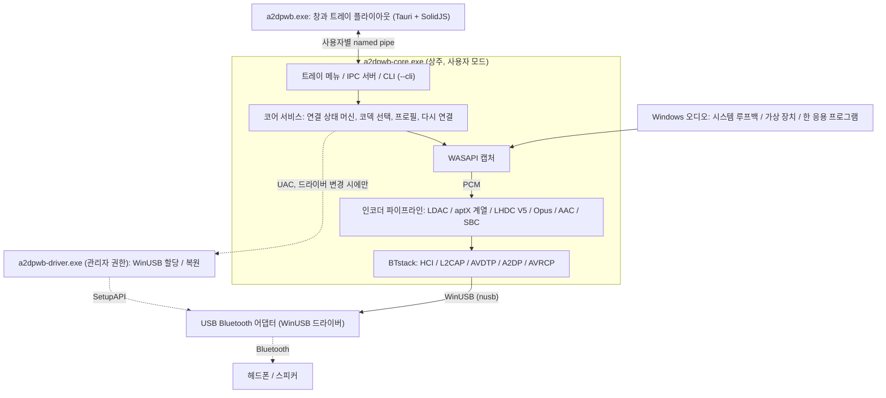
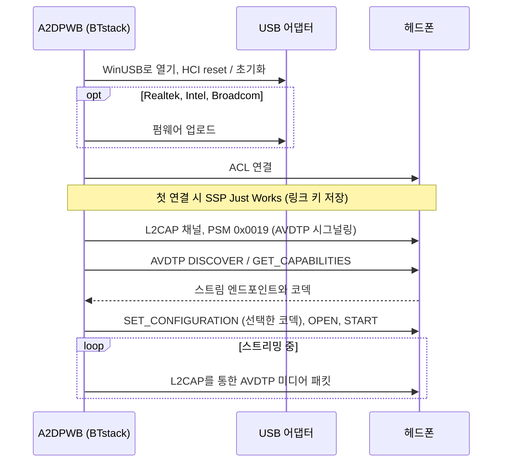
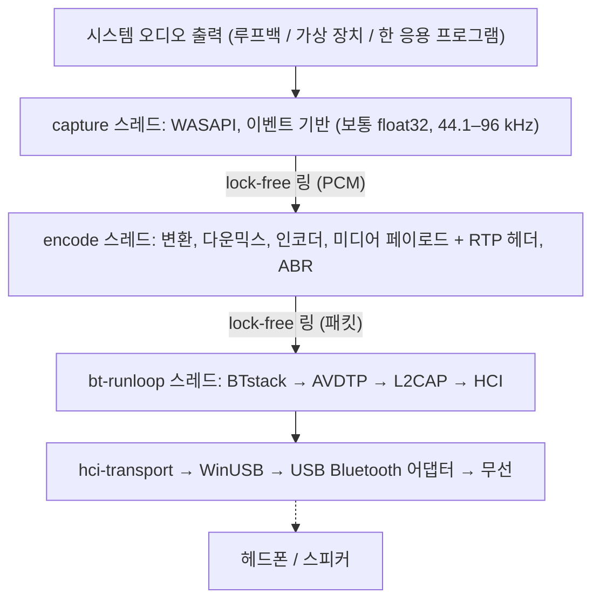
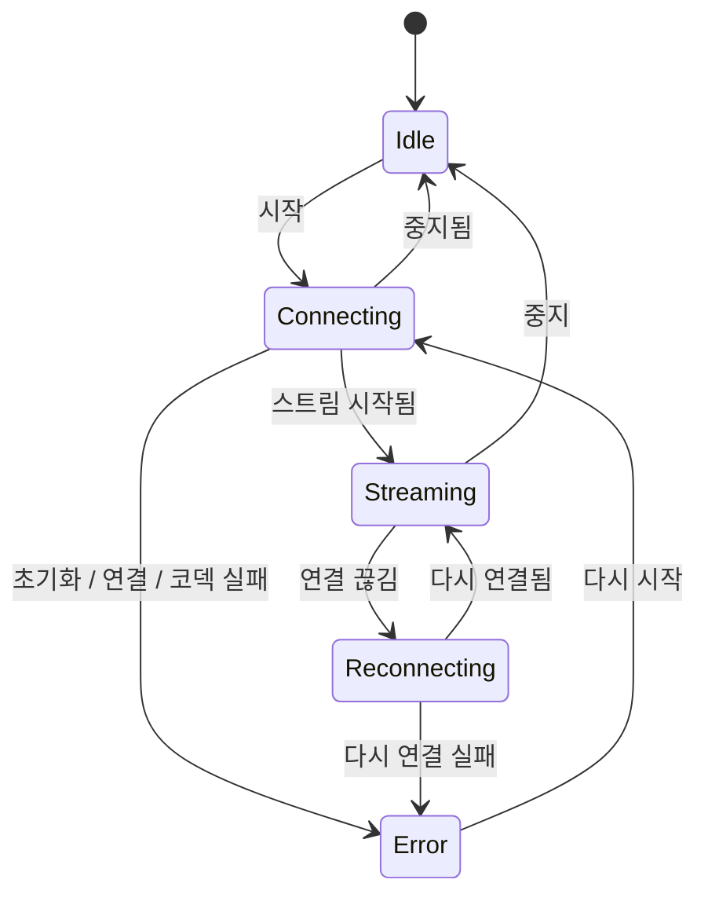

# 아키텍처
{: .no_toc }

## 목차
{: .no_toc .text-delta }

1. TOC
{:toc}

---

## 개요

A2DP Windows Bridge(A2DPWB)는 Windows에서 LDAC, aptX HD, aptX Low Latency, aptX,
AAC, SBC Bluetooth 오디오를 사용할 수 있게 합니다. Windows 자체 Bluetooth 스택은
A2DP에서 SBC, 기본 aptX, (Windows 11만) AAC만 지원합니다. 이 도구는 커널 드라이버 없이
LDAC, aptX HD, aptX Low Latency를 추가합니다.

**BTstack + WinUSB**를 사용하며, 완전히 사용자 모드에서 작동하므로 드라이버 서명이 필요 없습니다.

A2DPWB 2.0은 Rust로 작성되었습니다. 대체할 수 없는 C 라이브러리(BTstack과
코덱 인코더)는 소스에서 컴파일하여 작은 FFI 크레이트를 통해 호출하며, SBC 인코더를
포함한 나머지는 모두 Rust입니다.

## 프로세스

A2DPWB는 최대 세 개의 프로그램으로 실행됩니다.

| 프로그램 | 실행 시점 | 역할 |
|:---------|:----------|:-----|
| `a2dpwb-core.exe` | A2DPWB가 실행 중인 동안 (창, 시작 메뉴 또는 **Windows 시작 시 실행**으로 시작) | Bluetooth, 오디오 캡처와 인코딩, 프로필과 설정, 트레이 아이콘과 그 메뉴, IPC 서버. `--cli`를 지정하면 같은 코어를 콘솔에서 실행 |
| `a2dpwb.exe` | 창이 열려 있는 동안만 (마지막 창을 닫고 3분 후 종료) | 기본 창과 트레이 플라이아웃 (Tauri 2, SolidJS + TypeScript). 자체 상태를 갖지 않음 |
| `a2dpwb-driver.exe` | 드라이버를 한 번 변경할 때, 관리자 권한(UAC)으로 | 어댑터에 WinUSB를 할당하거나 이전 드라이버를 복원한 후 종료 |

- **코어는 Windows 서비스가 아닙니다.** WASAPI 루프백은 로그인한 사용자 세션의
  오디오를 캡처하므로, 코어는 그 사용자의 일반 프로세스로 실행됩니다.
  세션별 뮤텍스로 인스턴스를 하나로 유지하며, 다시 시작하면 창이 열립니다.
- **트레이는 코어에 속합니다.** 오른쪽 클릭 메뉴(열기, 처음 10개의 프로필,
  연결 끊기, 종료)는 창을 시작하지 않고 바로 열립니다. 왼쪽 클릭하면 창의
  플라이아웃이 시작됩니다.
- **창은 표시만 합니다.** 창은 코어 상태의 스냅샷을 받은 다음 변경 사항을
  받습니다. 창을 닫거나 창이 비정상 종료되어도 오디오는 멈추지 않습니다.
  창을 닫으면 숨겨질 뿐이므로, 트레이에서 다시 열면 바로 표시됩니다.
- **명령줄도 같은 코어를 사용합니다.** `a2dpwb-core.exe --cli`는 트레이와 IPC 없이
  코어 서비스를 실행합니다. 에뮬레이터 테스트도 이 방식으로 실행됩니다.

## 전송 계층: BTstack + WinUSB

WinUSB(Microsoft가 서명한 범용 USB 드라이버)를 통해 USB Bluetooth 어댑터와 직접 통신하여
Windows Bluetooth 스택을 완전히 우회합니다. 소스 공개 Bluetooth 스택(비상업적 라이선스)인
BTstack이 HCI, L2CAP, AVDTP, A2DP를 사용자 모드에서 구현합니다.

**장점**:
- 드라이버 서명 비용 없음
- 테스트 서명 모드 불필요
- 보안 부팅 비활성화 불필요
- 모든 코드가 사용자 모드에서 실행됨 (디버깅이 쉬움)

**단점**:
- 전용 USB Bluetooth 어댑터 필요 (Windows 내장 Bluetooth와
  별도)
- WinUSB가 점유하는 동안 어댑터를 일반 Windows Bluetooth로
  사용할 수 없음
- 장치 주소는 직접 입력하거나 USB 어댑터로 검색(GAP inquiry)하여 찾음

**작동 방식**:
1. 앱(**어댑터 > WinUSB 할당**, [드라이버 할당](#driver-assignment) 참조) 또는 Zadig로
   USB Bluetooth 어댑터에 WinUSB를 할당
2. `hci-transport` 크레이트가 `nusb`로 WinUSB를 통해 어댑터를 열고,
   BTstack의 HCI 전송으로 연결
3. BTstack이 HCI 명령을 보내 Bluetooth 컨트롤러를 초기화
4. (Realtek, Intel, Broadcom 어댑터) 필요하면 펌웨어를 업로드
5. BTstack이 ACL 연결을 설정하고 L2CAP 채널(PSM 0x0019)을 엶
6. AVDTP 시그널링으로 원격 SEP를 검색하고 코덱을 협상
7. 인코딩된 오디오를 L2CAP를 통해 AVDTP 미디어 패킷으로 전송

USB 전송 계층은 v1에서 실제 어댑터에 필요했던 복구 절차를 그대로 유지합니다.
어댑터를 열 때 이벤트 파이프와 ACL 파이프를 재설정하고, 실패한 이벤트 읽기를
재시도하며, HCI 명령에는 시간 제한이 있고, 어댑터를 닫을 때 HCI Reset을 보내므로
다음 세션은 유휴 상태의 컨트롤러를 만나게 됩니다.

## 크레이트 구조

Cargo 워크스페이스 하나(저장소 루트의 `Cargo.toml`)가 다섯 계층으로 구성되며,
각 계층은 그 아래 계층에만 의존합니다. 라이브러리는 `app/src/crates/`에,
프로그램은 `app/src/core`, `app/src/ui`, `app/src/driver`에 있습니다.
`unsafe` 코드는 `*-sys` 크레이트와 `win-sys`에만 허용되며, 그 밖의 모든
크레이트에는 `#![forbid(unsafe_code)]`가 지정되어 있습니다.

| 계층 | 크레이트 | 역할 |
|:-----|:---------|:-----|
| 1. FFI | `btstack-sys` | `cc`(MSVC)로 BTstack 빌드, 직접 작성한 FFI 선언과 안전한 래퍼, `btstack_config.h`. BTstack은 자체 run loop 스레드에서만 호출할 수 있으며, `!Send`인 `Stack` 토큰이 이를 강제함 |
| 1. FFI | `ldac-sys`, `openaptx-sys`, `fdkaac-sys`, `lhdcv5-sys`, `opus-sys` | C 인코더를 빌드하여 제공. 라이브러리마다 크레이트 하나씩이므로 각 라이선스가 분리됨 |
| 1. FFI | `win-sys` | Rust 라이브러리가 없는 Win32 API: MMCSS, 기본 오디오 장치(IPolicyConfig), WLAN API(AFH), 전원 알림, Run 키, 미디어 키, 파이프의 DACL, 권한 상승, WinUSB 드라이버 할당(SetupAPI) |
| 2. 부품 | `hci-transport` | `nusb`를 사용한 USB를 통한 HCI("H2"), 가상 컨트롤러(`tools/emu`)로의 TCP를 통한 H4 |
| 2. 부품 | `codec` | `Encoder` 트레이트, SBC 인코더(Bluedroid 인코더의 Rust 포팅), C 인코더의 안전한 래퍼, Codec Information 구문 분석과 코덱 선택 |
| 2. 부품 | `audio-capture` | WASAPI 캡처(`wasapi` 크레이트): 시스템 루프백, 가상 장치, 한 응용 프로그램(프로세스 루프백), 장치 및 앱 목록, 테스트 톤 |
| 3. 엔진 | `bt-host` | BTstack을 자체 스레드에서 실행하며, 명령과 타입이 지정된 이벤트로 구동: GAP, A2DP Source, AVRCP, SDP, 링크 키, AFH, 펌웨어 로딩, HCI 캡처(`.pklg`) |
| 3. 엔진 | `pipeline` | PCM 링 버퍼, 형식 변환, 다운믹스, 인코딩, 미디어 페이로드, 전송 속도 조절, ABR |
| 4. 코어 | `a2dpwb-core` (디렉터리 `core`) | 상태 머신, 다시 연결, 절전 / 복귀, 프로필, 설정과 v1 마이그레이션, 볼륨 동기화, 업데이트 확인, 수신기 테스트 클라이언트, 통계 |
| 4. 코어 | `ipc` | 코어와 창이 공유하는 프로토콜 타입(serde, `ts-rs`로 TypeScript 타입 생성)과 파이프 프레이밍 |
| 5. 프로그램 | `a2dpwb-core-exe` (`app/src/core`) | `a2dpwb-core.exe`: 코어, 트레이(`tao` 이벤트 루프 위의 `tray-icon`), IPC 서버, `--cli` |
| 5. 프로그램 | `a2dpwb-ui` (`app/src/ui`) | `a2dpwb.exe`: Tauri 2. Rust 쪽은 IPC 클라이언트이고, 페이지는 SolidJS + TypeScript + Vite |
| 5. 프로그램 | `a2dpwb-driver` (`app/src/driver`) | `a2dpwb-driver.exe`: 관리자 권한으로 실행되는 도우미 |

## 오디오 경로와 스레드

| 스레드 | 우선순위 | 작업 |
|:-------|:---------|:-----|
| capture | MMCSS "Audio" | WASAPI를 읽음. 소리가 없는 구간은 무음으로 채움 |
| encode | MMCSS "Pro Audio" | 인코더가 받는 형식으로 변환하고, 인코더 블록 단위로 인코딩하며(나머지는 다음 회차까지 대기), 프레임을 미디어 페이로드로 묶음. 패킷이 고르게 나가도록 약 10 ms 단위로 처리 |
| bt-runloop | -- | BTstack의 run loop. L2CAP가 전송할 수 있을 때마다 대기 중인 패킷을 전송 |
| USB | -- | WinUSB 전송: 각 IN 파이프(이벤트, ACL 데이터)에서 동시에 세 개의 읽기를 진행하고, 명령과 ACL 데이터용 쓰기 스레드 하나 |
| core | Normal | 상태 머신, IPC(tokio), 설정, 통계(4 Hz), 업데이트 확인 |

스트림이 시작되면 오디오 경로는 메모리를 할당하지 않고 잠금도 사용하지 않습니다.
통계는 코어가 1초에 네 번 읽는 원자적 카운터입니다.
BTstack은 스레드 안전하지 않으므로, 다른 스레드는 BTstack에 명령을 보내고
그 명령은 bt-runloop 스레드에서 실행됩니다.

## 코어와 IPC

창은 사용자의 named pipe
`\\.\pipe\a2dpwb-<user SID>`를 통해 코어와 통신하며, 이 파이프의 DACL은 해당 사용자만 허용합니다.
메시지는 길이가 앞에 붙은 JSON 프레임입니다.

1. 창이 `hello { protocol, client }`를 보냅니다. 프로토콜 버전이 다른 코어는
   이를 거부하며, 창에는 두 프로그램의 버전이 다르다고 표시됩니다.
2. 코어는 `snapshot`으로 응답합니다. 전체 상태(어댑터, 장치, 스트림, 프로필,
   설정, 업데이트)와 리비전 번호가 담겨 있습니다.
3. 그 후 코어는 변경 사항을 `event`로 보냅니다. 리비전이 빠지면 창은
   새 스냅샷을 가져옵니다.
4. 작업은 `request { id, method, params }`와 그에 대한 `response { id,
   result | error }`입니다. 메서드 그룹은 `stream.*`, `device.*`,
   `profile.*`, `settings.*`, `adapter.*`, `audio.*`, `diag.*`, `app.*`입니다.

오류는 텍스트가 아니라 매개변수가 붙은 코드(예: `adapter.driver_missing`)입니다.
창이 이를 번역하고 메시지 옆에 해결 방법을 제시합니다.
빈도가 높은 데이터(연결 품질, 로그)는 화면이 구독하는 동안에만 전송됩니다.

연결 상태 머신:

실패한 연결은 최대 3회 재시도하고, 끊어진 연결은 최대 10회 다시 연결합니다.
PC가 절전 모드로 전환되면 코어는 끊어진 링크를 실패로 세지 않고 BTstack을
중지하며, PC가 복귀한 후 다시 연결합니다.

## 드라이버 할당 {#driver-assignment}

Windows 8 이상에는 Microsoft가 서명한 WinUSB 드라이버(`winusb.inf`)가
포함되어 있습니다. `a2dpwb-driver.exe`는 장치 관리자의 "드라이버 업데이트 >
직접 선택 > WinUsb Device"와 같은 작업을 SetupAPI로 수행합니다.

1. 장치 인스턴스 ID로 어댑터를 엽니다.
2. WinUSB가 장치 인터페이스를 등록하도록 어댑터의 `Device Parameters`에
   `DeviceInterfaceGUIDs` 값을 기록합니다.
3. `%SystemRoot%\INF\winusb.inf`의 "WinUsb Device" 모델을 선택하고
   `DiInstallDevice`로 설치합니다. 기본 제공 드라이버는 서명되어 있으므로
   인증서를 설치하지 않습니다(생성한 INF에 자체 제작 인증서로 서명하는
   Zadig / libwdi와 다른 점).
4. **복원**: 장치를 제거하고(`DiUninstallDevice`) 다시 열거합니다. 그러면
   Windows가 다시 가장 순위가 높은 드라이버(보통 `BthUSB` 또는 제조사
   드라이버)를 선택합니다. 어댑터가 이전에 사용하던 드라이버는 설정 폴더(`driver\`)에
   기록되며, 복원 후 비교됩니다.

코어는 관리자 권한으로 실행되지 않습니다. 할당이나 복원을 할 때는 UAC 프롬프트와
함께 도우미를 시작하고(`ShellExecuteEx` "runas") 그 JSON 결과를 읽습니다.
어댑터와 그 드라이버 목록을 가져오는 데는 권한 상승이 필요 없습니다.

## 주요 모듈

### 코덱 선택 (`codec::caps`)

- 원격 장치의 기능을 구문 분석합니다. 표준 SBC 및 AAC 요소와 벤더 코덱이
  대상이며, 두 벤더 ID의 aptX LL과 aptX Adaptive(감지하여 로그에만 기록)를
  포함합니다
- 코덱을 선택합니다. 자동은 원격 장치가 제공하는 최적의 코덱을 선택합니다.
  원격 장치가 제공하지 않는 코덱을 요청하면, 프로필이 허용하는 경우
  (**이 코덱을 사용할 수 없으면 다른 코덱 사용**) 자동의 선택으로 대체되고,
  그렇지 않으면 오류가 됩니다
- aptX 계열 샘플링 속도를 선택합니다(원격 장치가 알리는 속도 중 44.1 / 48 kHz,
  캡처는 WASAPI가 리샘플링)

### Bluetooth 호스트 (`bt-host`)

**역할**:
- USB(또는 TCP) HCI 전송으로 BTstack을 자체 스레드에서 실행
- 스트림 엔드포인트 등록: 벤더 코덱(LDAC, aptX HD, aptX, aptX LL,
  LHDC V5, FastStream, Opus) 및 SBC(SBC XQ도 사용)와 AAC
- SDP 레코드 등록 (A2DP Source, AVRCP Controller, AVRCP Target)
- SSP 페어링 관리 (Just Works, General Bonding, 링크 키 저장)
- 연결 시간 초과 후 반쯤 열린 연결을 해제하여 재시도가 가능하도록 함
- 실패한 연결을 재시도하고(최대 3회) 원인을 구분(응답 없음, 데이터 없는
  링크, 원격 장치가 링크 종료, 인증), 장치가 더 이상 모르는 링크 키는
  삭제하고 다시 페어링
- 장치 검색을 위한 GAP inquiry
- AVRCP 절대 볼륨과 헤드폰 버튼
- AFH 호스트 채널 분류 및 연결 품질 화면용 RSSI / AFH 읽기
- Realtek, Intel, Broadcom 칩셋용 펌웨어 로딩
- HCI 캡처(`.pklg`), 연결 도중 시작한 경우 연결 설정 과정 포함

**사용하는 주요 BTstack API**:
- `a2dp_source_create_stream_endpoint()` — 코덱 엔드포인트 등록
- `a2dp_source_establish_stream()` — A2DP 싱크에 연결
- `a2dp_source_set_config_other()` — 벤더별 코덱 구성
- `a2dp_source_stream_send_media_payload_rtp()` — 인코딩된 오디오를
  RTP 헤더와 함께 전송 (LDAC, aptX HD, AAC, SBC, SBC XQ, LHDC V5, Opus)
- `a2dp_source_stream_send_media_packet()` — RTP 헤더 없이 원시 미디어
  패킷 전송 (aptX, aptX LL, FastStream)

### 오디오 캡처 (`audio-capture`)

Windows Audio Session API를 사용하여 오디오를 실시간으로 캡처합니다.
- 기본 출력 장치의 시스템 루프백, 선택한 (가상) 장치의 루프백, 또는
  한 응용 프로그램과 그 하위 프로세스의 프로세스 루프백(Windows 10 빌드 19041 이상)
- 장치의 공유 모드 믹스 형식을 전달 (보통 float32, 파이프라인이
  인코더용으로 변환)
- 응용 프로그램 모드에서는 응용 프로그램을 기다렸다가, 다시 시작되면
  다시 캡처

### 오디오 인코더

| 인코더 | 라이브러리 | 비트레이트 | 특징 |
|---------|---------|---------|----------|
| LDAC | libldac (AOSP) | 330/660/990 kbps | HQ/SQ/MQ 모드, ABR |
| aptX HD | libopenaptx | 576 kbps | 24비트 입력, 고정 비트레이트, RTP 헤더 |
| aptX LL | libopenaptx | 352 kbps | 약 32 ms 지연, RTP 헤더 없음, 패킷 ≤ 약 7.5 ms |
| aptX | libopenaptx | 352/384 kbps (44.1/48 kHz) | 16비트 스테레오, RTP 헤더 없음 |
| AAC | fdk-aac | 최대 256 kbps | AAC-LC, LATM 전송 |
| SBC | Bluedroid 인코더의 Rust 포팅 | 최대 약 345 kbps | A2DP 필수 기본 코덱. C 인코더와 비트 단위로 일치 (모든 구성에서 테스트) |
| SBC XQ | 같은 SBC 인코더 | 약 385/505/552 kbps | 듀얼 채널, 44.1 / 48 kHz에서 bitpool 47 / 43 (높음). 싱크의 SBC가 듀얼 채널과 bitpool 43 이상을 허용할 때만 사용. SBC의 스트림 엔드포인트, 미디어 페이로드 헤더, RTP 헤더를 공유 |
| FastStream | 같은 SBC 인코더 | 198/216 kbps (44.1/48 kHz) | CSR 벤더 코덱, 음악 방향만 (음성 백채널 없음): SBC joint stereo bitpool 29, 프레임을 72바이트로 패딩, 패킷당 3개, 미디어 페이로드 헤더와 RTP 헤더 없음 (PipeWire와 동일). 자동에서는 선택되지 않음 |
| LHDC V5 | lhdcv5-enc (AOSP 인코더의 C 포팅) | 400/500/900/1000 kbps, ABR 160–400 kbps | 16/24비트, 5 ms 프레임, 2바이트 미디어 페이로드 헤더, RTP 헤더 |
| Opus | libopus 1.5.2 | 128/192/256 kbps (스테레오, 모노는 절반) | 실험적. Android의 A2DP Opus: 48 kHz, 20 ms 프레임(싱크가 10 ms만 지원하면 10 ms), 미디어 페이로드에 맞춘 상한이 있는 constrained VBR, 패킷당 프레임 하나, 1바이트 미디어 페이로드 헤더, RTP 헤더 |

모든 인코더는 `codec::Encoder` 트레이트를 구현합니다. 각 인코더는 PCM 형식과
한 번의 호출에서 소비하는 프레임 수를 명시하고, 코덱 프레임을 반환합니다.

libopenaptx는 스테레오 샘플 4개 단위의 packed 24-bit little-endian
PCM을 입력으로 받습니다. aptX 래퍼는 16비트 또는 32비트 샘플을 이 형식으로
변환하며, 모노 입력은 양쪽 채널에 복제합니다.

## 벤더 코덱 정보 요소

비표준 코덱은 AVDTP에서 Vendor Specific으로 등록됩니다.

| 코덱 | Vendor ID | Codec ID |
|-------|-----------|----------|
| LDAC | Sony (0x0000012D) | 0x00AA |
| aptX | APT (0x0000004F) | 0x0001 |
| aptX HD | Qualcomm (0x000000D7) | 0x0024 |
| aptX Low Latency | CSR (0x0000000A) 또는 Qualcomm (0x000000D7) | 0x0002 |
| aptX Adaptive | Qualcomm (0x000000D7) | 0x00AD (감지만 하며 선택하지 않음) |
| LHDC V5 | Savitech (0x0000053A) | 0x4C35 |
| FastStream | CSR (0x0000000A) | 0x0001 |
| Opus | Google (0x000000E0) | 0x0001 |

AAC와 SBC는 A2DP 사양에 정의된 표준 A2DP 코덱 ID를 사용합니다.

코덱 정보 요소 크기 (6바이트 vendor/codec ID 포함):

- **aptX**: 7바이트 (바이트 6 = 샘플링 속도 / 채널 모드)
- **aptX HD**: 11바이트 (바이트 6은 aptX와 동일, 예약 바이트 4개 추가), 스테레오
  필수
- **aptX LL**: 8바이트, 싱크가 확장("new caps") 플래그를 설정하면
  17바이트. A2DPWB는 aptX LL 엔드포인트 하나를 등록하고, 싱크가 사용한
  vendor ID로 스트림을 구성
- **LHDC V5**: 11바이트 (Android `a2dp_vendor_lhdcv5_constants.h`): 바이트 6은
  샘플링 속도(0x20 44.1k, 0x10 48k, 0x04 96k, 0x01 192k), 바이트 7은 비트 심도
  (0x04 16-bit, 0x02 24-bit)와 싱크의 최소/최대 비트레이트 제한, 바이트 8은
  코덱 하위 버전(0x01 = V5 ver.1)과 0x10 = 5 ms 프레임, 바이트 9-10은
  선택 기능(low latency, lossless, JAS, AR, META)이며 A2DPWB는 이 중 어느 것도
  제공하지 않음. 스테레오만 지원. 싱크의 비트레이트 제한은 Android와 마찬가지로
  구성에 그대로 반영되고 인코더에 적용됨. 미디어 패킷에는 2바이트 페이로드 헤더가
  포함됨: frame count << 2 (지연 비트 0)와 시퀀스 번호
- **FastStream**: 8바이트 (PipeWire `a2dp_faststream_t`): 바이트 6은 방향
  (0x01 sink = 음악, 0x02 source = 음성), 바이트 7의 하위 니블은 sink 속도
  (0x2 44.1k, 0x1 48k), 상위 니블은 source 속도(0x2 16k). A2DPWB는
  음악 방향만 제공하고 구성함
- **Opus**: 7바이트 (Android `a2dp_vendor_opus_constants.h`): 바이트 6의 비트
  2..0은 채널 모드(0x01 모노, 0x02 스테레오, 0x04 듀얼 모노), 비트 4..3은
  프레임 길이(0x08 10 ms, 0x10 20 ms), 비트 7은 48 kHz. A2DPWB는 모노와
  스테레오, 10 ms와 20 ms를 제공하고, 20 ms 스테레오로 구성함(모노는 모노
  입력이고 싱크가 모노를 지원할 때만). 미디어 패킷에는 1바이트 페이로드 헤더
  (하위 4비트에 frame count 1) 뒤에 Opus 패킷 하나가 담김

**RTP 사용 여부**: LDAC, aptX HD, AAC, SBC, SBC XQ, LHDC V5, Opus 미디어 패킷에는
12바이트 RTP 헤더가 붙습니다. aptX, aptX LL, FastStream은 (Android 및
PipeWire와 마찬가지로) RTP 헤더 **없이** 전송되므로, L2CAP MTU 전체를 aptX 프레임에 사용할 수 있습니다.

**aptX Adaptive**는 오픈 소스 인코더가 없으므로(libopenaptx는 이를
구현하지 않음) A2DPWB는 이를 등록하거나 선택하지 않습니다. 싱크가 이를 제공하면
A2DPWB는 로그에만 기록하며, 싱크가 기본 aptX를 별도로 제공하면 그것을 사용합니다.

## 설정과 파일

모든 데이터는 설정 폴더 `%APPDATA%\A2DPWB`(또는 `A2DPWB_CONFIG_DIR` 환경
변수로 지정한 폴더)에 v1과 같은 형식으로 저장됩니다.

| 파일 | 내용 |
|:-----|:-----|
| `settings.json` | 앱 설정 (`schema_version` 포함). 알 수 없는 키는 유지됨 |
| `profiles.json` | 프로필 |
| `devices.txt`, `link_keys.txt` | 알려진 장치와 그 링크 키: v1에서 페어링한 헤드폰은 다시 페어링하지 않고 다시 연결됨 |
| `le_audio_devices.txt`, `le_audio_bonds.tlv`, `le_audio_csip.txt` | LE 오디오(실험적): 장치 목록의 LE 오디오 항목, LE 본딩 정보(GATT 서버가 유지하는 CCC 값 포함), 조정 세트 |
| `*.bin`, `*.hcd`, `ibt-*` | 펌웨어 파일 |
| `hci_<date>_<time>.pklg` | HCI 캡처 |
| `logs\a2dpwb-core.<date>.log` | 코어의 로그. 하루에 파일 하나(UTC), 최근 7개 유지 |
| `driver\` | WinUSB를 할당한 각 어댑터의 이전 드라이버 |
| `backup-v1\` | v2를 처음 시작할 때 한 번 만드는 v1 설정 사본 |

## 빌드 시스템

- 모든 것을 **Cargo**로 빌드하며, CMake는 사용하지 않습니다. 각 `-sys` 크레이트는
  `build.rs`에서 `extern/`의 git 서브모듈에 있는 C 라이브러리를 MSVC로 컴파일합니다
- 창의 페이지는 **Vite**로 빌드하며(`app/src/ui`에서 `pnpm build`), Tauri가
  `a2dpwb.exe`에 내장합니다
- IPC 프로토콜의 TypeScript 타입은 Rust 타입에서 생성됩니다
  (`cargo test -p ipc export_bindings`)
- 언어 파일(`app/lang/*.json`)은 창과 코어의 트레이 메뉴에서 사용됩니다
- `installer/build-release.ps1`이 NSIS 설치 프로그램(Tauri의 번들러),
  포터블 zip, 업데이터 매니페스트를 만듭니다. [빌드](building)를 참조하십시오

## 중요 고려 사항

- **어댑터 호환성**: Realtek(가장 많이 테스트됨)과 CSR USB 어댑터. Intel과
  Broadcom은 실험적. Realtek 어댑터는 시작 시 펌웨어 업로드가 필요하며,
  부트로더 모드의 Intel 어댑터도 마찬가지
- **페어링**: General Bonding과 함께 SSP Just Works 사용. 링크 키는
  로컬 파일에 저장
- **두 번째 어댑터 권장**: 내장 Bluetooth는 Windows용으로 유지하고,
  A2DPWB에는 전용 USB 어댑터 사용
- 일부 Bluetooth 어댑터는 펌웨어 때문에 달성 가능한 비트레이트가 제한됨
- USB Bluetooth 5.0 이상 어댑터는 일반적으로 LDAC에서 잘 작동함
- 자동 코덱 선택 우선순위: LDAC > aptX HD > aptX LL > aptX > LHDC V5 > Opus (실험적) > AAC > SBC XQ > SBC (FastStream은 직접 선택한 경우에만)
