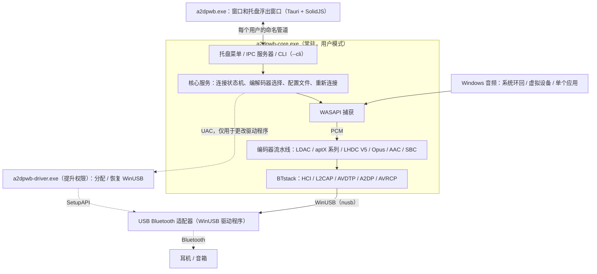
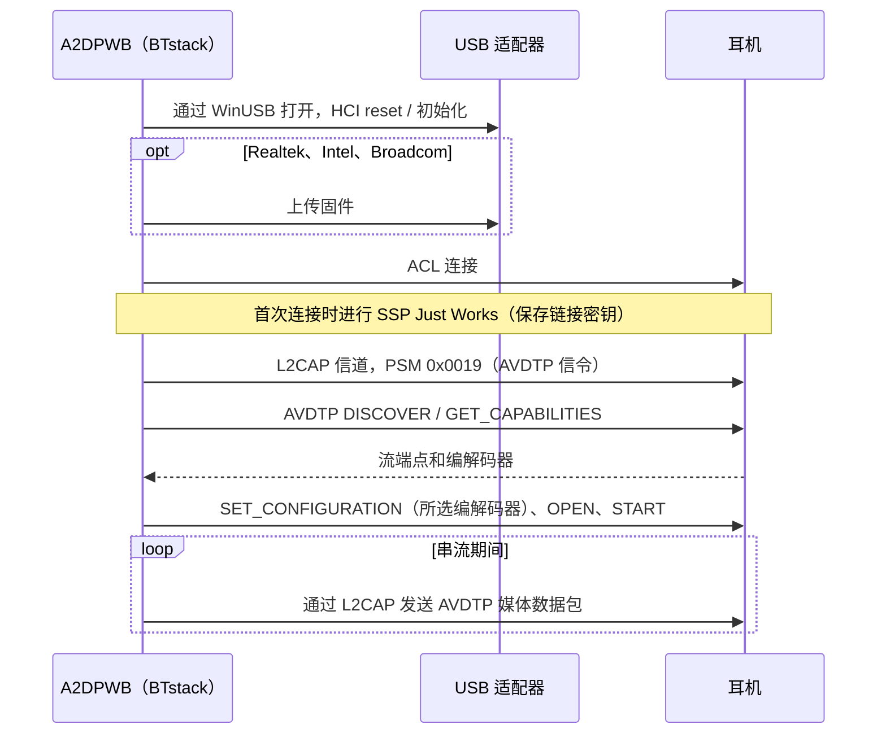
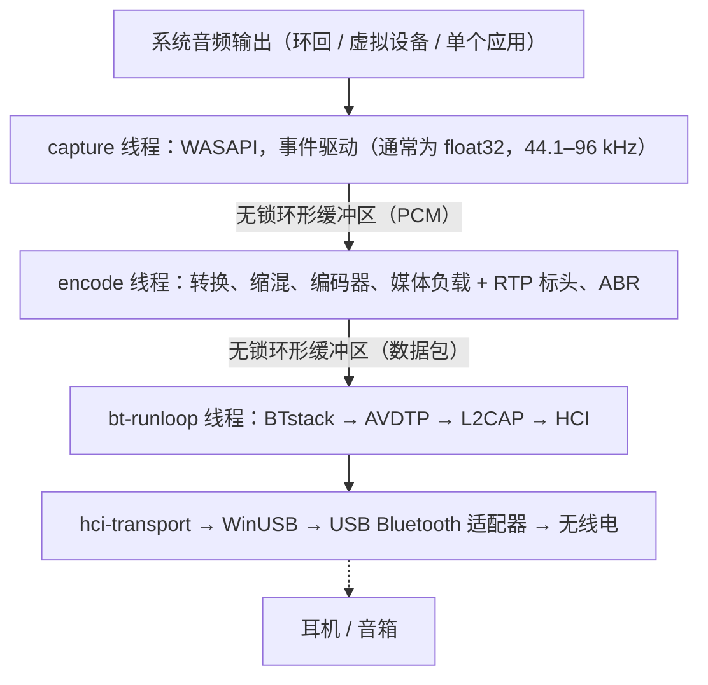
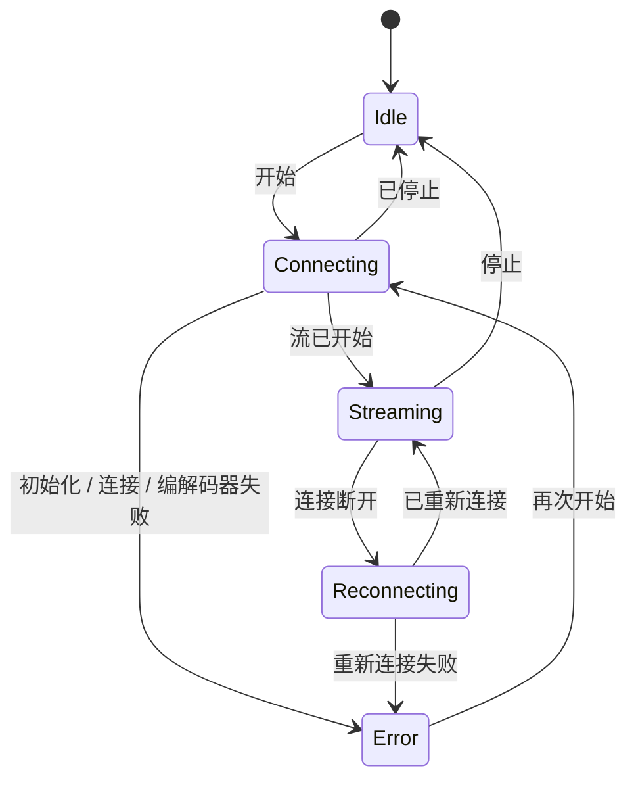

# 架构
{: .no_toc }

## 目录
{: .no_toc .text-delta }

1. TOC
{:toc}

---

## 概述

A2DP Windows Bridge (A2DPWB) 让 Windows 能够使用 LDAC、aptX HD、aptX Low Latency、aptX、AAC 和 SBC 的 Bluetooth 音频。Windows 自带的 Bluetooth 堆栈在 A2DP 上只支持 SBC、经典 aptX 以及（仅限 Windows 11）AAC——本工具无需内核驱动即可增加 LDAC、aptX HD 和 aptX Low Latency。

使用 **BTstack + WinUSB**——完全在用户模式下运行，无需驱动签名。

A2DPWB 2.0 使用 Rust 编写。无法替换的 C 库（BTstack 和各编解码器的编码器）从源代码编译，并通过小型 FFI crate 调用；其余部分（包括 SBC 编码器）均为 Rust。

## 进程

A2DPWB 最多以三个程序运行：

| 程序 | 运行时机 | 职责 |
|:--------|:-----|:-----|
| `a2dpwb-core.exe` | A2DPWB 运行期间（由窗口、“开始”菜单或**随 Windows 启动**启动） | Bluetooth、音频捕获和编码、配置文件和设置、托盘图标及其菜单、IPC 服务器。`--cli` 则在控制台中运行同一个核心 |
| `a2dpwb.exe` | 仅在有窗口打开时（最后一个窗口关闭 3 分钟后退出） | 主窗口和托盘浮出窗口（Tauri 2，SolidJS + TypeScript）。自身不保存任何状态 |
| `a2dpwb-driver.exe` | 每次更改驱动程序时，以管理员权限（UAC）运行 | 为适配器分配 WinUSB 或恢复其之前的驱动程序，然后退出 |

- **核心不是 Windows 服务。** 它是已登录用户的普通进程，因为 WASAPI 环回捕获的是该用户会话的音频。每个会话的互斥体保证只有一个实例；再次启动它会打开窗口。
- **托盘属于核心。** 右键菜单（打开、前 10 个配置文件、断开连接、退出）会立即打开，无需启动窗口。左键单击会启动窗口的浮出窗口。
- **窗口只负责显示。** 它先接收核心状态的快照，之后接收变更；关闭窗口或窗口崩溃都不会停止音频。关闭窗口只是将其隐藏，因此从托盘重新打开是即时的。
- **命令行使用同一个核心。** `a2dpwb-core.exe --cli` 在没有托盘和 IPC 的情况下运行核心服务；模拟器测试就是以这种方式运行的。

## 传输层：BTstack + WinUSB

通过 WinUSB（Microsoft 签名的通用 USB 驱动）直接与 USB Bluetooth 适配器通信，完全绕过 Windows 的 Bluetooth 堆栈。BTstack 是一个源代码公开的 Bluetooth 堆栈（非商业许可），在用户模式下实现 HCI、L2CAP、AVDTP 和 A2DP。

**优点**：
- 无需驱动签名费用
- 无需测试签名模式
- 无需禁用安全启动（Secure Boot）
- 所有代码都在用户模式下运行（更易于调试）

**取舍**：
- 需要一个专用的 USB Bluetooth 适配器（独立于 Windows 的内置 Bluetooth）
- 被 WinUSB 占用期间，该适配器无法用于 Windows 的普通 Bluetooth
- 设备地址需手动输入，或通过 USB 适配器扫描（GAP inquiry）查找

**工作原理**：
1. 在应用中（**适配器 > 分配 WinUSB**，请参阅[驱动程序分配](#driver-assignment)）或使用 Zadig 为 USB Bluetooth 适配器分配 WinUSB
2. `hci-transport` crate 通过 WinUSB 使用 `nusb` 打开适配器，并将其作为 HCI 传输连接到 BTstack
3. BTstack 发送 HCI 命令初始化 Bluetooth 控制器
4. （Realtek、Intel 和 Broadcom 适配器）根据需要上传固件
5. BTstack 建立 ACL 连接并打开 L2CAP 信道（PSM 0x0019）
6. AVDTP 信令发现远端 SEP 并协商编解码器
7. 编码后的音频作为 AVDTP 媒体数据包通过 L2CAP 发送

USB 传输保留了 v1 中真实适配器所需的恢复措施：打开适配器时重置事件管道和 ACL 管道，事件读取失败时重试，HCI 命令有超时，关闭适配器时发送 HCI Reset，这样下一次会话就能找到一个空闲的控制器。

## Crate 结构

一个 Cargo 工作区（仓库根目录的 `Cargo.toml`），分为五层；每一层只依赖其下方的层。库位于 `app/src/crates/`，程序位于 `app/src/core`、`app/src/ui` 和 `app/src/driver`。只有 `*-sys` crate 和 `win-sys` 可以包含 `unsafe` 代码；其他所有 crate 都带有 `#![forbid(unsafe_code)]`。

| 层 | Crate | 职责 |
|:------|:------|:-----|
| 1. FFI | `btstack-sys` | 用 `cc`（MSVC）构建 BTstack，手写的 FFI 声明和安全封装，`btstack_config.h`。BTstack 只能在其运行循环线程上调用：`!Send` 的 `Stack` 令牌保证了这一点 |
| 1. FFI | `ldac-sys`、`openaptx-sys`、`fdkaac-sys`、`lhdcv5-sys`、`opus-sys` | 构建 C 编码器并对外提供；每个库一个 crate，使各自的许可证保持分离 |
| 1. FFI | `win-sys` | 没有 Rust 库可用的 Win32 API：MMCSS、默认音频设备（IPolicyConfig）、WLAN API（AFH）、电源通知、Run 注册表项、媒体键、管道的 DACL、权限提升，以及 WinUSB 驱动程序分配（SetupAPI） |
| 2. 组件 | `hci-transport` | 使用 `nusb` 的 USB 上 HCI（“H2”），以及通过 TCP 连接虚拟控制器（`tools/emu`）的 H4 |
| 2. 组件 | `codec` | `Encoder` trait、SBC 编码器（Bluedroid 编码器的 Rust 移植版）、C 编码器的安全封装、Codec Information 解析以及编解码器选择 |
| 2. 组件 | `audio-capture` | WASAPI 捕获（`wasapi` crate）：系统环回、虚拟设备、单个应用（进程环回）；设备和应用列表、测试音 |
| 3. 引擎 | `bt-host` | 在独立线程上运行 BTstack，由命令和类型化事件驱动：GAP、A2DP Source、AVRCP、SDP、链接密钥、AFH、固件加载、HCI 捕获（`.pklg`） |
| 3. 引擎 | `pipeline` | PCM 环形缓冲区、格式转换、缩混、编码、媒体负载、发送节奏控制、ABR |
| 4. 核心 | `a2dpwb-core`（目录 `core`） | 状态机、重新连接、睡眠 / 恢复、配置文件、设置和 v1 迁移、音量同步、更新检查、接收器测试客户端、统计 |
| 4. 核心 | `ipc` | 核心与窗口共享的协议类型（serde；用 `ts-rs` 生成 TypeScript 类型）以及管道分帧 |
| 5. 程序 | `a2dpwb-core-exe`（`app/src/core`） | `a2dpwb-core.exe`：核心、托盘（`tao` 事件循环上的 `tray-icon`）、IPC 服务器、`--cli` |
| 5. 程序 | `a2dpwb-ui`（`app/src/ui`） | `a2dpwb.exe`：Tauri 2；Rust 端是 IPC 客户端，页面为 SolidJS + TypeScript + Vite |
| 5. 程序 | `a2dpwb-driver`（`app/src/driver`） | `a2dpwb-driver.exe`：提升权限运行的辅助程序 |

## 音频路径与线程

| 线程 | 优先级 | 工作 |
|:-------|:---------|:-----|
| capture | MMCSS "Audio" | 读取 WASAPI；在无声的时段填充静音 |
| encode | MMCSS "Pro Audio" | 转换为编码器所需的格式，按完整的编码块进行编码（剩余部分等待下一轮），将帧打包进媒体负载；每轮约 10 ms，使数据包均匀发出 |
| bt-runloop | -- | BTstack 的运行循环；每当 L2CAP 可以发送时，就发送一个排队中的数据包 |
| USB | -- | WinUSB 传输：每个 IN 管道（事件、ACL 数据）上同时有三个读取请求在进行，另有一个写入器负责命令和 ACL 数据 |
| core | Normal | 状态机、IPC（tokio）、设置、统计（4 Hz）、更新检查 |

串流开始后，音频路径不再分配内存，也不获取任何锁。统计数据是原子计数器，核心每秒读取四次。BTstack 不是线程安全的：其他线程向它发送命令，这些命令在 bt-runloop 线程上执行。

## 核心与 IPC

窗口通过用户的命名管道 `\\.\pipe\a2dpwb-<user SID>` 与核心通信，该管道的 DACL 只允许该用户访问。消息是带长度前缀的 JSON 帧：

1. 窗口发送 `hello { protocol, client }`。协议版本不同的核心会拒绝它，窗口随即提示这两个程序来自不同的版本。
2. 核心以 `snapshot` 应答：包含其全部状态（适配器、设备、流、配置文件、设置、更新）和一个修订号。
3. 此后核心以 `event` 发送变更。如果漏掉了某个修订号，窗口会重新获取快照。
4. 操作通过 `request { id, method, params }` 发送，并以 `response { id,
   result | error }` 应答。方法分组为 `stream.*`、`device.*`、`profile.*`、`settings.*`、`adapter.*`、`audio.*`、`diag.*` 和 `app.*`。

错误是带参数的代码（例如 `adapter.driver_missing`），而不是文本；窗口会翻译它们，并在消息旁边提供解决方法。高频数据（链路质量、日志）只在某个页面订阅时才会发送。

连接状态机：

失败的连接最多重试 3 次，断开的连接最多重新连接 10 次。PC 进入睡眠时，核心会停止 BTstack，且不将断开的链路计为失败，并在 PC 恢复后重新连接。

## 驱动程序分配 {#driver-assignment}

Windows 8 及更高版本自带 Microsoft 签名的 WinUSB 驱动程序（`winusb.inf`）。`a2dpwb-driver.exe` 通过 SetupAPI 完成设备管理器中“更新驱动程序 > 让我从列表中选取 > WinUsb Device”所做的操作：

1. 通过设备实例 ID 打开适配器。
2. 向其 `Device Parameters` 写入 `DeviceInterfaceGUIDs` 值，使 WinUSB 为其注册设备接口。
3. 选择 `%SystemRoot%\INF\winusb.inf` 中的“WinUsb Device”型号，并用 `DiInstallDevice` 安装。该收件箱驱动程序本身已签名，因此不会安装任何证书（这与 Zadig / libwdi 不同，它们会用自制证书为生成的 INF 签名）。
4. **恢复**：删除设备（`DiUninstallDevice`）并重新枚举；Windows 随后会再次选择其排名最高的驱动程序（通常是 `BthUSB` 或厂商的驱动程序）。适配器之前的驱动程序会记录在设置文件夹（`driver\`）中，并在恢复后进行比对。

核心从不以管理员身份运行：分配或恢复时，它会通过 UAC 提示（`ShellExecuteEx` "runas"）启动辅助程序，并读取其 JSON 结果。列出适配器及其驱动程序不需要提升权限。

## 主要模块

### 编解码器选择（`codec::caps`）

- 解析远端的能力：标准的 SBC 和 AAC 元素以及厂商编解码器，包括两种厂商 ID 下的 aptX LL 以及 aptX Adaptive（仅检测并记录到日志）
- 选择编解码器：“自动”会选择远端提供的最佳编解码器；如果请求的编解码器远端不提供，在配置文件允许时（**此编解码器不可用时使用其他编解码器**）会改用“自动”选择的编解码器，否则视为错误
- 选择 aptX 系列的采样率（从远端通告的采样率中选择 44.1 / 48 kHz；由 WASAPI 对捕获的音频重采样）

### Bluetooth 主机（`bt-host`）

**职责**：
- 在独立线程上以 USB（或 TCP）HCI 传输运行 BTstack
- 注册流端点：厂商编解码器（LDAC、aptX HD、aptX、aptX LL、LHDC V5、FastStream、Opus）以及 SBC（SBC XQ 也使用它）和 AAC
- 注册 SDP 记录（A2DP Source、AVRCP Controller、AVRCP Target）
- 管理 SSP 配对（Just Works、General Bonding；链接密钥持久保存）
- 连接超时后断开半开的连接，以便重试能够正常进行
- 重试失败的连接（最多 3 次），并区分失败原因（无应答、链路无数据、远端主动断开、身份验证）；丢弃设备已不再识别的链接密钥并重新配对
- 用于设备扫描的 GAP inquiry
- AVRCP 绝对音量和耳机按键
- AFH 主机信道分类，以及为链路质量视图读取 RSSI / AFH
- 为 Realtek、Intel 和 Broadcom 芯片组加载固件
- HCI 捕获（`.pklg`），在连接中途开始时也包含连接建立过程

**使用的主要 BTstack API**：
- `a2dp_source_create_stream_endpoint()`——注册编解码器端点
- `a2dp_source_establish_stream()`——连接到 A2DP 接收端
- `a2dp_source_set_config_other()`——配置厂商特定的编解码器
- `a2dp_source_stream_send_media_payload_rtp()`——发送带 RTP 标头的编码音频（LDAC、aptX HD、AAC、SBC、SBC XQ、LHDC V5、Opus）
- `a2dp_source_stream_send_media_packet()`——发送不带 RTP 标头的原始媒体数据包（aptX、aptX LL、FastStream）

### 音频捕获（`audio-capture`）

使用 Windows 音频会话 API 实时捕获音频。
- 默认输出设备的系统环回、所选（虚拟）设备的环回，或单个应用及其子进程的进程环回（Windows 10 内部版本 19041 或更高版本）
- 提供设备在共享模式下的混音格式（通常为 float32；由流水线为编码器转换）
- 在应用程序模式下，会等待应用启动，并在应用重新启动后重新捕获它

### 音频编码器

| 编码器 | 库 | 比特率 | 特性 |
|---------|---------|---------|----------|
| LDAC | libldac (AOSP) | 330/660/990 kbps | HQ/SQ/MQ 模式，ABR |
| aptX HD | libopenaptx | 576 kbps | 24-bit 输入，固定码率，RTP 标头 |
| aptX LL | libopenaptx | 352 kbps | 约 32 ms 延迟，无 RTP 标头，数据包 ≤ 约 7.5 ms |
| aptX | libopenaptx | 352/384 kbps（44.1/48 kHz） | 16-bit 立体声，无 RTP 标头 |
| AAC | fdk-aac | 最高 256 kbps | AAC-LC，LATM 传输 |
| SBC | Bluedroid 编码器的 Rust 移植版 | 最高约 345 kbps | A2DP 必备的基础编解码器；与 C 编码器逐位一致（已在所有配置下测试） |
| SBC XQ | 同一 SBC 编码器 | 约 385/505/552 kbps | 双声道（Dual Channel），44.1 / 48 kHz 下 bitpool 为 47 / 43（高）；仅当接收端的 SBC 允许双声道且 bitpool 至少为 43 时使用；与 SBC 共用流端点、媒体负载标头和 RTP 标头 |
| FastStream | 同一 SBC 编码器 | 198/216 kbps（44.1/48 kHz） | CSR 厂商编解码器，仅音乐方向（无语音回传）：SBC 联合立体声、bitpool 29，帧填充到 72 字节，每个数据包 3 帧，无媒体负载标头也无 RTP 标头（与 PipeWire 相同）；“自动”从不选择 |
| LHDC V5 | lhdcv5-enc（AOSP 编码器的 C 语言移植版） | 400/500/900/1000 kbps，ABR 160–400 kbps | 16/24-bit，5 ms 帧，2 字节媒体负载标头，RTP 标头 |
| Opus | libopus 1.5.2 | 128/192/256 kbps（立体声；单声道减半） | 实验性；Android 的 A2DP Opus：48 kHz，20 ms 帧（接收端只支持 10 ms 时为 10 ms），以媒体负载为上限的受约束 VBR，每个数据包一帧，1 字节媒体负载标头，RTP 标头 |

所有编码器都实现了 `codec::Encoder` trait：它们声明 PCM 格式以及每次调用消耗的帧数，并返回编解码器帧。

libopenaptx 要求输入为每组 4 个立体声采样、打包为 24 位小端序的 PCM；aptX 封装会将 16 位或 32 位采样转换为该格式，单声道输入会复制到两个声道。

## 厂商编解码器信息元素

非标准编解码器在 AVDTP 中注册为 Vendor Specific：

| 编解码器 | Vendor ID | Codec ID |
|-------|-----------|----------|
| LDAC | Sony (0x0000012D) | 0x00AA |
| aptX | APT (0x0000004F) | 0x0001 |
| aptX HD | Qualcomm (0x000000D7) | 0x0024 |
| aptX Low Latency | CSR (0x0000000A) 或 Qualcomm (0x000000D7) | 0x0002 |
| aptX Adaptive | Qualcomm (0x000000D7) | 0x00AD（仅检测，永不选择） |
| LHDC V5 | Savitech (0x0000053A) | 0x4C35 |
| FastStream | CSR (0x0000000A) | 0x0001 |
| Opus | Google (0x000000E0) | 0x0001 |

AAC 和 SBC 使用 A2DP 规范中定义的标准 A2DP 编解码器 ID。

编解码器信息元素的大小（包括 6 字节的 vendor/codec ID）：

- **aptX**：7 字节（第 6 字节 = 采样率 / 声道模式）
- **aptX HD**：11 字节（第 6 字节同 aptX，另加 4 个保留字节）；必须为立体声
- **aptX LL**：8 字节；当接收端设置了扩展（“new caps”）标志时为 17 字节。A2DPWB 只注册一个 aptX LL 端点，并以接收端所用的 vendor ID 配置流
- **LHDC V5**：11 字节（Android `a2dp_vendor_lhdcv5_constants.h`）：第 6 字节为采样率（0x20 44.1k、0x10 48k、0x04 96k、0x01 192k），第 7 字节为位深度（0x04 16-bit、0x02 24-bit）以及接收端的最小/最大比特率限制，第 8 字节为编解码器子版本（0x01 = V5 ver.1）和 0x10 = 5 ms 帧，第 9-10 字节为可选功能（低延迟、无损、JAS、AR、META），A2DPWB 均不提供。仅支持立体声。与 Android 一样，接收端的比特率限制会在配置中回传并应用到编码器。媒体数据包带有 2 字节的负载标头：帧数 << 2（延迟位为 0）以及序列号
- **FastStream**：8 字节（PipeWire `a2dp_faststream_t`）：第 6 字节为方向（0x01 sink = 音乐，0x02 source = 语音），第 7 字节的低 4 位为接收方向的采样率（0x2 44.1k、0x1 48k），高 4 位为发送方向的采样率（0x2 16k）。A2DPWB 只提供并配置音乐方向
- **Opus**：7 字节（Android `a2dp_vendor_opus_constants.h`）：第 6 字节的位 2..0 为声道模式（0x01 单声道、0x02 立体声、0x04 双单声道），位 4..3 为帧长（0x08 10 ms、0x10 20 ms），位 7 为 48 kHz。A2DPWB 提供单声道和立体声、10 ms 和 20 ms，并配置为 20 ms 立体声（仅当输入为单声道且接收端支持单声道时才使用单声道）。媒体数据包在 1 字节的负载标头（低 4 位为帧数 1）之后携带一个 Opus 数据包

**有无 RTP**：LDAC、aptX HD、AAC、SBC、SBC XQ、LHDC V5 和 Opus 的媒体数据包带有 12 字节的 RTP 标头。aptX、aptX LL 和 FastStream **不带** RTP 标头发送（与 Android 和 PipeWire 相同），因此整个 L2CAP MTU 都可用于 aptX 帧。

**aptX Adaptive** 没有开源编码器（libopenaptx 未实现它），因此 A2DPWB 从不注册或选择它。当接收端列出它时，A2DPWB 只会记录到日志；如果接收端另外列出了经典 aptX，则使用经典 aptX。

## 设置与文件

所有内容都保存在设置文件夹 `%APPDATA%\A2DPWB`（或环境变量 `A2DPWB_CONFIG_DIR` 指定的文件夹）中，格式与 v1 相同：

| 文件 | 内容 |
|:-----|:---------|
| `settings.json` | 应用设置，带有 `schema_version`；未知的键会被保留 |
| `profiles.json` | 配置文件 |
| `devices.txt`、`link_keys.txt` | 已知设备及其链接密钥：与 v1 配对过的耳机无需重新配对即可再次连接 |
| `le_audio_devices.txt`、`le_audio_bonds.tlv`、`le_audio_csip.txt` | LE Audio（实验性）：设备列表中的 LE Audio 条目、LE 绑定信息（含 GATT 服务器持久保存的 CCC 值）以及协调集 |
| `*.bin`、`*.hcd`、`ibt-*` | 固件文件 |
| `hci_<date>_<time>.pklg` | HCI 捕获 |
| `logs\a2dpwb-core.<date>.log` | 核心的日志，每天一个文件（UTC），保留最近 7 个 |
| `driver\` | 每个被分配了 WinUSB 的适配器之前的驱动程序 |
| `backup-v1\` | v1 设置的副本，在 v2 首次启动时创建一次 |

## 构建系统

- 一切都由 **Cargo** 构建；不再使用 CMake。每个 `-sys` crate 在 `build.rs` 中用 MSVC 从 `extern/` 中的 git 子模块编译其 C 库
- 窗口的页面由 **Vite** 构建（在 `app/src/ui` 中运行 `pnpm build`），并由 Tauri 嵌入 `a2dpwb.exe`
- IPC 协议的 TypeScript 类型由 Rust 类型生成（`cargo test -p ipc export_bindings`）
- 语言文件（`app/lang/*.json`）供窗口和核心的托盘菜单使用
- `installer/build-release.ps1` 生成 NSIS 安装程序（Tauri 的打包工具）、便携版 zip 和更新程序清单。请参阅[构建](building)

## 重要注意事项

- **适配器兼容性**：Realtek（测试最充分）和 CSR USB 适配器；Intel 和 Broadcom 为实验性支持。Realtek 适配器需要在启动时上传固件，处于 bootloader 模式的 Intel 适配器也是如此
- **配对**：使用 SSP Just Works 和 General Bonding。链接密钥持久保存到本地文件
- **建议使用第二个适配器**：内置 Bluetooth 留给 Windows 使用，专用 USB 适配器用于 A2DPWB
- 某些 Bluetooth 适配器的固件会限制可达到的比特率
- USB Bluetooth 5.0+ 适配器通常能很好地支持 LDAC
- 自动选择编解码器的优先级：LDAC > aptX HD > aptX LL > aptX > LHDC V5 > Opus（实验性）> AAC > SBC XQ > SBC（FastStream 仅在明确选择时使用）
