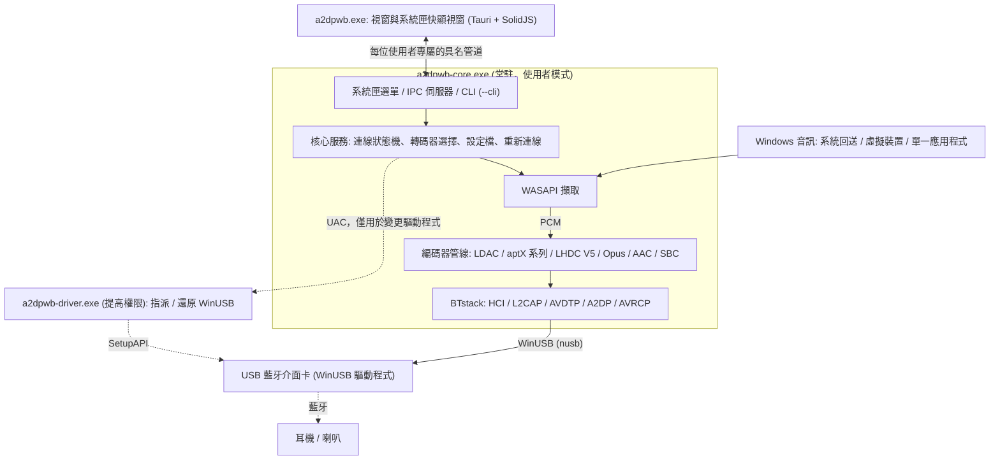
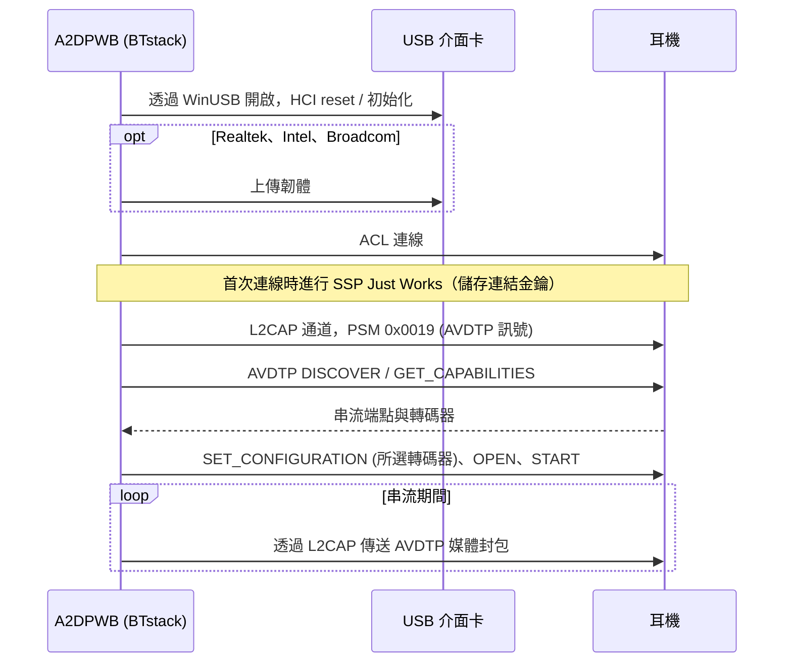
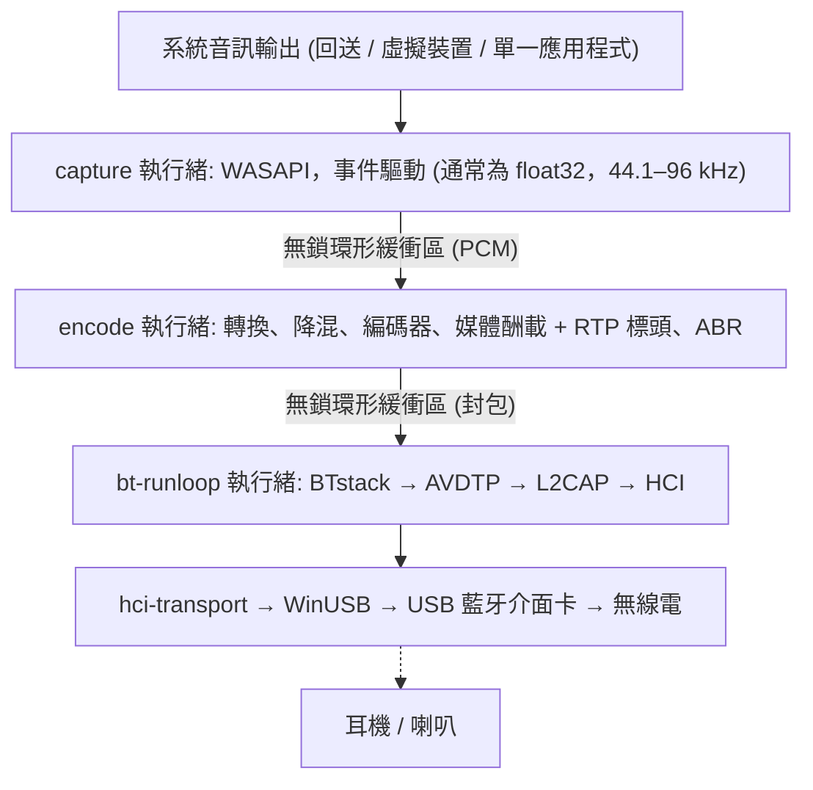
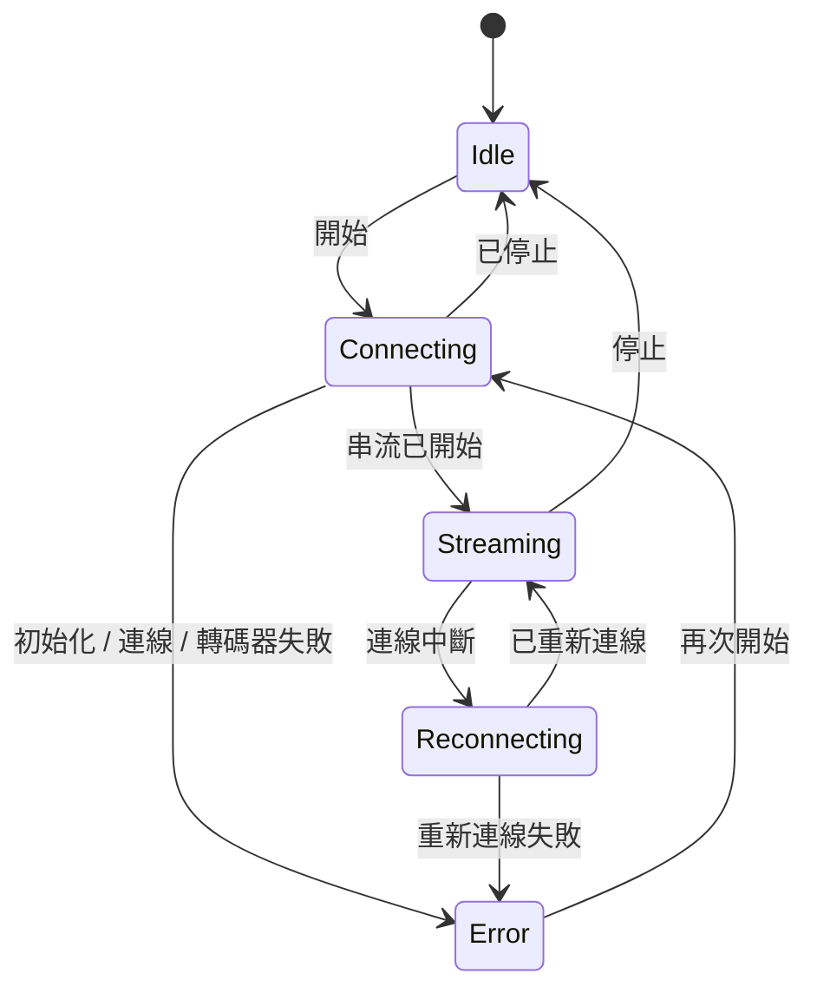

# 架構
{: .no_toc }

## 目錄
{: .no_toc .text-delta }

1. TOC
{:toc}

---

## 概觀

A2DP Windows Bridge (A2DPWB) 讓 Windows 能使用 LDAC、aptX HD、aptX Low Latency、aptX、
AAC 與 SBC 藍牙音訊。Windows 本身的藍牙堆疊在 A2DP 上只支援 SBC、傳統 aptX
與（僅限 Windows 11）AAC — 本工具不需核心驅動程式即可加入 LDAC、aptX HD 與 aptX
Low Latency。

使用 **BTstack + WinUSB** — 完全在使用者模式下運作，不需要驅動程式簽章。

A2DPWB 2.0 以 Rust 撰寫。無法替換的 C 程式庫（BTstack 與各轉碼器的編碼器）
從原始碼編譯，並透過小型 FFI crate 呼叫；其餘一切（包括 SBC 編碼器）都是 Rust。

## 處理程序

A2DPWB 最多以三個程式執行：

| 程式 | 執行時機 | 工作內容 |
|:--------|:-----|:-----|
| `a2dpwb-core.exe` | A2DPWB 執行期間（由視窗、「開始」功能表或 **隨 Windows 啟動** 啟動） | 藍牙、音訊擷取與編碼、設定檔與設定、系統匣圖示及其選單、IPC 伺服器。`--cli` 則改從主控台執行相同的核心 |
| `a2dpwb.exe` | 只在視窗開啟期間（最後一個視窗關閉 3 分鐘後結束） | 主視窗與系統匣快顯視窗（Tauri 2、SolidJS + TypeScript）。本身不保存任何狀態 |
| `a2dpwb-driver.exe` | 每次變更驅動程式時，以系統管理員權限（UAC）執行 | 為介面卡指派 WinUSB，或還原其先前的驅動程式，然後結束 |

- **核心不是 Windows 服務。** 它是已登入使用者的一般處理程序，因為 WASAPI
  回送擷取的是該使用者工作階段的音訊。每個工作階段的 mutex 讓它只執行一個
  執行個體；再次啟動它會開啟視窗。
- **系統匣屬於核心。** 其右鍵選單（開啟、前 10 個設定檔、中斷連線、結束）
  會立即開啟，不需要啟動視窗。按左鍵則會啟動視窗的快顯視窗。
- **視窗只負責顯示。** 它會收到核心狀態的快照，之後再收到變更；關閉視窗或
  視窗當機都不會停止音訊。關閉視窗只會將它隱藏，因此從系統匣重新開啟時
  會立即出現。
- **命令列使用相同的核心。** `a2dpwb-core.exe --cli` 會在沒有系統匣與 IPC 的
  情況下執行核心服務；模擬器測試就是以這種方式執行。

## 傳輸：BTstack + WinUSB

透過 WinUSB（Microsoft 簽署的通用 USB 驅動程式）直接與 USB 藍牙介面卡通訊，
完全繞過 Windows 藍牙堆疊。BTstack 是一個公開原始碼的藍牙堆疊（非商業授權），
在使用者模式下實作 HCI、L2CAP、AVDTP 與 A2DP。

**優點**：
- 不需要驅動程式簽章費用
- 不需要測試簽章模式
- 不需要停用安全開機
- 所有程式碼都在使用者模式下執行（較容易偵錯）

**取捨**：
- 需要專用的 USB 藍牙介面卡（與 Windows 內建藍牙分開）
- 由 WinUSB 佔用期間，該介面卡無法用於一般的 Windows 藍牙
- 裝置位址需手動輸入，或以 USB 介面卡掃描（GAP inquiry）找到

**運作方式**：
1. 在應用程式中（**介面卡 > 指派 WinUSB**，請參閱 [驅動程式指派](#driver-assignment)）
   或透過 Zadig，為 USB 藍牙介面卡指派 WinUSB
2. `hci-transport` crate 以 `nusb` 透過 WinUSB 開啟介面卡，並將它作為 HCI 傳輸
   連接到 BTstack
3. BTstack 傳送 HCI 命令以初始化藍牙控制器
4. （Realtek、Intel 與 Broadcom 介面卡）視需要上傳韌體
5. BTstack 建立 ACL 連線並開啟 L2CAP 通道（PSM 0x0019）
6. AVDTP 訊號探索遠端 SEP 並協商轉碼器
7. 編碼後的音訊以 AVDTP 媒體封包透過 L2CAP 傳送

USB 傳輸保留了 v1 中實際介面卡所需的復原步驟：開啟介面卡時會重設事件與
ACL 管道，事件讀取失敗時會重試，HCI 命令有逾時，關閉介面卡時會傳送
HCI Reset，讓下一個工作階段面對的是閒置的控制器。

## Crate 結構

一個 Cargo 工作區（儲存庫根目錄的 `Cargo.toml`），分為五層；每一層只依賴
其下方的層。程式庫位於 `app/src/crates/`，程式位於 `app/src/core`、`app/src/ui`
與 `app/src/driver`。只有 `*-sys` crate 與 `win-sys` 可以包含 `unsafe` 程式碼；
其他所有 crate 都標有 `#![forbid(unsafe_code)]`。

| 層 | Crate | 工作內容 |
|:------|:------|:-----|
| 1. FFI | `btstack-sys` | 以 `cc`（MSVC）建置 BTstack、手寫的 FFI 宣告與安全包裝函式、`btstack_config.h`。BTstack 只能在其 run loop 執行緒上呼叫：由 `!Send` 的 `Stack` token 強制保證 |
| 1. FFI | `ldac-sys`、`openaptx-sys`、`fdkaac-sys`、`lhdcv5-sys`、`opus-sys` | 建置 C 編碼器並對外提供；每個程式庫一個 crate，讓各自的授權保持分離 |
| 1. FFI | `win-sys` | 沒有 Rust 程式庫的 Win32 API：MMCSS、預設音訊裝置（IPolicyConfig）、WLAN API（AFH）、電源通知、Run 機碼、媒體鍵、管道的 DACL、提高權限，以及 WinUSB 驅動程式指派（SetupAPI） |
| 2. 元件 | `hci-transport` | 以 `nusb` 實作 HCI over USB（「H2」），以及透過 TCP 以 H4 連線到虛擬控制器（`tools/emu`） |
| 2. 元件 | `codec` | `Encoder` trait、SBC 編碼器（Bluedroid 編碼器的 Rust 移植版）、C 編碼器的安全包裝函式、Codec Information 解析與轉碼器選擇 |
| 2. 元件 | `audio-capture` | WASAPI 擷取（`wasapi` crate）：系統回送、虛擬裝置、單一應用程式（處理程序回送）；裝置與應用程式清單、測試音 |
| 3. 引擎 | `bt-host` | 在專用執行緒上執行 BTstack，由命令與具型別的事件驅動：GAP、A2DP Source、AVRCP、SDP、連結金鑰、AFH、韌體載入、HCI 擷取（`.pklg`） |
| 3. 引擎 | `pipeline` | PCM 環形緩衝區、格式轉換、降混、編碼、媒體酬載、送出節奏控制、ABR |
| 4. 核心 | `a2dpwb-core`（目錄 `core`） | 狀態機、重新連線、睡眠 / 恢復、設定檔、設定與 v1 移轉、音量同步、更新檢查、接收器測試用戶端、統計資料 |
| 4. 核心 | `ipc` | 核心與視窗共用的通訊協定型別（serde；TypeScript 型別以 `ts-rs` 產生）與管道的訊框處理 |
| 5. 程式 | `a2dpwb-core-exe`（`app/src/core`） | `a2dpwb-core.exe`：核心、系統匣（在 `tao` 事件迴圈上使用 `tray-icon`）、IPC 伺服器、`--cli` |
| 5. 程式 | `a2dpwb-ui`（`app/src/ui`） | `a2dpwb.exe`：Tauri 2；Rust 端是 IPC 用戶端，頁面為 SolidJS + TypeScript + Vite |
| 5. 程式 | `a2dpwb-driver`（`app/src/driver`） | `a2dpwb-driver.exe`：提高權限的輔助程式 |

## 音訊路徑與執行緒

| 執行緒 | 優先順序 | 工作 |
|:-------|:---------|:-----|
| capture | MMCSS "Audio" | 讀取 WASAPI；無聲的區段以靜音填補 |
| encode | MMCSS "Pro Audio" | 轉換為編碼器接受的格式，以完整的編碼器區塊為單位編碼（剩餘部分等待下一輪），將訊框打包成媒體酬載；每輪約 10 ms，讓封包平均送出 |
| bt-runloop | -- | BTstack 的 run loop；每當 L2CAP 可以傳送時，就送出佇列中的封包 |
| USB | -- | WinUSB 傳輸：每個 IN 管道（事件、ACL 資料）上同時有三個讀取在進行，另有一個負責命令與 ACL 資料的寫入者 |
| core | Normal | 狀態機、IPC（tokio）、設定、統計資料（4 Hz）、更新檢查 |

串流開始後，音訊路徑不會配置記憶體，也不會取得任何鎖。統計資料是原子計數器，
由核心每秒讀取四次。BTstack 並非執行緒安全：其他執行緒會向它傳送命令，
這些命令在 bt-runloop 執行緒上執行。

## 核心與 IPC

視窗透過使用者的具名管道 `\\.\pipe\a2dpwb-<user SID>` 與核心通訊，其 DACL
只允許該使用者存取。訊息為附長度前置碼的 JSON 訊框：

1. 視窗傳送 `hello { protocol, client }`。通訊協定版本不同的核心會拒絕它，
   視窗則會顯示兩個程式來自不同版本。
2. 核心以 `snapshot` 回應：其完整狀態（介面卡、裝置、串流、設定檔、設定、
   更新）以及修訂編號。
3. 之後核心會以 `event` 傳送變更。若遺漏了某個修訂，視窗會重新取得快照。
4. 操作為 `request { id, method, params }`，並以 `response { id,
   result | error }` 回應。方法群組有 `stream.*`、`device.*`、
   `profile.*`、`settings.*`、`adapter.*`、`audio.*`、`diag.*` 與 `app.*`。

錯誤是附參數的代碼（例如 `adapter.driver_missing`），而不是文字；視窗會將其
翻譯，並在訊息旁提供解決方法。高頻率的資料（連線品質、記錄）只會在某個畫面
訂閱時傳送。

連線狀態機：

連線失敗時最多重試 3 次，連線中斷時最多重新連線 10 次。PC 進入睡眠時，
核心會停止 BTstack，且不將中斷的連結計為失敗，並在 PC 恢復後重新連線。

## 驅動程式指派 {#driver-assignment}

Windows 8 以上內建由 Microsoft 簽署的 WinUSB 驅動程式（`winusb.inf`）。
`a2dpwb-driver.exe` 透過 SetupAPI，執行與裝置管理員「更新驅動程式 >
讓我挑選 > WinUsb Device」相同的動作：

1. 以裝置執行個體 ID 開啟介面卡。
2. 在其 `Device Parameters` 中寫入 `DeviceInterfaceGUIDs` 值，讓 WinUSB
   為它註冊裝置介面。
3. 選取 `%SystemRoot%\INF\winusb.inf` 的「WinUsb Device」型號，並以
   `DiInstallDevice` 安裝。內建驅動程式已經簽署，因此不會安裝任何憑證
   （不同於 Zadig / libwdi，它們會以自製憑證簽署產生的 INF）。
4. **還原**：移除裝置（`DiUninstallDevice`）並重新列舉；Windows 接著會再次
   選擇排名最高的驅動程式（通常是 `BthUSB` 或廠商的驅動程式）。介面卡先前
   使用的驅動程式會記錄在設定資料夾中（`driver\`），並在還原後進行比對。

核心絕不會以系統管理員身分執行：進行指派或還原時，它會以 UAC 提示
（`ShellExecuteEx` "runas"）啟動輔助程式，並讀取其 JSON 結果。列出介面卡及其
驅動程式不需要提高權限。

## 主要模組

### 轉碼器選擇 (`codec::caps`)

- 解析遠端的功能：標準的 SBC 與 AAC 元素以及廠商轉碼器，包括兩種 Vendor ID
  下的 aptX LL，以及 aptX Adaptive（僅偵測並記錄）
- 選擇轉碼器：「自動」會選用遠端提供的最佳轉碼器；若指定的轉碼器不在遠端
  提供的清單中，在設定檔允許時（**無法使用此轉碼器時改用其他轉碼器**）會改用
  「自動」的選擇，否則視為錯誤
- 選擇 aptX 系列的取樣率（從遠端公布的取樣率中選擇 44.1 / 48 kHz；
  由 WASAPI 對擷取的音訊重新取樣）

### 藍牙主機 (`bt-host`)

**職責**：
- 在專用執行緒上，以 USB（或 TCP）HCI 傳輸執行 BTstack
- 註冊串流端點：廠商轉碼器（LDAC、aptX HD、aptX、aptX LL、
  LHDC V5、FastStream、Opus）以及 SBC（SBC XQ 也使用）與 AAC
- 註冊 SDP 記錄（A2DP Source、AVRCP Controller、AVRCP Target）
- 管理 SSP 配對（Just Works、General Bonding；保存連結金鑰）
- 連線逾時後拆除半開的連線，讓重試能正常運作
- 重試失敗的連線（最多 3 次）並區分原因（沒有回應、連結無資料、
  遠端結束連結、驗證）；捨棄裝置已不認得的連結金鑰並重新配對
- 用於裝置掃描的 GAP inquiry
- AVRCP 絕對音量與耳機按鈕
- AFH 主機通道分類，以及供連線品質畫面使用的 RSSI / AFH 讀數
- Realtek、Intel 與 Broadcom 晶片組的韌體載入
- HCI 擷取（`.pklg`），在連線期間開始時也包含連線建立過程

**使用的主要 BTstack API**：
- `a2dp_source_create_stream_endpoint()` — 註冊轉碼器端點
- `a2dp_source_establish_stream()` — 連線到 A2DP 接收端
- `a2dp_source_set_config_other()` — 設定廠商專屬轉碼器
- `a2dp_source_stream_send_media_payload_rtp()` — 傳送附 RTP 標頭的
  編碼音訊（LDAC、aptX HD、AAC、SBC、SBC XQ、LHDC V5、Opus）
- `a2dp_source_stream_send_media_packet()` — 傳送不含 RTP 標頭的
  原始媒體封包（aptX、aptX LL、FastStream）

### 音訊擷取 (`audio-capture`)

使用 Windows Audio Session API 即時擷取音訊。
- 預設輸出裝置的系統回送、所選（虛擬）裝置的回送，或單一應用程式及其子
  處理程序的處理程序回送（Windows 10 組建 19041 以上）
- 提供裝置共用模式的混音格式（通常為 float32；由管線為編碼器轉換）
- 在應用程式模式下，會等待應用程式啟動，並在應用程式重新啟動時再次擷取

### 音訊編碼器

| 編碼器 | 程式庫 | 位元率 | 特色 |
|---------|---------|---------|----------|
| LDAC | libldac (AOSP) | 330/660/990 kbps | HQ/SQ/MQ 模式、ABR |
| aptX HD | libopenaptx | 576 kbps | 24 位元輸入、固定位元率、RTP 標頭 |
| aptX LL | libopenaptx | 352 kbps | 約 32 ms 延遲、無 RTP 標頭、封包 ≤ 約 7.5 ms |
| aptX | libopenaptx | 352/384 kbps (44.1/48 kHz) | 16 位元立體聲、無 RTP 標頭 |
| AAC | fdk-aac | 最高 256 kbps | AAC-LC、LATM 傳輸 |
| SBC | Bluedroid 編碼器的 Rust 移植版 | 最高約 345 kbps | A2DP 必備的基本轉碼器；與 C 編碼器位元完全一致（已以所有設定組合測試） |
| SBC XQ | 同一個 SBC 編碼器 | 約 385/505/552 kbps | 雙聲道（dual channel），44.1 / 48 kHz 時 bitpool 47 / 43（高）；僅在接收端的 SBC 允許雙聲道且 bitpool 至少為 43 時使用；與 SBC 共用串流端點、媒體酬載標頭與 RTP 標頭 |
| FastStream | 同一個 SBC 編碼器 | 198/216 kbps (44.1/48 kHz) | CSR 廠商轉碼器，僅音樂方向（無語音回傳通道）：SBC joint stereo、bitpool 29，訊框補齊至 72 位元組，每個封包 3 個訊框，無媒體酬載標頭也無 RTP 標頭（與 PipeWire 相同）；「自動」永遠不會選用 |
| LHDC V5 | lhdcv5-enc（AOSP 編碼器的 C 語言移植版） | 400/500/900/1000 kbps，ABR 160–400 kbps | 16/24 位元、5 ms 訊框、2 位元組媒體酬載標頭、RTP 標頭 |
| Opus | libopus 1.5.2 | 128/192/256 kbps（立體聲；單聲道為一半） | 實驗性；Android 的 A2DP Opus：48 kHz、20 ms 訊框（接收端只支援 10 ms 時為 10 ms）、上限為媒體酬載大小的受限 VBR、每個封包一個訊框、1 位元組媒體酬載標頭、RTP 標頭 |

所有編碼器都實作 `codec::Encoder` trait：它們會說明 PCM 格式與每次呼叫
消耗的訊框數，並回傳轉碼器訊框。

libopenaptx 預期的輸入是以 4 個立體聲取樣為一組的 packed 24-bit little-endian
PCM；aptX 包裝函式會將 16 位元或 32 位元取樣轉換為該格式，單聲道輸入會複製到
兩個聲道。

## 廠商轉碼器資訊元素

非標準轉碼器在 AVDTP 中以 Vendor Specific 註冊：

| 轉碼器 | Vendor ID | Codec ID |
|-------|-----------|----------|
| LDAC | Sony (0x0000012D) | 0x00AA |
| aptX | APT (0x0000004F) | 0x0001 |
| aptX HD | Qualcomm (0x000000D7) | 0x0024 |
| aptX Low Latency | CSR (0x0000000A) 或 Qualcomm (0x000000D7) | 0x0002 |
| aptX Adaptive | Qualcomm (0x000000D7) | 0x00AD（僅偵測，永不選用） |
| LHDC V5 | Savitech (0x0000053A) | 0x4C35 |
| FastStream | CSR (0x0000000A) | 0x0001 |
| Opus | Google (0x000000E0) | 0x0001 |

AAC 與 SBC 使用 A2DP 規格中定義的標準 A2DP Codec ID。

轉碼器資訊元素的大小（含 6 位元組的 vendor/codec ID）：

- **aptX**：7 位元組（第 6 位元組 = 取樣率 / 聲道模式）
- **aptX HD**：11 位元組（第 6 位元組同 aptX，另加 4 個保留位元組）；
  必須為立體聲
- **aptX LL**：8 位元組，接收端設定延伸（「new caps」）旗標時為 17 位元組。
  A2DPWB 註冊一個 aptX LL 端點，並以接收端使用的 Vendor ID 設定串流
- **LHDC V5**：11 位元組（Android `a2dp_vendor_lhdcv5_constants.h`）：第 6 位元組
  為取樣率（0x20 44.1k、0x10 48k、0x04 96k、0x01 192k），第 7 位元組為位元深度
  （0x04 16-bit、0x02 24-bit）及接收端的最小/最大位元率限制，第 8 位元組為
  轉碼器子版本（0x01 = V5 ver.1）與 0x10 = 5 ms 訊框，第 9-10 位元組為
  選用功能（low latency、lossless、JAS、AR、META），A2DPWB 均不提供。
  僅支援立體聲。接收端的位元率限制會回傳於設定中並套用到編碼器，
  與 Android 的做法相同。媒體封包帶有 2 位元組的酬載標頭：
  訊框數 << 2（延遲位元為 0）與序號
- **FastStream**：8 位元組（PipeWire `a2dp_faststream_t`）：第 6 位元組為方向
  （0x01 sink = 音樂、0x02 source = 語音），第 7 位元組的低 4 位元為接收端取樣率
  （0x2 44.1k、0x1 48k），高 4 位元為來源端取樣率（0x2 16k）。A2DPWB 只提供
  並設定音樂方向
- **Opus**：7 位元組（Android `a2dp_vendor_opus_constants.h`）：第 6 位元組的
  位元 2..0 為聲道模式（0x01 單聲道、0x02 立體聲、0x04 雙單聲道），位元 4..3
  為訊框長度（0x08 10 ms、0x10 20 ms），位元 7 為 48 kHz。A2DPWB 提供單聲道
  與立體聲、10 與 20 ms，並設定為 20 ms 立體聲（只有在單聲道輸入且接收端支援
  單聲道時才使用單聲道）。媒體封包在 1 位元組的酬載標頭（低 4 位元為訊框數 1）
  之後帶有一個 Opus 封包

**RTP 與無 RTP**：LDAC、aptX HD、AAC、SBC、SBC XQ、LHDC V5 與 Opus 的媒體封包帶有
12 位元組的 RTP 標頭。aptX、aptX LL 與 FastStream 則 **不帶** RTP 標頭傳送（與 Android 及
PipeWire 相同），因此整個 L2CAP MTU 都可用於 aptX 訊框。

**aptX Adaptive** 沒有開放原始碼的編碼器（libopenaptx 未實作），
因此 A2DPWB 永遠不會註冊或選用它。當接收端列出它時，A2DPWB
只會記錄下來；若接收端另外列出傳統 aptX，則使用傳統 aptX。

## 設定與檔案

所有內容都保存在設定資料夾 `%APPDATA%\A2DPWB`（或環境變數
`A2DPWB_CONFIG_DIR` 指定的資料夾）中，格式與 v1 相同：

| 檔案 | 內容 |
|:-----|:---------|
| `settings.json` | 應用程式設定，附 `schema_version`；未知的鍵會保留 |
| `profiles.json` | 設定檔 |
| `devices.txt`、`link_keys.txt` | 已知裝置及其連結金鑰：與 v1 配對過的耳機不需重新配對即可重新連線 |
| `le_audio_devices.txt`、`le_audio_bonds.tlv`、`le_audio_csip.txt` | LE Audio（實驗性）：裝置清單中的 LE Audio 項目、LE 綁定資訊（含 GATT 伺服器持久保存的 CCC 值）以及協調集 |
| `*.bin`、`*.hcd`、`ibt-*` | 韌體檔案 |
| `hci_<date>_<time>.pklg` | HCI 擷取檔 |
| `logs\a2dpwb-core.<date>.log` | 核心的記錄，每天一個檔案（UTC），保留最近 7 個 |
| `driver\` | 每個曾指派 WinUSB 的介面卡先前使用的驅動程式 |
| `backup-v1\` | v1 設定的複本，在 v2 首次啟動時建立一次 |

## 建置系統

- 一切都由 **Cargo** 建置；不使用 CMake。每個 `-sys` crate 會在 `build.rs` 中
  以 MSVC 編譯 `extern/` 內 git 子模組的 C 程式庫
- 視窗的頁面以 **Vite** 建置（在 `app/src/ui` 中執行 `pnpm build`），並由 Tauri
  內嵌到 `a2dpwb.exe` 中
- IPC 通訊協定的 TypeScript 型別由 Rust 型別產生
  （`cargo test -p ipc export_bindings`）
- 語言檔（`app/lang/*.json`）由視窗與核心的系統匣選單共同使用
- `installer/build-release.ps1` 會產生 NSIS 安裝程式（Tauri 的 bundler）、
  免安裝版 zip 與更新程式資訊清單。請參閱 [建置](building)

## 重要注意事項

- **介面卡相容性**：Realtek（測試最完整）與 CSR USB 介面卡；Intel 與
  Broadcom 為實驗性。Realtek 介面卡在啟動時需要上傳韌體，
  處於 bootloader 模式的 Intel 介面卡亦同
- **配對**：使用 SSP Just Works 搭配 General Bonding。連結金鑰保存於
  本機檔案
- **建議使用第二個介面卡**：內建藍牙保留給 Windows 使用，
  A2DPWB 使用專用的 USB 介面卡
- 部分藍牙介面卡的韌體會限制可達到的位元率
- USB 藍牙 5.0 以上的介面卡通常很適合 LDAC
- 自動轉碼器選擇的優先順序：LDAC > aptX HD > aptX LL > aptX > LHDC V5 > Opus（實驗性） > AAC > SBC XQ > SBC（FastStream 僅在明確選擇時使用）
